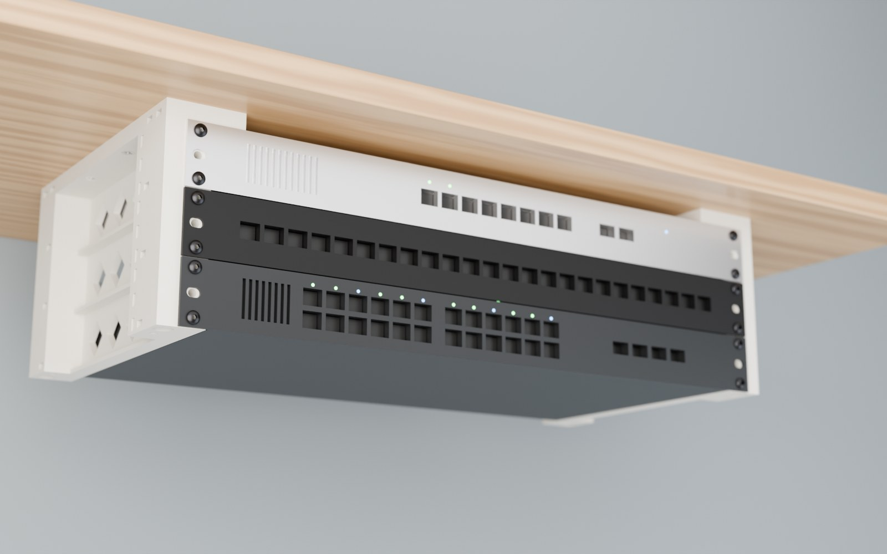
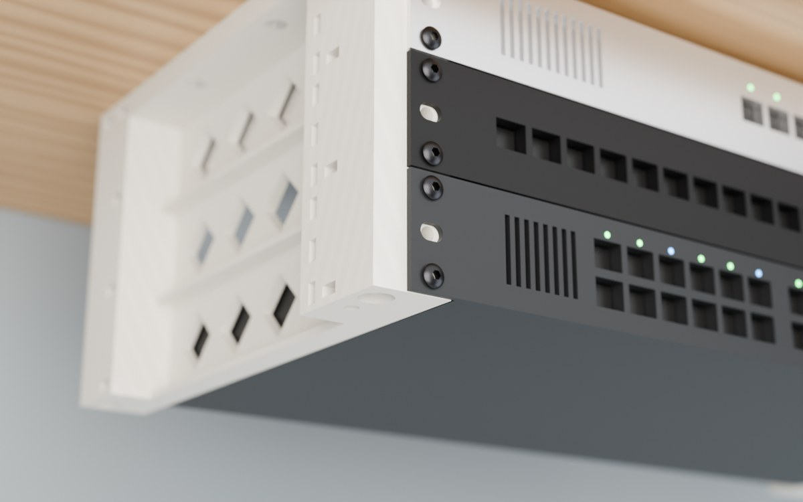

# microrack

**A 3D-printable 19″ rack you build one 1U level at a time.** Screw it to the underside of a shelf or cabinet top and hang your gear from it, or screw it to a shelf or desk and stack upwards. To add a level, print one more pair of side pieces and use longer threaded rod.



- **Generic 19″:** standard EIA-310 rack-ear spacing (465.1 mm) with 3 holes per U. Default inner opening 445.4 mm.
- **One 1U level = two printed side pieces**, the same part for every level (left + right).
- **Top or bottom mounted:** the same parts work hanging and standing.
- **Steel takes the load:** M5 threaded rod (or M5×45 screws for a single 1U) runs vertically through every level into captive nuts in the top plates. The plastic is only clamped.
- **Attachment points:** captive M5 nuts in the bottom of every side piece, for hanging extra things off the end of the stack.
- **Fits a 256 × 256 mm bed** (Bambu Lab P1S/X1/A1 class). No supports needed.



---

## 3D preview

This is a simplified preview of one 1U level (2 side pieces + 2 top plates; nut pockets and countersinks left out). Click a file below to open the real part in GitHub's 3D viewer.

| Part | File | Print per build |
|---|---|---|
| Side piece, left | [`side_left.stl`](side_left.stl) | 1 per 1U level |
| Side piece, right | [`side_right.stl`](side_right.stl) | 1 per 1U level |
| Top plate, left | [`top_left.stl`](top_left.stl) | 1 |
| Top plate, right | [`top_right.stl`](top_right.stl) | 1 |

```stl
solid microrack_1U
facet normal 1 0 0
outer loop
vertex 227.7 206 44.5
vertex 227.7 194 22.7
vertex 227.7 206 3
endloop
endfacet
facet normal 1 0 0
outer loop
vertex 227.7 206 44.5
vertex 227.7 180 36.7
vertex 227.7 194 22.7
endloop
endfacet
facet normal 1 0 0
outer loop
vertex 227.7 180 36.7
vertex 227.7 158 22.7
vertex 227.7 166 22.7
endloop
endfacet
facet normal 1 0 0
outer loop
vertex 227.7 180 36.7
vertex 227.7 144 36.7
vertex 227.7 158 22.7
endloop
endfacet
facet normal 1 0 0
outer loop
vertex 227.7 206 44.5
vertex 227.7 144 36.7
vertex 227.7 180 36.7
endloop
endfacet
facet normal 1 0 0
outer loop
vertex 227.7 144 36.7
vertex 227.7 122 22.7
vertex 227.7 130 22.7
endloop
endfacet
facet normal 1 0 0
outer loop
vertex 227.7 144 36.7
vertex 227.7 108 36.7
vertex 227.7 122 22.7
endloop
endfacet
facet normal 1 0 0
outer loop
vertex 227.7 206 44.5
vertex 227.7 108 36.7
vertex 227.7 144 36.7
endloop
endfacet
facet normal 1 0 0
outer loop
vertex 227.7 108 36.7
vertex 227.7 86 22.7
vertex 227.7 94 22.7
endloop
endfacet
facet normal 1 0 0
outer loop
vertex 227.7 108 36.7
vertex 227.7 72 36.7
vertex 227.7 86 22.7
endloop
endfacet
facet normal 1 -0 0
outer loop
vertex 227.7 46 44.5
vertex 227.7 108 36.7
vertex 227.7 206 44.5
endloop
endfacet
facet normal 1 0 0
outer loop
vertex 227.7 72 36.7
vertex 227.7 46 44.5
vertex 227.7 58 22.7
endloop
endfacet
facet normal 1 0 0
outer loop
vertex 227.7 108 36.7
vertex 227.7 46 44.5
vertex 227.7 72 36.7
endloop
endfacet
facet normal 1 -0 0
outer loop
vertex 227.7 180 8.7
vertex 227.7 206 3
vertex 227.7 194 22.7
endloop
endfacet
facet normal 1 -0 0
outer loop
vertex 227.7 158 22.7
vertex 227.7 180 8.7
vertex 227.7 166 22.7
endloop
endfacet
facet normal 1 0 0
outer loop
vertex 227.7 144 8.7
vertex 227.7 180 8.7
vertex 227.7 158 22.7
endloop
endfacet
facet normal 1 -0 0
outer loop
vertex 227.7 144 8.7
vertex 227.7 206 3
vertex 227.7 180 8.7
endloop
endfacet
facet normal 1 -0 0
outer loop
vertex 227.7 122 22.7
vertex 227.7 144 8.7
vertex 227.7 130 22.7
endloop
endfacet
facet normal 1 0 0
outer loop
vertex 227.7 108 8.7
vertex 227.7 144 8.7
vertex 227.7 122 22.7
endloop
endfacet
facet normal 1 -0 0
outer loop
vertex 227.7 108 8.7
vertex 227.7 206 3
vertex 227.7 144 8.7
endloop
endfacet
facet normal 1 -0 0
outer loop
vertex 227.7 86 22.7
vertex 227.7 108 8.7
vertex 227.7 94 22.7
endloop
endfacet
facet normal 1 0 0
outer loop
vertex 227.7 72 8.7
vertex 227.7 108 8.7
vertex 227.7 86 22.7
endloop
endfacet
facet normal 1 0 0
outer loop
vertex 227.7 46 3
vertex 227.7 108 8.7
vertex 227.7 72 8.7
endloop
endfacet
facet normal 1 0 0
outer loop
vertex 227.7 108 8.7
vertex 227.7 46 3
vertex 227.7 206 3
endloop
endfacet
facet normal 1 0 0
outer loop
vertex 227.7 58 22.7
vertex 227.7 46 3
vertex 227.7 72 8.7
endloop
endfacet
facet normal 1 0 0
outer loop
vertex 227.7 46 3
vertex 227.7 58 22.7
vertex 227.7 46 44.5
endloop
endfacet
facet normal -0 0 1
outer loop
vertex 247.4 228.1 44.5
vertex 248.2 214 44.5
vertex 248.2 230 44.5
endloop
endfacet
facet normal 0 0 1
outer loop
vertex 247.4 228.1 44.5
vertex 247.4 215.9 44.5
vertex 248.2 214 44.5
endloop
endfacet
facet normal -0 0 1
outer loop
vertex 245.5 227.2 44.5
vertex 247.4 215.9 44.5
vertex 247.4 228.1 44.5
endloop
endfacet
facet normal 0 0 1
outer loop
vertex 245.5 227.2 44.5
vertex 245.5 216.8 44.5
vertex 247.4 215.9 44.5
endloop
endfacet
facet normal 0 0 1
outer loop
vertex 243.6 228.1 44.5
vertex 245.5 216.8 44.5
vertex 245.5 227.2 44.5
endloop
endfacet
facet normal 0 0 1
outer loop
vertex 243.6 228.1 44.5
vertex 243.6 215.9 44.5
vertex 245.5 216.8 44.5
endloop
endfacet
facet normal 0 0 1
outer loop
vertex 227.7 206 44.5
vertex 243.6 228.1 44.5
vertex 242.8 230 44.5
endloop
endfacet
facet normal 0 0 1
outer loop
vertex 243.6 228.1 44.5
vertex 227.7 206 44.5
vertex 243.6 215.9 44.5
endloop
endfacet
facet normal 0 0 1
outer loop
vertex 255 240 44.5
vertex 248.2 230 44.5
vertex 255 206 44.5
endloop
endfacet
facet normal 0 0 1
outer loop
vertex 255 240 44.5
vertex 247.4 231.9 44.5
vertex 248.2 230 44.5
endloop
endfacet
facet normal 0 0 1
outer loop
vertex 255 240 44.5
vertex 245.5 232.8 44.5
vertex 247.4 231.9 44.5
endloop
endfacet
facet normal -0 0 1
outer loop
vertex 222.7 240 44.5
vertex 245.5 232.8 44.5
vertex 255 240 44.5
endloop
endfacet
facet normal 0 0 1
outer loop
vertex 243.6 215.9 44.5
vertex 227.7 206 44.5
vertex 242.8 214 44.5
endloop
endfacet
facet normal 0 0 1
outer loop
vertex 222.7 240 44.5
vertex 242.8 230 44.5
vertex 243.6 231.9 44.5
endloop
endfacet
facet normal 0 0 1
outer loop
vertex 227.7 206 44.5
vertex 222.7 240 44.5
vertex 227.7 46 44.5
endloop
endfacet
facet normal 0 0 1
outer loop
vertex 242.8 230 44.5
vertex 222.7 240 44.5
vertex 227.7 206 44.5
endloop
endfacet
facet normal 0 0 1
outer loop
vertex 245.5 232.8 44.5
vertex 222.7 240 44.5
vertex 243.6 231.9 44.5
endloop
endfacet
facet normal -0 0 1
outer loop
vertex 248.2 214 44.5
vertex 255 206 44.5
vertex 248.2 230 44.5
endloop
endfacet
facet normal -0 0 1
outer loop
vertex 247.4 212.1 44.5
vertex 255 206 44.5
vertex 248.2 214 44.5
endloop
endfacet
facet normal -0 0 1
outer loop
vertex 245.5 211.2 44.5
vertex 255 206 44.5
vertex 247.4 212.1 44.5
endloop
endfacet
facet normal 0 0 1
outer loop
vertex 227.7 206 44.5
vertex 245.5 211.2 44.5
vertex 243.6 212.1 44.5
endloop
endfacet
facet normal 0 0 1
outer loop
vertex 245.5 211.2 44.5
vertex 227.7 206 44.5
vertex 255 206 44.5
endloop
endfacet
facet normal 0 0 1
outer loop
vertex 227.7 206 44.5
vertex 243.6 212.1 44.5
vertex 242.8 214 44.5
endloop
endfacet
facet normal -0 0 1
outer loop
vertex 247.4 25.1 44.5
vertex 248.2 12 44.5
vertex 248.2 27 44.5
endloop
endfacet
facet normal 0 0 1
outer loop
vertex 247.4 25.1 44.5
vertex 247.4 13.9 44.5
vertex 248.2 12 44.5
endloop
endfacet
facet normal -0 0 1
outer loop
vertex 245.5 24.2 44.5
vertex 247.4 13.9 44.5
vertex 247.4 25.1 44.5
endloop
endfacet
facet normal 0 0 1
outer loop
vertex 245.5 24.2 44.5
vertex 245.5 14.8 44.5
vertex 247.4 13.9 44.5
endloop
endfacet
facet normal 0 0 1
outer loop
vertex 243.6 25.1 44.5
vertex 245.5 14.8 44.5
vertex 245.5 24.2 44.5
endloop
endfacet
facet normal 0 0 1
outer loop
vertex 243.6 25.1 44.5
vertex 243.6 13.9 44.5
vertex 245.5 14.8 44.5
endloop
endfacet
facet normal 0 0 1
outer loop
vertex 242.8 27 44.5
vertex 243.6 13.9 44.5
vertex 243.6 25.1 44.5
endloop
endfacet
facet normal 0 0 1
outer loop
vertex 243.6 13.9 44.5
vertex 242.8 27 44.5
vertex 242.8 12 44.5
endloop
endfacet
facet normal 0 0 1
outer loop
vertex 255 46 44.5
vertex 248.2 27 44.5
vertex 255 0 44.5
endloop
endfacet
facet normal 0 0 1
outer loop
vertex 255 46 44.5
vertex 247.4 28.9 44.5
vertex 248.2 27 44.5
endloop
endfacet
facet normal 0 0 1
outer loop
vertex 255 46 44.5
vertex 245.5 29.8 44.5
vertex 247.4 28.9 44.5
endloop
endfacet
facet normal -0 0 1
outer loop
vertex 227.7 46 44.5
vertex 245.5 29.8 44.5
vertex 255 46 44.5
endloop
endfacet
facet normal 0 0 1
outer loop
vertex 222.7 0 44.5
vertex 242.8 27 44.5
vertex 227.7 46 44.5
endloop
endfacet
facet normal 0 0 1
outer loop
vertex 243.6 28.9 44.5
vertex 227.7 46 44.5
vertex 242.8 27 44.5
endloop
endfacet
facet normal 0 0 1
outer loop
vertex 245.5 29.8 44.5
vertex 227.7 46 44.5
vertex 243.6 28.9 44.5
endloop
endfacet
facet normal -0 0 1
outer loop
vertex 248.2 12 44.5
vertex 255 0 44.5
vertex 248.2 27 44.5
endloop
endfacet
facet normal -0 0 1
outer loop
vertex 247.4 10.1 44.5
vertex 255 0 44.5
vertex 248.2 12 44.5
endloop
endfacet
facet normal -0 0 1
outer loop
vertex 245.5 9.2 44.5
vertex 255 0 44.5
vertex 247.4 10.1 44.5
endloop
endfacet
facet normal 0 0 1
outer loop
vertex 222.7 0 44.5
vertex 245.5 9.2 44.5
vertex 243.6 10.1 44.5
endloop
endfacet
facet normal 0 0 1
outer loop
vertex 242.8 27 44.5
vertex 222.7 0 44.5
vertex 242.8 12 44.5
endloop
endfacet
facet normal 0 0 1
outer loop
vertex 245.5 9.2 44.5
vertex 222.7 0 44.5
vertex 255 0 44.5
endloop
endfacet
facet normal 0 0 1
outer loop
vertex 242.8 12 44.5
vertex 222.7 0 44.5
vertex 243.6 10.1 44.5
endloop
endfacet
facet normal 0 0 1
outer loop
vertex 222.7 0 44.5
vertex 227.7 46 44.5
vertex 222.7 240 44.5
endloop
endfacet
facet normal 0 0 -1
outer loop
vertex 255 206 0
vertex 252 230 0
vertex 255 240 0
endloop
endfacet
facet normal 0 0 -1
outer loop
vertex 255 206 0
vertex 250.1 225.4 0
vertex 252 230 0
endloop
endfacet
facet normal 0 0 -1
outer loop
vertex 255 206 0
vertex 248.2 214 0
vertex 250.1 225.4 0
endloop
endfacet
facet normal 0 0 -1
outer loop
vertex 255 206 0
vertex 247.4 212.1 0
vertex 248.2 214 0
endloop
endfacet
facet normal 0 0 -1
outer loop
vertex 255 206 0
vertex 245.5 211.2 0
vertex 247.4 212.1 0
endloop
endfacet
facet normal 0 0 -1
outer loop
vertex 236 206 0
vertex 245.5 211.2 0
vertex 255 206 0
endloop
endfacet
facet normal 0 0 -1
outer loop
vertex 236 206 0
vertex 240.9 225.4 0
vertex 242.8 214 0
endloop
endfacet
facet normal -0 0 -1
outer loop
vertex 240.9 225.4 0
vertex 236 206 0
vertex 239 230 0
endloop
endfacet
facet normal -0 0 -1
outer loop
vertex 243.6 212.1 0
vertex 236 206 0
vertex 242.8 214 0
endloop
endfacet
facet normal -0 0 -1
outer loop
vertex 245.5 211.2 0
vertex 236 206 0
vertex 243.6 212.1 0
endloop
endfacet
facet normal 0 0 -1
outer loop
vertex 250.1 234.6 0
vertex 255 240 0
vertex 252 230 0
endloop
endfacet
facet normal 0 0 -1
outer loop
vertex 245.5 236.5 0
vertex 255 240 0
vertex 250.1 234.6 0
endloop
endfacet
facet normal 0 0 -1
outer loop
vertex 245.5 236.5 0
vertex 222.7 240 0
vertex 255 240 0
endloop
endfacet
facet normal 0 0 -1
outer loop
vertex 240.9 234.6 0
vertex 222.7 240 0
vertex 245.5 236.5 0
endloop
endfacet
facet normal 0 0 -1
outer loop
vertex 239 230 0
vertex 222.7 240 0
vertex 240.9 234.6 0
endloop
endfacet
facet normal 0 0 -1
outer loop
vertex 236 206 0
vertex 222.7 240 0
vertex 239 230 0
endloop
endfacet
facet normal 0 0 -1
outer loop
vertex 236 46 0
vertex 222.7 240 0
vertex 236 206 0
endloop
endfacet
facet normal 0 0 -1
outer loop
vertex 247.4 215.9 0
vertex 250.1 225.4 0
vertex 248.2 214 0
endloop
endfacet
facet normal 0 0 -1
outer loop
vertex 245.5 223.5 0
vertex 247.4 215.9 0
vertex 245.5 216.8 0
endloop
endfacet
facet normal 0 0 -1
outer loop
vertex 247.4 215.9 0
vertex 245.5 223.5 0
vertex 250.1 225.4 0
endloop
endfacet
facet normal 0 0 -1
outer loop
vertex 243.6 215.9 0
vertex 245.5 223.5 0
vertex 245.5 216.8 0
endloop
endfacet
facet normal 0 0 -1
outer loop
vertex 240.9 225.4 0
vertex 243.6 215.9 0
vertex 242.8 214 0
endloop
endfacet
facet normal 0 0 -1
outer loop
vertex 243.6 215.9 0
vertex 240.9 225.4 0
vertex 245.5 223.5 0
endloop
endfacet
facet normal 0 0 -1
outer loop
vertex 250.1 16.6 0
vertex 247.4 25.1 0
vertex 248.2 27 0
endloop
endfacet
facet normal 0 0 -1
outer loop
vertex 245.5 18.5 0
vertex 247.4 25.1 0
vertex 250.1 16.6 0
endloop
endfacet
facet normal 0 0 -1
outer loop
vertex 245.5 18.5 0
vertex 245.5 24.2 0
vertex 247.4 25.1 0
endloop
endfacet
facet normal 0 0 -1
outer loop
vertex 245.5 18.5 0
vertex 243.6 25.1 0
vertex 245.5 24.2 0
endloop
endfacet
facet normal 0 0 -1
outer loop
vertex 240.9 16.6 0
vertex 243.6 25.1 0
vertex 245.5 18.5 0
endloop
endfacet
facet normal -0 0 -1
outer loop
vertex 243.6 25.1 0
vertex 240.9 16.6 0
vertex 242.8 27 0
endloop
endfacet
facet normal 0 0 -1
outer loop
vertex 255 0 0
vertex 252 12 0
vertex 255 46 0
endloop
endfacet
facet normal 0 0 -1
outer loop
vertex 255 0 0
vertex 250.1 7.4 0
vertex 252 12 0
endloop
endfacet
facet normal 0 0 -1
outer loop
vertex 255 0 0
vertex 245.5 5.5 0
vertex 250.1 7.4 0
endloop
endfacet
facet normal 0 0 -1
outer loop
vertex 222.7 0 0
vertex 245.5 5.5 0
vertex 255 0 0
endloop
endfacet
facet normal 0 0 -1
outer loop
vertex 222.7 240 0
vertex 236 46 0
vertex 222.7 0 0
endloop
endfacet
facet normal -0 0 -1
outer loop
vertex 242.8 27 0
vertex 222.7 0 0
vertex 236 46 0
endloop
endfacet
facet normal -0 0 -1
outer loop
vertex 240.9 7.4 0
vertex 222.7 0 0
vertex 239 12 0
endloop
endfacet
facet normal -0 0 -1
outer loop
vertex 245.5 5.5 0
vertex 222.7 0 0
vertex 240.9 7.4 0
endloop
endfacet
facet normal 0 0 -1
outer loop
vertex 250.1 16.6 0
vertex 255 46 0
vertex 252 12 0
endloop
endfacet
facet normal 0 0 -1
outer loop
vertex 248.2 27 0
vertex 255 46 0
vertex 250.1 16.6 0
endloop
endfacet
facet normal 0 0 -1
outer loop
vertex 247.4 28.9 0
vertex 255 46 0
vertex 248.2 27 0
endloop
endfacet
facet normal 0 0 -1
outer loop
vertex 245.5 29.8 0
vertex 255 46 0
vertex 247.4 28.9 0
endloop
endfacet
facet normal 0 0 -1
outer loop
vertex 236 46 0
vertex 245.5 29.8 0
vertex 243.6 28.9 0
endloop
endfacet
facet normal 0 0 -1
outer loop
vertex 222.7 0 0
vertex 240.9 16.6 0
vertex 239 12 0
endloop
endfacet
facet normal 0 0 -1
outer loop
vertex 245.5 29.8 0
vertex 236 46 0
vertex 255 46 0
endloop
endfacet
facet normal 0 0 -1
outer loop
vertex 242.8 27 0
vertex 236 46 0
vertex 243.6 28.9 0
endloop
endfacet
facet normal 0 0 -1
outer loop
vertex 222.7 0 0
vertex 242.8 27 0
vertex 240.9 16.6 0
endloop
endfacet
facet normal -1 0 0
outer loop
vertex 222.7 240 0
vertex 222.7 194 22.7
vertex 222.7 240 44.5
endloop
endfacet
facet normal -1 0 0
outer loop
vertex 222.7 240 0
vertex 222.7 180 8.7
vertex 222.7 194 22.7
endloop
endfacet
facet normal -1 0 0
outer loop
vertex 222.7 180 8.7
vertex 222.7 158 22.7
vertex 222.7 166 22.7
endloop
endfacet
facet normal -1 0 0
outer loop
vertex 222.7 180 8.7
vertex 222.7 144 8.7
vertex 222.7 158 22.7
endloop
endfacet
facet normal -1 0 0
outer loop
vertex 222.7 240 0
vertex 222.7 144 8.7
vertex 222.7 180 8.7
endloop
endfacet
facet normal -1 0 0
outer loop
vertex 222.7 144 8.7
vertex 222.7 122 22.7
vertex 222.7 130 22.7
endloop
endfacet
facet normal -1 0 0
outer loop
vertex 222.7 144 8.7
vertex 222.7 108 8.7
vertex 222.7 122 22.7
endloop
endfacet
facet normal -1 0 0
outer loop
vertex 222.7 240 0
vertex 222.7 108 8.7
vertex 222.7 144 8.7
endloop
endfacet
facet normal -1 0 0
outer loop
vertex 222.7 108 8.7
vertex 222.7 86 22.7
vertex 222.7 94 22.7
endloop
endfacet
facet normal -1 0 0
outer loop
vertex 222.7 108 8.7
vertex 222.7 72 8.7
vertex 222.7 86 22.7
endloop
endfacet
facet normal -1 0 0
outer loop
vertex 222.7 0 0
vertex 222.7 108 8.7
vertex 222.7 240 0
endloop
endfacet
facet normal -1 -0 0
outer loop
vertex 222.7 72 8.7
vertex 222.7 0 0
vertex 222.7 58 22.7
endloop
endfacet
facet normal -1 -0 0
outer loop
vertex 222.7 108 8.7
vertex 222.7 0 0
vertex 222.7 72 8.7
endloop
endfacet
facet normal -1 0 0
outer loop
vertex 222.7 180 36.7
vertex 222.7 240 44.5
vertex 222.7 194 22.7
endloop
endfacet
facet normal -1 0 0
outer loop
vertex 222.7 158 22.7
vertex 222.7 180 36.7
vertex 222.7 166 22.7
endloop
endfacet
facet normal -1 0 0
outer loop
vertex 222.7 144 36.7
vertex 222.7 180 36.7
vertex 222.7 158 22.7
endloop
endfacet
facet normal -1 0 0
outer loop
vertex 222.7 144 36.7
vertex 222.7 240 44.5
vertex 222.7 180 36.7
endloop
endfacet
facet normal -1 0 0
outer loop
vertex 222.7 122 22.7
vertex 222.7 144 36.7
vertex 222.7 130 22.7
endloop
endfacet
facet normal -1 0 0
outer loop
vertex 222.7 108 36.7
vertex 222.7 144 36.7
vertex 222.7 122 22.7
endloop
endfacet
facet normal -1 0 0
outer loop
vertex 222.7 108 36.7
vertex 222.7 240 44.5
vertex 222.7 144 36.7
endloop
endfacet
facet normal -1 0 0
outer loop
vertex 222.7 86 22.7
vertex 222.7 108 36.7
vertex 222.7 94 22.7
endloop
endfacet
facet normal -1 0 0
outer loop
vertex 222.7 72 36.7
vertex 222.7 108 36.7
vertex 222.7 86 22.7
endloop
endfacet
facet normal -1 0 0
outer loop
vertex 222.7 0 44.5
vertex 222.7 108 36.7
vertex 222.7 72 36.7
endloop
endfacet
facet normal -1 0 0
outer loop
vertex 222.7 0 44.5
vertex 222.7 58 22.7
vertex 222.7 0 0
endloop
endfacet
facet normal -1 0 0
outer loop
vertex 222.7 108 36.7
vertex 222.7 0 44.5
vertex 222.7 240 44.5
endloop
endfacet
facet normal -1 0 0
outer loop
vertex 222.7 58 22.7
vertex 222.7 0 44.5
vertex 222.7 72 36.7
endloop
endfacet
facet normal 0 1 -0
outer loop
vertex 255 240 0
vertex 222.7 240 44.5
vertex 255 240 44.5
endloop
endfacet
facet normal 0 1 0
outer loop
vertex 222.7 240 44.5
vertex 255 240 0
vertex 222.7 240 0
endloop
endfacet
facet normal 0 -1 0
outer loop
vertex 222.7 0 44.5
vertex 232.6 0 40.9
vertex 255 0 44.5
endloop
endfacet
facet normal 0 -1 0
outer loop
vertex 222.7 0 44.5
vertex 230.6 0 40
vertex 232.6 0 40.9
endloop
endfacet
facet normal 0 -1 0
outer loop
vertex 222.7 0 44.5
vertex 229.8 0 38.1
vertex 230.6 0 40
endloop
endfacet
facet normal 0 -1 0
outer loop
vertex 222.7 0 44.5
vertex 230.6 0 36.2
vertex 229.8 0 38.1
endloop
endfacet
facet normal 0 -1 0
outer loop
vertex 230.6 0 36.2
vertex 232.6 0 25
vertex 232.6 0 35.4
endloop
endfacet
facet normal 0 -1 0
outer loop
vertex 230.6 0 24.2
vertex 230.6 0 36.2
vertex 222.7 0 44.5
endloop
endfacet
facet normal 0 -1 0
outer loop
vertex 230.6 0 36.2
vertex 230.6 0 24.2
vertex 232.6 0 25
endloop
endfacet
facet normal 0 -1 0
outer loop
vertex 222.7 0 44.5
vertex 229.8 0 22.2
vertex 230.6 0 24.2
endloop
endfacet
facet normal 0 -1 0
outer loop
vertex 230.6 0 20.3
vertex 232.6 0 9.1
vertex 232.6 0 19.5
endloop
endfacet
facet normal 0 -1 0
outer loop
vertex 222.7 0 0
vertex 230.6 0 20.3
vertex 229.8 0 22.2
endloop
endfacet
facet normal 0 -1 0
outer loop
vertex 222.7 0 0
vertex 229.8 0 22.2
vertex 222.7 0 44.5
endloop
endfacet
facet normal 0 -1 0
outer loop
vertex 230.6 0 20.3
vertex 230.6 0 8.3
vertex 232.6 0 9.1
endloop
endfacet
facet normal 0 -1 -0
outer loop
vertex 230.6 0 20.3
vertex 222.7 0 0
vertex 230.6 0 8.3
endloop
endfacet
facet normal 0 -1 -0
outer loop
vertex 230.6 0 4.4
vertex 222.7 0 0
vertex 232.6 0 3.6
endloop
endfacet
facet normal 0 -1 -0
outer loop
vertex 229.8 0 6.3
vertex 222.7 0 0
vertex 230.6 0 4.4
endloop
endfacet
facet normal 0 -1 0
outer loop
vertex 230.6 0 8.3
vertex 222.7 0 0
vertex 229.8 0 6.3
endloop
endfacet
facet normal 0 -1 0
outer loop
vertex 234.5 0 40
vertex 255 0 44.5
vertex 232.6 0 40.9
endloop
endfacet
facet normal 0 -1 0
outer loop
vertex 235.3 0 38.1
vertex 255 0 44.5
vertex 234.5 0 40
endloop
endfacet
facet normal 0 -1 0
outer loop
vertex 234.5 0 36.2
vertex 255 0 44.5
vertex 235.3 0 38.1
endloop
endfacet
facet normal 0 -1 0
outer loop
vertex 234.5 0 24.2
vertex 234.5 0 36.2
vertex 232.6 0 35.4
endloop
endfacet
facet normal 0 -1 0
outer loop
vertex 234.5 0 24.2
vertex 232.6 0 35.4
vertex 232.6 0 25
endloop
endfacet
facet normal 0 -1 0
outer loop
vertex 234.5 0 36.2
vertex 234.5 0 24.2
vertex 255 0 44.5
endloop
endfacet
facet normal 0 -1 0
outer loop
vertex 235.3 0 22.2
vertex 255 0 44.5
vertex 234.5 0 24.2
endloop
endfacet
facet normal 0 -1 0
outer loop
vertex 255 0 0
vertex 235.3 0 22.2
vertex 234.5 0 20.3
endloop
endfacet
facet normal 0 -1 0
outer loop
vertex 232.6 0 9.1
vertex 234.5 0 20.3
vertex 232.6 0 19.5
endloop
endfacet
facet normal 0 -1 0
outer loop
vertex 234.5 0 8.3
vertex 234.5 0 20.3
vertex 232.6 0 9.1
endloop
endfacet
facet normal 0 -1 0
outer loop
vertex 255 0 0
vertex 234.5 0 20.3
vertex 234.5 0 8.3
endloop
endfacet
facet normal 0 -1 0
outer loop
vertex 255 0 0
vertex 234.5 0 8.3
vertex 235.3 0 6.3
endloop
endfacet
facet normal 0 -1 0
outer loop
vertex 255 0 0
vertex 235.3 0 6.3
vertex 234.5 0 4.4
endloop
endfacet
facet normal 0 -1 0
outer loop
vertex 235.3 0 22.2
vertex 255 0 0
vertex 255 0 44.5
endloop
endfacet
facet normal 0 -1 0
outer loop
vertex 232.6 0 3.6
vertex 255 0 0
vertex 234.5 0 4.4
endloop
endfacet
facet normal 0 -1 0
outer loop
vertex 255 0 0
vertex 232.6 0 3.6
vertex 222.7 0 0
endloop
endfacet
facet normal 1 -0 0
outer loop
vertex 236 46 3
vertex 236 206 0
vertex 236 206 3
endloop
endfacet
facet normal 1 0 0
outer loop
vertex 236 206 0
vertex 236 46 3
vertex 236 46 0
endloop
endfacet
facet normal -0 0 1
outer loop
vertex 227.7 206 3
vertex 236 46 3
vertex 236 206 3
endloop
endfacet
facet normal 0 0 1
outer loop
vertex 236 46 3
vertex 227.7 206 3
vertex 227.7 46 3
endloop
endfacet
facet normal 1 -0 0
outer loop
vertex 255 0 44.5
vertex 255 46 0
vertex 255 46 44.5
endloop
endfacet
facet normal 1 0 0
outer loop
vertex 255 46 0
vertex 255 0 44.5
vertex 255 0 0
endloop
endfacet
facet normal 0 1 -0
outer loop
vertex 234.5 46 40
vertex 227.7 46 44.5
vertex 255 46 44.5
endloop
endfacet
facet normal 0 1 0
outer loop
vertex 227.7 46 44.5
vertex 234.5 46 40
vertex 232.6 46 40.9
endloop
endfacet
facet normal 0 1 0
outer loop
vertex 255 46 44.5
vertex 235.3 46 38.1
vertex 234.5 46 40
endloop
endfacet
facet normal 0 1 0
outer loop
vertex 255 46 44.5
vertex 234.5 46 36.2
vertex 235.3 46 38.1
endloop
endfacet
facet normal 0 1 0
outer loop
vertex 234.5 46 24.2
vertex 234.5 46 36.2
vertex 255 46 44.5
endloop
endfacet
facet normal 0 1 0
outer loop
vertex 234.5 46 36.2
vertex 234.5 46 24.2
vertex 232.6 46 35.4
endloop
endfacet
facet normal 0 1 0
outer loop
vertex 232.6 46 35.4
vertex 234.5 46 24.2
vertex 232.6 46 25
endloop
endfacet
facet normal 0 1 0
outer loop
vertex 255 46 44.5
vertex 235.3 46 22.2
vertex 234.5 46 24.2
endloop
endfacet
facet normal 0 1 -0
outer loop
vertex 255 46 0
vertex 235.3 46 22.2
vertex 255 46 44.5
endloop
endfacet
facet normal 0 1 0
outer loop
vertex 234.5 46 20.3
vertex 232.6 46 9.1
vertex 232.6 46 19.5
endloop
endfacet
facet normal 0 1 0
outer loop
vertex 235.3 46 22.2
vertex 255 46 0
vertex 234.5 46 20.3
endloop
endfacet
facet normal 0 1 0
outer loop
vertex 234.5 46 20.3
vertex 234.5 46 8.3
vertex 232.6 46 9.1
endloop
endfacet
facet normal 0 1 0
outer loop
vertex 234.5 46 20.3
vertex 255 46 0
vertex 234.5 46 8.3
endloop
endfacet
facet normal 0 1 0
outer loop
vertex 234.5 46 8.3
vertex 255 46 0
vertex 235.3 46 6.3
endloop
endfacet
facet normal 0 1 0
outer loop
vertex 234.5 46 4.4
vertex 236 46 3
vertex 232.6 46 3.6
endloop
endfacet
facet normal -0 1 -0
outer loop
vertex 236 46 3
vertex 235.3 46 6.3
vertex 255 46 0
endloop
endfacet
facet normal 0 1 0
outer loop
vertex 235.3 46 6.3
vertex 236 46 3
vertex 234.5 46 4.4
endloop
endfacet
facet normal 0 1 0
outer loop
vertex 236 46 3
vertex 255 46 0
vertex 236 46 0
endloop
endfacet
facet normal 0 1 -0
outer loop
vertex 230.6 46 40
vertex 227.7 46 44.5
vertex 232.6 46 40.9
endloop
endfacet
facet normal 0 1 -0
outer loop
vertex 229.8 46 38.1
vertex 227.7 46 44.5
vertex 230.6 46 40
endloop
endfacet
facet normal 0 1 -0
outer loop
vertex 232.6 46 25
vertex 230.6 46 36.2
vertex 232.6 46 35.4
endloop
endfacet
facet normal 0 1 0
outer loop
vertex 230.6 46 24.2
vertex 230.6 46 36.2
vertex 232.6 46 25
endloop
endfacet
facet normal 0 1 0
outer loop
vertex 230.6 46 36.2
vertex 230.6 46 24.2
vertex 229.8 46 38.1
endloop
endfacet
facet normal 0 1 0
outer loop
vertex 229.8 46 22.2
vertex 229.8 46 38.1
vertex 230.6 46 24.2
endloop
endfacet
facet normal 0 1 0
outer loop
vertex 229.8 46 38.1
vertex 229.8 46 22.2
vertex 227.7 46 44.5
endloop
endfacet
facet normal 0 1 -0
outer loop
vertex 232.6 46 9.1
vertex 230.6 46 20.3
vertex 232.6 46 19.5
endloop
endfacet
facet normal 0 1 0
outer loop
vertex 230.6 46 8.3
vertex 230.6 46 20.3
vertex 232.6 46 9.1
endloop
endfacet
facet normal 0 1 0
outer loop
vertex 230.6 46 20.3
vertex 230.6 46 8.3
vertex 229.8 46 22.2
endloop
endfacet
facet normal 0 1 0
outer loop
vertex 227.7 46 3
vertex 229.8 46 22.2
vertex 230.6 46 8.3
endloop
endfacet
facet normal 0 1 0
outer loop
vertex 227.7 46 3
vertex 230.6 46 8.3
vertex 229.8 46 6.3
endloop
endfacet
facet normal 0 1 0
outer loop
vertex 229.8 46 22.2
vertex 227.7 46 3
vertex 227.7 46 44.5
endloop
endfacet
facet normal 0 1 0
outer loop
vertex 230.6 46 4.4
vertex 227.7 46 3
vertex 229.8 46 6.3
endloop
endfacet
facet normal 0 1 0
outer loop
vertex 232.6 46 3.6
vertex 227.7 46 3
vertex 230.6 46 4.4
endloop
endfacet
facet normal 0 1 0
outer loop
vertex 227.7 46 3
vertex 232.6 46 3.6
vertex 236 46 3
endloop
endfacet
facet normal 1 -0 0
outer loop
vertex 255 206 44.5
vertex 255 240 0
vertex 255 240 44.5
endloop
endfacet
facet normal 1 0 0
outer loop
vertex 255 240 0
vertex 255 206 44.5
vertex 255 206 0
endloop
endfacet
facet normal 0 -1 0
outer loop
vertex 236 206 3
vertex 227.7 206 44.5
vertex 227.7 206 3
endloop
endfacet
facet normal 0 -1 0
outer loop
vertex 227.7 206 44.5
vertex 236 206 3
vertex 255 206 44.5
endloop
endfacet
facet normal 0 -1 0
outer loop
vertex 255 206 0
vertex 236 206 3
vertex 236 206 0
endloop
endfacet
facet normal 0 -1 0
outer loop
vertex 236 206 3
vertex 255 206 0
vertex 255 206 44.5
endloop
endfacet
facet normal -0.38 -0.92 0
outer loop
vertex 245.5 14.8 9
vertex 247.4 13.9 44.5
vertex 245.5 14.8 44.5
endloop
endfacet
facet normal -0.38 -0.92 -0
outer loop
vertex 247.4 13.9 44.5
vertex 245.5 14.8 9
vertex 247.4 13.9 9
endloop
endfacet
facet normal -0.92 -0.38 0
outer loop
vertex 248.2 12 9
vertex 247.4 13.9 44.5
vertex 247.4 13.9 9
endloop
endfacet
facet normal -0.92 -0.38 0
outer loop
vertex 247.4 13.9 44.5
vertex 248.2 12 9
vertex 248.2 12 44.5
endloop
endfacet
facet normal 0.38 -0.92 0
outer loop
vertex 243.6 13.9 9
vertex 245.5 14.8 44.5
vertex 243.6 13.9 44.5
endloop
endfacet
facet normal 0.38 -0.92 0
outer loop
vertex 245.5 14.8 44.5
vertex 243.6 13.9 9
vertex 245.5 14.8 9
endloop
endfacet
facet normal -0.92 0.38 0
outer loop
vertex 247.4 10.1 9
vertex 248.2 12 44.5
vertex 248.2 12 9
endloop
endfacet
facet normal -0.92 0.38 0
outer loop
vertex 248.2 12 44.5
vertex 247.4 10.1 9
vertex 247.4 10.1 44.5
endloop
endfacet
facet normal 0.92 -0.38 0
outer loop
vertex 242.8 12 44.5
vertex 243.6 13.9 9
vertex 243.6 13.9 44.5
endloop
endfacet
facet normal 0.92 -0.38 0
outer loop
vertex 243.6 13.9 9
vertex 242.8 12 44.5
vertex 242.8 12 9
endloop
endfacet
facet normal 0.38 0.92 -0
outer loop
vertex 245.5 9.2 9
vertex 243.6 10.1 44.5
vertex 245.5 9.2 44.5
endloop
endfacet
facet normal 0.38 0.92 0
outer loop
vertex 243.6 10.1 44.5
vertex 245.5 9.2 9
vertex 243.6 10.1 9
endloop
endfacet
facet normal -0.38 0.92 0
outer loop
vertex 247.4 10.1 9
vertex 245.5 9.2 44.5
vertex 247.4 10.1 44.5
endloop
endfacet
facet normal -0.38 0.92 0
outer loop
vertex 245.5 9.2 44.5
vertex 247.4 10.1 9
vertex 245.5 9.2 9
endloop
endfacet
facet normal 0.92 0.38 0
outer loop
vertex 243.6 10.1 44.5
vertex 242.8 12 9
vertex 242.8 12 44.5
endloop
endfacet
facet normal 0.92 0.38 0
outer loop
vertex 242.8 12 9
vertex 243.6 10.1 44.5
vertex 243.6 10.1 9
endloop
endfacet
facet normal -0.38 -0.92 0
outer loop
vertex 245.5 232.8 9
vertex 247.4 231.9 44.5
vertex 245.5 232.8 44.5
endloop
endfacet
facet normal -0.38 -0.92 -0
outer loop
vertex 247.4 231.9 44.5
vertex 245.5 232.8 9
vertex 247.4 231.9 9
endloop
endfacet
facet normal -0.92 -0.38 0
outer loop
vertex 248.2 230 9
vertex 247.4 231.9 44.5
vertex 247.4 231.9 9
endloop
endfacet
facet normal -0.92 -0.38 0
outer loop
vertex 247.4 231.9 44.5
vertex 248.2 230 9
vertex 248.2 230 44.5
endloop
endfacet
facet normal 0.38 -0.92 0
outer loop
vertex 243.6 231.9 9
vertex 245.5 232.8 44.5
vertex 243.6 231.9 44.5
endloop
endfacet
facet normal 0.38 -0.92 0
outer loop
vertex 245.5 232.8 44.5
vertex 243.6 231.9 9
vertex 245.5 232.8 9
endloop
endfacet
facet normal -0.92 0.38 0
outer loop
vertex 247.4 228.1 9
vertex 248.2 230 44.5
vertex 248.2 230 9
endloop
endfacet
facet normal -0.92 0.38 0
outer loop
vertex 248.2 230 44.5
vertex 247.4 228.1 9
vertex 247.4 228.1 44.5
endloop
endfacet
facet normal 0.92 -0.38 0
outer loop
vertex 242.8 230 44.5
vertex 243.6 231.9 9
vertex 243.6 231.9 44.5
endloop
endfacet
facet normal 0.92 -0.38 0
outer loop
vertex 243.6 231.9 9
vertex 242.8 230 44.5
vertex 242.8 230 9
endloop
endfacet
facet normal 0.38 0.92 -0
outer loop
vertex 245.5 227.2 9
vertex 243.6 228.1 44.5
vertex 245.5 227.2 44.5
endloop
endfacet
facet normal 0.38 0.92 0
outer loop
vertex 243.6 228.1 44.5
vertex 245.5 227.2 9
vertex 243.6 228.1 9
endloop
endfacet
facet normal -0.38 0.92 0
outer loop
vertex 247.4 228.1 9
vertex 245.5 227.2 44.5
vertex 247.4 228.1 44.5
endloop
endfacet
facet normal -0.38 0.92 0
outer loop
vertex 245.5 227.2 44.5
vertex 247.4 228.1 9
vertex 245.5 227.2 9
endloop
endfacet
facet normal 0.92 0.38 0
outer loop
vertex 243.6 228.1 44.5
vertex 242.8 230 9
vertex 242.8 230 44.5
endloop
endfacet
facet normal 0.92 0.38 0
outer loop
vertex 242.8 230 9
vertex 243.6 228.1 44.5
vertex 243.6 228.1 9
endloop
endfacet
facet normal -0.38 -0.92 0
outer loop
vertex 245.5 29.8 0
vertex 247.4 28.9 44.5
vertex 245.5 29.8 44.5
endloop
endfacet
facet normal -0.38 -0.92 -0
outer loop
vertex 247.4 28.9 44.5
vertex 245.5 29.8 0
vertex 247.4 28.9 0
endloop
endfacet
facet normal -0.92 -0.38 0
outer loop
vertex 248.2 27 0
vertex 247.4 28.9 44.5
vertex 247.4 28.9 0
endloop
endfacet
facet normal -0.92 -0.38 0
outer loop
vertex 247.4 28.9 44.5
vertex 248.2 27 0
vertex 248.2 27 44.5
endloop
endfacet
facet normal 0.38 -0.92 0
outer loop
vertex 243.6 28.9 0
vertex 245.5 29.8 44.5
vertex 243.6 28.9 44.5
endloop
endfacet
facet normal 0.38 -0.92 0
outer loop
vertex 245.5 29.8 44.5
vertex 243.6 28.9 0
vertex 245.5 29.8 0
endloop
endfacet
facet normal -0.92 0.38 0
outer loop
vertex 247.4 25.1 0
vertex 248.2 27 44.5
vertex 248.2 27 0
endloop
endfacet
facet normal -0.92 0.38 0
outer loop
vertex 248.2 27 44.5
vertex 247.4 25.1 0
vertex 247.4 25.1 44.5
endloop
endfacet
facet normal 0.92 -0.38 0
outer loop
vertex 242.8 27 44.5
vertex 243.6 28.9 0
vertex 243.6 28.9 44.5
endloop
endfacet
facet normal 0.92 -0.38 0
outer loop
vertex 243.6 28.9 0
vertex 242.8 27 44.5
vertex 242.8 27 0
endloop
endfacet
facet normal 0.38 0.92 -0
outer loop
vertex 245.5 24.2 0
vertex 243.6 25.1 44.5
vertex 245.5 24.2 44.5
endloop
endfacet
facet normal 0.38 0.92 0
outer loop
vertex 243.6 25.1 44.5
vertex 245.5 24.2 0
vertex 243.6 25.1 0
endloop
endfacet
facet normal -0.38 0.92 0
outer loop
vertex 247.4 25.1 0
vertex 245.5 24.2 44.5
vertex 247.4 25.1 44.5
endloop
endfacet
facet normal -0.38 0.92 0
outer loop
vertex 245.5 24.2 44.5
vertex 247.4 25.1 0
vertex 245.5 24.2 0
endloop
endfacet
facet normal 0.92 0.38 0
outer loop
vertex 243.6 25.1 44.5
vertex 242.8 27 0
vertex 242.8 27 44.5
endloop
endfacet
facet normal 0.92 0.38 0
outer loop
vertex 242.8 27 0
vertex 243.6 25.1 44.5
vertex 243.6 25.1 0
endloop
endfacet
facet normal -0.38 -0.92 0
outer loop
vertex 245.5 216.8 0
vertex 247.4 215.9 44.5
vertex 245.5 216.8 44.5
endloop
endfacet
facet normal -0.38 -0.92 -0
outer loop
vertex 247.4 215.9 44.5
vertex 245.5 216.8 0
vertex 247.4 215.9 0
endloop
endfacet
facet normal -0.92 -0.38 0
outer loop
vertex 248.2 214 0
vertex 247.4 215.9 44.5
vertex 247.4 215.9 0
endloop
endfacet
facet normal -0.92 -0.38 0
outer loop
vertex 247.4 215.9 44.5
vertex 248.2 214 0
vertex 248.2 214 44.5
endloop
endfacet
facet normal 0.38 -0.92 0
outer loop
vertex 243.6 215.9 0
vertex 245.5 216.8 44.5
vertex 243.6 215.9 44.5
endloop
endfacet
facet normal 0.38 -0.92 0
outer loop
vertex 245.5 216.8 44.5
vertex 243.6 215.9 0
vertex 245.5 216.8 0
endloop
endfacet
facet normal -0.92 0.38 0
outer loop
vertex 247.4 212.1 0
vertex 248.2 214 44.5
vertex 248.2 214 0
endloop
endfacet
facet normal -0.92 0.38 0
outer loop
vertex 248.2 214 44.5
vertex 247.4 212.1 0
vertex 247.4 212.1 44.5
endloop
endfacet
facet normal 0.92 -0.38 0
outer loop
vertex 242.8 214 44.5
vertex 243.6 215.9 0
vertex 243.6 215.9 44.5
endloop
endfacet
facet normal 0.92 -0.38 0
outer loop
vertex 243.6 215.9 0
vertex 242.8 214 44.5
vertex 242.8 214 0
endloop
endfacet
facet normal 0.38 0.92 -0
outer loop
vertex 245.5 211.2 0
vertex 243.6 212.1 44.5
vertex 245.5 211.2 44.5
endloop
endfacet
facet normal 0.38 0.92 0
outer loop
vertex 243.6 212.1 44.5
vertex 245.5 211.2 0
vertex 243.6 212.1 0
endloop
endfacet
facet normal -0.38 0.92 0
outer loop
vertex 247.4 212.1 0
vertex 245.5 211.2 44.5
vertex 247.4 212.1 44.5
endloop
endfacet
facet normal -0.38 0.92 0
outer loop
vertex 245.5 211.2 44.5
vertex 247.4 212.1 0
vertex 245.5 211.2 0
endloop
endfacet
facet normal 0.92 0.38 0
outer loop
vertex 243.6 212.1 44.5
vertex 242.8 214 0
vertex 242.8 214 44.5
endloop
endfacet
facet normal 0.92 0.38 0
outer loop
vertex 242.8 214 0
vertex 243.6 212.1 44.5
vertex 243.6 212.1 0
endloop
endfacet
facet normal -0.38 -0.92 0
outer loop
vertex 245.5 18.5 0
vertex 250.1 16.6 9
vertex 245.5 18.5 9
endloop
endfacet
facet normal -0.38 -0.92 -0
outer loop
vertex 250.1 16.6 9
vertex 245.5 18.5 0
vertex 250.1 16.6 0
endloop
endfacet
facet normal -0.92 -0.38 0
outer loop
vertex 252 12 0
vertex 250.1 16.6 9
vertex 250.1 16.6 0
endloop
endfacet
facet normal -0.92 -0.38 0
outer loop
vertex 250.1 16.6 9
vertex 252 12 0
vertex 252 12 9
endloop
endfacet
facet normal 0.38 -0.92 0
outer loop
vertex 240.9 16.6 0
vertex 245.5 18.5 9
vertex 240.9 16.6 9
endloop
endfacet
facet normal 0.38 -0.92 0
outer loop
vertex 245.5 18.5 9
vertex 240.9 16.6 0
vertex 245.5 18.5 0
endloop
endfacet
facet normal 0 0 -1
outer loop
vertex 248.2 12 9
vertex 252 12 9
vertex 250.1 7.4 9
endloop
endfacet
facet normal 0 0 -1
outer loop
vertex 252 12 9
vertex 248.2 12 9
vertex 250.1 16.6 9
endloop
endfacet
facet normal 0 0 -1
outer loop
vertex 250.1 7.4 9
vertex 247.4 10.1 9
vertex 248.2 12 9
endloop
endfacet
facet normal 0 0 -1
outer loop
vertex 245.5 5.5 9
vertex 247.4 10.1 9
vertex 250.1 7.4 9
endloop
endfacet
facet normal 0 0 -1
outer loop
vertex 245.5 5.5 9
vertex 245.5 9.2 9
vertex 247.4 10.1 9
endloop
endfacet
facet normal 0 0 -1
outer loop
vertex 245.5 5.5 9
vertex 243.6 10.1 9
vertex 245.5 9.2 9
endloop
endfacet
facet normal -0 0 -1
outer loop
vertex 243.6 10.1 9
vertex 240.9 7.4 9
vertex 242.8 12 9
endloop
endfacet
facet normal 0 0 -1
outer loop
vertex 240.9 7.4 9
vertex 243.6 10.1 9
vertex 245.5 5.5 9
endloop
endfacet
facet normal 0 0 -1
outer loop
vertex 247.4 13.9 9
vertex 250.1 16.6 9
vertex 248.2 12 9
endloop
endfacet
facet normal 0 0 -1
outer loop
vertex 245.5 14.8 9
vertex 250.1 16.6 9
vertex 247.4 13.9 9
endloop
endfacet
facet normal 0 0 -1
outer loop
vertex 245.5 14.8 9
vertex 245.5 18.5 9
vertex 250.1 16.6 9
endloop
endfacet
facet normal 0 0 -1
outer loop
vertex 243.6 13.9 9
vertex 245.5 18.5 9
vertex 245.5 14.8 9
endloop
endfacet
facet normal 0 0 -1
outer loop
vertex 243.6 13.9 9
vertex 240.9 16.6 9
vertex 245.5 18.5 9
endloop
endfacet
facet normal 0 0 -1
outer loop
vertex 242.8 12 9
vertex 240.9 16.6 9
vertex 243.6 13.9 9
endloop
endfacet
facet normal 0 0 -1
outer loop
vertex 239 12 9
vertex 242.8 12 9
vertex 240.9 7.4 9
endloop
endfacet
facet normal 0 0 -1
outer loop
vertex 242.8 12 9
vertex 239 12 9
vertex 240.9 16.6 9
endloop
endfacet
facet normal -0.92 0.38 0
outer loop
vertex 250.1 7.4 0
vertex 252 12 9
vertex 252 12 0
endloop
endfacet
facet normal -0.92 0.38 0
outer loop
vertex 252 12 9
vertex 250.1 7.4 0
vertex 250.1 7.4 9
endloop
endfacet
facet normal 0.92 -0.38 0
outer loop
vertex 239 12 9
vertex 240.9 16.6 0
vertex 240.9 16.6 9
endloop
endfacet
facet normal 0.92 -0.38 0
outer loop
vertex 240.9 16.6 0
vertex 239 12 9
vertex 239 12 0
endloop
endfacet
facet normal 0.38 0.92 -0
outer loop
vertex 245.5 5.5 0
vertex 240.9 7.4 9
vertex 245.5 5.5 9
endloop
endfacet
facet normal 0.38 0.92 0
outer loop
vertex 240.9 7.4 9
vertex 245.5 5.5 0
vertex 240.9 7.4 0
endloop
endfacet
facet normal -0.38 0.92 0
outer loop
vertex 250.1 7.4 0
vertex 245.5 5.5 9
vertex 250.1 7.4 9
endloop
endfacet
facet normal -0.38 0.92 0
outer loop
vertex 245.5 5.5 9
vertex 250.1 7.4 0
vertex 245.5 5.5 0
endloop
endfacet
facet normal 0.92 0.38 0
outer loop
vertex 240.9 7.4 9
vertex 239 12 0
vertex 239 12 9
endloop
endfacet
facet normal 0.92 0.38 0
outer loop
vertex 239 12 0
vertex 240.9 7.4 9
vertex 240.9 7.4 0
endloop
endfacet
facet normal -0.38 -0.92 0
outer loop
vertex 245.5 236.5 0
vertex 250.1 234.6 9
vertex 245.5 236.5 9
endloop
endfacet
facet normal -0.38 -0.92 -0
outer loop
vertex 250.1 234.6 9
vertex 245.5 236.5 0
vertex 250.1 234.6 0
endloop
endfacet
facet normal -0.92 -0.38 0
outer loop
vertex 252 230 0
vertex 250.1 234.6 9
vertex 250.1 234.6 0
endloop
endfacet
facet normal -0.92 -0.38 0
outer loop
vertex 250.1 234.6 9
vertex 252 230 0
vertex 252 230 9
endloop
endfacet
facet normal 0.38 -0.92 0
outer loop
vertex 240.9 234.6 0
vertex 245.5 236.5 9
vertex 240.9 234.6 9
endloop
endfacet
facet normal 0.38 -0.92 0
outer loop
vertex 245.5 236.5 9
vertex 240.9 234.6 0
vertex 245.5 236.5 0
endloop
endfacet
facet normal 0 0 -1
outer loop
vertex 248.2 230 9
vertex 252 230 9
vertex 250.1 225.4 9
endloop
endfacet
facet normal 0 0 -1
outer loop
vertex 252 230 9
vertex 248.2 230 9
vertex 250.1 234.6 9
endloop
endfacet
facet normal 0 0 -1
outer loop
vertex 250.1 225.4 9
vertex 247.4 228.1 9
vertex 248.2 230 9
endloop
endfacet
facet normal 0 0 -1
outer loop
vertex 245.5 223.5 9
vertex 247.4 228.1 9
vertex 250.1 225.4 9
endloop
endfacet
facet normal 0 0 -1
outer loop
vertex 245.5 223.5 9
vertex 245.5 227.2 9
vertex 247.4 228.1 9
endloop
endfacet
facet normal 0 0 -1
outer loop
vertex 245.5 223.5 9
vertex 243.6 228.1 9
vertex 245.5 227.2 9
endloop
endfacet
facet normal -0 0 -1
outer loop
vertex 243.6 228.1 9
vertex 240.9 225.4 9
vertex 242.8 230 9
endloop
endfacet
facet normal 0 0 -1
outer loop
vertex 240.9 225.4 9
vertex 243.6 228.1 9
vertex 245.5 223.5 9
endloop
endfacet
facet normal 0 0 -1
outer loop
vertex 247.4 231.9 9
vertex 250.1 234.6 9
vertex 248.2 230 9
endloop
endfacet
facet normal 0 0 -1
outer loop
vertex 245.5 232.8 9
vertex 250.1 234.6 9
vertex 247.4 231.9 9
endloop
endfacet
facet normal 0 0 -1
outer loop
vertex 245.5 232.8 9
vertex 245.5 236.5 9
vertex 250.1 234.6 9
endloop
endfacet
facet normal 0 0 -1
outer loop
vertex 243.6 231.9 9
vertex 245.5 236.5 9
vertex 245.5 232.8 9
endloop
endfacet
facet normal 0 0 -1
outer loop
vertex 243.6 231.9 9
vertex 240.9 234.6 9
vertex 245.5 236.5 9
endloop
endfacet
facet normal 0 0 -1
outer loop
vertex 242.8 230 9
vertex 240.9 234.6 9
vertex 243.6 231.9 9
endloop
endfacet
facet normal 0 0 -1
outer loop
vertex 239 230 9
vertex 242.8 230 9
vertex 240.9 225.4 9
endloop
endfacet
facet normal 0 0 -1
outer loop
vertex 242.8 230 9
vertex 239 230 9
vertex 240.9 234.6 9
endloop
endfacet
facet normal -0.92 0.38 0
outer loop
vertex 250.1 225.4 0
vertex 252 230 9
vertex 252 230 0
endloop
endfacet
facet normal -0.92 0.38 0
outer loop
vertex 252 230 9
vertex 250.1 225.4 0
vertex 250.1 225.4 9
endloop
endfacet
facet normal 0.92 -0.38 0
outer loop
vertex 239 230 9
vertex 240.9 234.6 0
vertex 240.9 234.6 9
endloop
endfacet
facet normal 0.92 -0.38 0
outer loop
vertex 240.9 234.6 0
vertex 239 230 9
vertex 239 230 0
endloop
endfacet
facet normal 0.38 0.92 -0
outer loop
vertex 245.5 223.5 0
vertex 240.9 225.4 9
vertex 245.5 223.5 9
endloop
endfacet
facet normal 0.38 0.92 0
outer loop
vertex 240.9 225.4 9
vertex 245.5 223.5 0
vertex 240.9 225.4 0
endloop
endfacet
facet normal -0.38 0.92 0
outer loop
vertex 250.1 225.4 0
vertex 245.5 223.5 9
vertex 250.1 225.4 9
endloop
endfacet
facet normal -0.38 0.92 0
outer loop
vertex 245.5 223.5 9
vertex 250.1 225.4 0
vertex 245.5 223.5 0
endloop
endfacet
facet normal 0.92 0.38 0
outer loop
vertex 240.9 225.4 9
vertex 239 230 0
vertex 239 230 9
endloop
endfacet
facet normal 0.92 0.38 0
outer loop
vertex 239 230 0
vertex 240.9 225.4 9
vertex 240.9 225.4 0
endloop
endfacet
facet normal -0.92 0 -0.38
outer loop
vertex 235.3 0 6.3
vertex 234.5 46 8.3
vertex 235.3 46 6.3
endloop
endfacet
facet normal -0.92 -0 -0.38
outer loop
vertex 234.5 46 8.3
vertex 235.3 0 6.3
vertex 234.5 0 8.3
endloop
endfacet
facet normal -0.38 0 0.92
outer loop
vertex 232.6 46 3.6
vertex 234.5 0 4.4
vertex 234.5 46 4.4
endloop
endfacet
facet normal -0.38 0 0.92
outer loop
vertex 234.5 0 4.4
vertex 232.6 46 3.6
vertex 232.6 0 3.6
endloop
endfacet
facet normal -0.92 0 0.38
outer loop
vertex 234.5 0 4.4
vertex 235.3 46 6.3
vertex 234.5 46 4.4
endloop
endfacet
facet normal -0.92 0 0.38
outer loop
vertex 235.3 46 6.3
vertex 234.5 0 4.4
vertex 235.3 0 6.3
endloop
endfacet
facet normal 0.38 0 0.92
outer loop
vertex 230.6 46 4.4
vertex 232.6 0 3.6
vertex 232.6 46 3.6
endloop
endfacet
facet normal 0.38 0 0.92
outer loop
vertex 232.6 0 3.6
vertex 230.6 46 4.4
vertex 230.6 0 4.4
endloop
endfacet
facet normal 0.92 -0 0.38
outer loop
vertex 229.8 0 6.3
vertex 230.6 46 4.4
vertex 229.8 46 6.3
endloop
endfacet
facet normal 0.92 0 0.38
outer loop
vertex 230.6 46 4.4
vertex 229.8 0 6.3
vertex 230.6 0 4.4
endloop
endfacet
facet normal -0.38 0 -0.92
outer loop
vertex 232.6 0 9.1
vertex 234.5 46 8.3
vertex 234.5 0 8.3
endloop
endfacet
facet normal -0.38 0 -0.92
outer loop
vertex 234.5 46 8.3
vertex 232.6 0 9.1
vertex 232.6 46 9.1
endloop
endfacet
facet normal 0.92 0 -0.38
outer loop
vertex 230.6 0 8.3
vertex 229.8 46 6.3
vertex 230.6 46 8.3
endloop
endfacet
facet normal 0.92 0 -0.38
outer loop
vertex 229.8 46 6.3
vertex 230.6 0 8.3
vertex 229.8 0 6.3
endloop
endfacet
facet normal 0.38 0 -0.92
outer loop
vertex 230.6 0 8.3
vertex 232.6 46 9.1
vertex 232.6 0 9.1
endloop
endfacet
facet normal 0.38 0 -0.92
outer loop
vertex 232.6 46 9.1
vertex 230.6 0 8.3
vertex 230.6 46 8.3
endloop
endfacet
facet normal -0.92 0 -0.38
outer loop
vertex 235.3 0 22.2
vertex 234.5 46 24.2
vertex 235.3 46 22.2
endloop
endfacet
facet normal -0.92 -0 -0.38
outer loop
vertex 234.5 46 24.2
vertex 235.3 0 22.2
vertex 234.5 0 24.2
endloop
endfacet
facet normal -0.38 0 0.92
outer loop
vertex 232.6 46 19.5
vertex 234.5 0 20.3
vertex 234.5 46 20.3
endloop
endfacet
facet normal -0.38 0 0.92
outer loop
vertex 234.5 0 20.3
vertex 232.6 46 19.5
vertex 232.6 0 19.5
endloop
endfacet
facet normal -0.92 0 0.38
outer loop
vertex 234.5 0 20.3
vertex 235.3 46 22.2
vertex 234.5 46 20.3
endloop
endfacet
facet normal -0.92 0 0.38
outer loop
vertex 235.3 46 22.2
vertex 234.5 0 20.3
vertex 235.3 0 22.2
endloop
endfacet
facet normal 0.38 0 0.92
outer loop
vertex 230.6 46 20.3
vertex 232.6 0 19.5
vertex 232.6 46 19.5
endloop
endfacet
facet normal 0.38 0 0.92
outer loop
vertex 232.6 0 19.5
vertex 230.6 46 20.3
vertex 230.6 0 20.3
endloop
endfacet
facet normal 0.92 -0 0.38
outer loop
vertex 229.8 0 22.2
vertex 230.6 46 20.3
vertex 229.8 46 22.2
endloop
endfacet
facet normal 0.92 0 0.38
outer loop
vertex 230.6 46 20.3
vertex 229.8 0 22.2
vertex 230.6 0 20.3
endloop
endfacet
facet normal -0.38 0 -0.92
outer loop
vertex 232.6 0 25
vertex 234.5 46 24.2
vertex 234.5 0 24.2
endloop
endfacet
facet normal -0.38 0 -0.92
outer loop
vertex 234.5 46 24.2
vertex 232.6 0 25
vertex 232.6 46 25
endloop
endfacet
facet normal 0.92 0 -0.38
outer loop
vertex 230.6 0 24.2
vertex 229.8 46 22.2
vertex 230.6 46 24.2
endloop
endfacet
facet normal 0.92 0 -0.38
outer loop
vertex 229.8 46 22.2
vertex 230.6 0 24.2
vertex 229.8 0 22.2
endloop
endfacet
facet normal 0.38 0 -0.92
outer loop
vertex 230.6 0 24.2
vertex 232.6 46 25
vertex 232.6 0 25
endloop
endfacet
facet normal 0.38 0 -0.92
outer loop
vertex 232.6 46 25
vertex 230.6 0 24.2
vertex 230.6 46 24.2
endloop
endfacet
facet normal -0.92 0 -0.38
outer loop
vertex 235.3 0 38.1
vertex 234.5 46 40
vertex 235.3 46 38.1
endloop
endfacet
facet normal -0.92 -0 -0.38
outer loop
vertex 234.5 46 40
vertex 235.3 0 38.1
vertex 234.5 0 40
endloop
endfacet
facet normal -0.38 0 0.92
outer loop
vertex 232.6 46 35.4
vertex 234.5 0 36.2
vertex 234.5 46 36.2
endloop
endfacet
facet normal -0.38 0 0.92
outer loop
vertex 234.5 0 36.2
vertex 232.6 46 35.4
vertex 232.6 0 35.4
endloop
endfacet
facet normal -0.92 0 0.38
outer loop
vertex 234.5 0 36.2
vertex 235.3 46 38.1
vertex 234.5 46 36.2
endloop
endfacet
facet normal -0.92 0 0.38
outer loop
vertex 235.3 46 38.1
vertex 234.5 0 36.2
vertex 235.3 0 38.1
endloop
endfacet
facet normal 0.38 0 0.92
outer loop
vertex 230.6 46 36.2
vertex 232.6 0 35.4
vertex 232.6 46 35.4
endloop
endfacet
facet normal 0.38 0 0.92
outer loop
vertex 232.6 0 35.4
vertex 230.6 46 36.2
vertex 230.6 0 36.2
endloop
endfacet
facet normal 0.92 -0 0.38
outer loop
vertex 229.8 0 38.1
vertex 230.6 46 36.2
vertex 229.8 46 38.1
endloop
endfacet
facet normal 0.92 0 0.38
outer loop
vertex 230.6 46 36.2
vertex 229.8 0 38.1
vertex 230.6 0 36.2
endloop
endfacet
facet normal -0.38 0 -0.92
outer loop
vertex 232.6 0 40.9
vertex 234.5 46 40
vertex 234.5 0 40
endloop
endfacet
facet normal -0.38 0 -0.92
outer loop
vertex 234.5 46 40
vertex 232.6 0 40.9
vertex 232.6 46 40.9
endloop
endfacet
facet normal 0.92 0 -0.38
outer loop
vertex 230.6 0 40
vertex 229.8 46 38.1
vertex 230.6 46 40
endloop
endfacet
facet normal 0.92 0 -0.38
outer loop
vertex 229.8 46 38.1
vertex 230.6 0 40
vertex 229.8 0 38.1
endloop
endfacet
facet normal 0.38 0 -0.92
outer loop
vertex 230.6 0 40
vertex 232.6 46 40.9
vertex 232.6 0 40.9
endloop
endfacet
facet normal 0.38 0 -0.92
outer loop
vertex 232.6 46 40.9
vertex 230.6 0 40
vertex 230.6 46 40
endloop
endfacet
facet normal 0 0.71 -0.71
outer loop
vertex 227.7 58 22.7
vertex 222.7 72 36.7
vertex 227.7 72 36.7
endloop
endfacet
facet normal 0 0.71 -0.71
outer loop
vertex 222.7 72 36.7
vertex 227.7 58 22.7
vertex 222.7 58 22.7
endloop
endfacet
facet normal 0 -0.71 0.71
outer loop
vertex 222.7 86 22.7
vertex 227.7 72 8.7
vertex 227.7 86 22.7
endloop
endfacet
facet normal 0 -0.71 0.71
outer loop
vertex 227.7 72 8.7
vertex 222.7 86 22.7
vertex 222.7 72 8.7
endloop
endfacet
facet normal 0 -0.71 -0.71
outer loop
vertex 222.7 86 22.7
vertex 227.7 72 36.7
vertex 222.7 72 36.7
endloop
endfacet
facet normal 0 -0.71 -0.71
outer loop
vertex 227.7 72 36.7
vertex 222.7 86 22.7
vertex 227.7 86 22.7
endloop
endfacet
facet normal -0 0.71 0.71
outer loop
vertex 222.7 72 8.7
vertex 227.7 58 22.7
vertex 227.7 72 8.7
endloop
endfacet
facet normal 0 0.71 0.71
outer loop
vertex 227.7 58 22.7
vertex 222.7 72 8.7
vertex 222.7 58 22.7
endloop
endfacet
facet normal 0 0.71 -0.71
outer loop
vertex 227.7 94 22.7
vertex 222.7 108 36.7
vertex 227.7 108 36.7
endloop
endfacet
facet normal 0 0.71 -0.71
outer loop
vertex 222.7 108 36.7
vertex 227.7 94 22.7
vertex 222.7 94 22.7
endloop
endfacet
facet normal 0 -0.71 0.71
outer loop
vertex 222.7 122 22.7
vertex 227.7 108 8.7
vertex 227.7 122 22.7
endloop
endfacet
facet normal 0 -0.71 0.71
outer loop
vertex 227.7 108 8.7
vertex 222.7 122 22.7
vertex 222.7 108 8.7
endloop
endfacet
facet normal -0 0.71 0.71
outer loop
vertex 222.7 108 8.7
vertex 227.7 94 22.7
vertex 227.7 108 8.7
endloop
endfacet
facet normal 0 0.71 0.71
outer loop
vertex 227.7 94 22.7
vertex 222.7 108 8.7
vertex 222.7 94 22.7
endloop
endfacet
facet normal 0 -0.71 -0.71
outer loop
vertex 222.7 122 22.7
vertex 227.7 108 36.7
vertex 222.7 108 36.7
endloop
endfacet
facet normal 0 -0.71 -0.71
outer loop
vertex 227.7 108 36.7
vertex 222.7 122 22.7
vertex 227.7 122 22.7
endloop
endfacet
facet normal 0 0.71 -0.71
outer loop
vertex 227.7 130 22.7
vertex 222.7 144 36.7
vertex 227.7 144 36.7
endloop
endfacet
facet normal 0 0.71 -0.71
outer loop
vertex 222.7 144 36.7
vertex 227.7 130 22.7
vertex 222.7 130 22.7
endloop
endfacet
facet normal 0 -0.71 0.71
outer loop
vertex 222.7 158 22.7
vertex 227.7 144 8.7
vertex 227.7 158 22.7
endloop
endfacet
facet normal 0 -0.71 0.71
outer loop
vertex 227.7 144 8.7
vertex 222.7 158 22.7
vertex 222.7 144 8.7
endloop
endfacet
facet normal -0 0.71 0.71
outer loop
vertex 222.7 144 8.7
vertex 227.7 130 22.7
vertex 227.7 144 8.7
endloop
endfacet
facet normal 0 0.71 0.71
outer loop
vertex 227.7 130 22.7
vertex 222.7 144 8.7
vertex 222.7 130 22.7
endloop
endfacet
facet normal 0 -0.71 -0.71
outer loop
vertex 222.7 158 22.7
vertex 227.7 144 36.7
vertex 222.7 144 36.7
endloop
endfacet
facet normal 0 -0.71 -0.71
outer loop
vertex 227.7 144 36.7
vertex 222.7 158 22.7
vertex 227.7 158 22.7
endloop
endfacet
facet normal 0 0.71 -0.71
outer loop
vertex 227.7 166 22.7
vertex 222.7 180 36.7
vertex 227.7 180 36.7
endloop
endfacet
facet normal 0 0.71 -0.71
outer loop
vertex 222.7 180 36.7
vertex 227.7 166 22.7
vertex 222.7 166 22.7
endloop
endfacet
facet normal 0 -0.71 0.71
outer loop
vertex 222.7 194 22.7
vertex 227.7 180 8.7
vertex 227.7 194 22.7
endloop
endfacet
facet normal 0 -0.71 0.71
outer loop
vertex 227.7 180 8.7
vertex 222.7 194 22.7
vertex 222.7 180 8.7
endloop
endfacet
facet normal -0 0.71 0.71
outer loop
vertex 222.7 180 8.7
vertex 227.7 166 22.7
vertex 227.7 180 8.7
endloop
endfacet
facet normal 0 0.71 0.71
outer loop
vertex 227.7 166 22.7
vertex 222.7 180 8.7
vertex 222.7 166 22.7
endloop
endfacet
facet normal 0 -0.71 -0.71
outer loop
vertex 222.7 194 22.7
vertex 227.7 180 36.7
vertex 222.7 180 36.7
endloop
endfacet
facet normal 0 -0.71 -0.71
outer loop
vertex 227.7 180 36.7
vertex 222.7 194 22.7
vertex 227.7 194 22.7
endloop
endfacet
facet normal -1 0 0
outer loop
vertex -227.7 206 3
vertex -227.7 194 22.7
vertex -227.7 206 44.5
endloop
endfacet
facet normal -1 0 0
outer loop
vertex -227.7 206 3
vertex -227.7 180 8.7
vertex -227.7 194 22.7
endloop
endfacet
facet normal -1 0 0
outer loop
vertex -227.7 180 8.7
vertex -227.7 158 22.7
vertex -227.7 166 22.7
endloop
endfacet
facet normal -1 0 0
outer loop
vertex -227.7 180 8.7
vertex -227.7 144 8.7
vertex -227.7 158 22.7
endloop
endfacet
facet normal -1 0 0
outer loop
vertex -227.7 206 3
vertex -227.7 144 8.7
vertex -227.7 180 8.7
endloop
endfacet
facet normal -1 0 0
outer loop
vertex -227.7 144 8.7
vertex -227.7 122 22.7
vertex -227.7 130 22.7
endloop
endfacet
facet normal -1 0 0
outer loop
vertex -227.7 144 8.7
vertex -227.7 108 8.7
vertex -227.7 122 22.7
endloop
endfacet
facet normal -1 0 0
outer loop
vertex -227.7 206 3
vertex -227.7 108 8.7
vertex -227.7 144 8.7
endloop
endfacet
facet normal -1 0 0
outer loop
vertex -227.7 108 8.7
vertex -227.7 86 22.7
vertex -227.7 94 22.7
endloop
endfacet
facet normal -1 0 0
outer loop
vertex -227.7 108 8.7
vertex -227.7 72 8.7
vertex -227.7 86 22.7
endloop
endfacet
facet normal -1 0 0
outer loop
vertex -227.7 46 3
vertex -227.7 108 8.7
vertex -227.7 206 3
endloop
endfacet
facet normal -1 -0 0
outer loop
vertex -227.7 72 8.7
vertex -227.7 46 3
vertex -227.7 58 22.7
endloop
endfacet
facet normal -1 -0 0
outer loop
vertex -227.7 108 8.7
vertex -227.7 46 3
vertex -227.7 72 8.7
endloop
endfacet
facet normal -1 0 0
outer loop
vertex -227.7 180 36.7
vertex -227.7 206 44.5
vertex -227.7 194 22.7
endloop
endfacet
facet normal -1 0 0
outer loop
vertex -227.7 158 22.7
vertex -227.7 180 36.7
vertex -227.7 166 22.7
endloop
endfacet
facet normal -1 0 0
outer loop
vertex -227.7 144 36.7
vertex -227.7 180 36.7
vertex -227.7 158 22.7
endloop
endfacet
facet normal -1 0 0
outer loop
vertex -227.7 144 36.7
vertex -227.7 206 44.5
vertex -227.7 180 36.7
endloop
endfacet
facet normal -1 0 0
outer loop
vertex -227.7 122 22.7
vertex -227.7 144 36.7
vertex -227.7 130 22.7
endloop
endfacet
facet normal -1 0 0
outer loop
vertex -227.7 108 36.7
vertex -227.7 144 36.7
vertex -227.7 122 22.7
endloop
endfacet
facet normal -1 0 0
outer loop
vertex -227.7 108 36.7
vertex -227.7 206 44.5
vertex -227.7 144 36.7
endloop
endfacet
facet normal -1 0 0
outer loop
vertex -227.7 86 22.7
vertex -227.7 108 36.7
vertex -227.7 94 22.7
endloop
endfacet
facet normal -1 0 0
outer loop
vertex -227.7 72 36.7
vertex -227.7 108 36.7
vertex -227.7 86 22.7
endloop
endfacet
facet normal -1 0 0
outer loop
vertex -227.7 46 44.5
vertex -227.7 108 36.7
vertex -227.7 72 36.7
endloop
endfacet
facet normal -1 0 0
outer loop
vertex -227.7 108 36.7
vertex -227.7 46 44.5
vertex -227.7 206 44.5
endloop
endfacet
facet normal -1 0 0
outer loop
vertex -227.7 58 22.7
vertex -227.7 46 44.5
vertex -227.7 72 36.7
endloop
endfacet
facet normal -1 0 0
outer loop
vertex -227.7 46 44.5
vertex -227.7 58 22.7
vertex -227.7 46 3
endloop
endfacet
facet normal -0 0 1
outer loop
vertex -243.6 25.1 44.5
vertex -242.8 12 44.5
vertex -242.8 27 44.5
endloop
endfacet
facet normal 0 0 1
outer loop
vertex -243.6 25.1 44.5
vertex -243.6 13.9 44.5
vertex -242.8 12 44.5
endloop
endfacet
facet normal -0 0 1
outer loop
vertex -245.5 24.2 44.5
vertex -243.6 13.9 44.5
vertex -243.6 25.1 44.5
endloop
endfacet
facet normal 0 0 1
outer loop
vertex -245.5 24.2 44.5
vertex -245.5 14.8 44.5
vertex -243.6 13.9 44.5
endloop
endfacet
facet normal 0 0 1
outer loop
vertex -247.4 25.1 44.5
vertex -245.5 14.8 44.5
vertex -245.5 24.2 44.5
endloop
endfacet
facet normal 0 0 1
outer loop
vertex -247.4 25.1 44.5
vertex -247.4 13.9 44.5
vertex -245.5 14.8 44.5
endloop
endfacet
facet normal 0 0 1
outer loop
vertex -248.2 27 44.5
vertex -247.4 13.9 44.5
vertex -247.4 25.1 44.5
endloop
endfacet
facet normal 0 0 1
outer loop
vertex -247.4 13.9 44.5
vertex -248.2 27 44.5
vertex -248.2 12 44.5
endloop
endfacet
facet normal 0 0 1
outer loop
vertex -227.7 46 44.5
vertex -243.6 28.9 44.5
vertex -242.8 27 44.5
endloop
endfacet
facet normal 0 0 1
outer loop
vertex -227.7 46 44.5
vertex -245.5 29.8 44.5
vertex -243.6 28.9 44.5
endloop
endfacet
facet normal -0 0 1
outer loop
vertex -255 46 44.5
vertex -245.5 29.8 44.5
vertex -227.7 46 44.5
endloop
endfacet
facet normal 0 0 1
outer loop
vertex -255 0 44.5
vertex -248.2 27 44.5
vertex -255 46 44.5
endloop
endfacet
facet normal 0 0 1
outer loop
vertex -247.4 28.9 44.5
vertex -255 46 44.5
vertex -248.2 27 44.5
endloop
endfacet
facet normal 0 0 1
outer loop
vertex -245.5 29.8 44.5
vertex -255 46 44.5
vertex -247.4 28.9 44.5
endloop
endfacet
facet normal -0 0 1
outer loop
vertex -243.6 215.9 44.5
vertex -227.7 206 44.5
vertex -243.6 228.1 44.5
endloop
endfacet
facet normal 0 0 1
outer loop
vertex -227.7 206 44.5
vertex -243.6 215.9 44.5
vertex -242.8 214 44.5
endloop
endfacet
facet normal -0 0 1
outer loop
vertex -245.5 227.2 44.5
vertex -243.6 215.9 44.5
vertex -243.6 228.1 44.5
endloop
endfacet
facet normal 0 0 1
outer loop
vertex -245.5 227.2 44.5
vertex -245.5 216.8 44.5
vertex -243.6 215.9 44.5
endloop
endfacet
facet normal 0 0 1
outer loop
vertex -247.4 228.1 44.5
vertex -245.5 216.8 44.5
vertex -245.5 227.2 44.5
endloop
endfacet
facet normal 0 0 1
outer loop
vertex -247.4 228.1 44.5
vertex -247.4 215.9 44.5
vertex -245.5 216.8 44.5
endloop
endfacet
facet normal 0 0 1
outer loop
vertex -248.2 230 44.5
vertex -247.4 215.9 44.5
vertex -247.4 228.1 44.5
endloop
endfacet
facet normal 0 0 1
outer loop
vertex -247.4 215.9 44.5
vertex -248.2 230 44.5
vertex -248.2 214 44.5
endloop
endfacet
facet normal 0 0 1
outer loop
vertex -227.7 46 44.5
vertex -222.7 240 44.5
vertex -227.7 206 44.5
endloop
endfacet
facet normal 0 0 1
outer loop
vertex -222.7 240 44.5
vertex -242.8 230 44.5
vertex -227.7 206 44.5
endloop
endfacet
facet normal 0 0 1
outer loop
vertex -222.7 240 44.5
vertex -243.6 231.9 44.5
vertex -242.8 230 44.5
endloop
endfacet
facet normal 0 0 1
outer loop
vertex -222.7 240 44.5
vertex -245.5 232.8 44.5
vertex -243.6 231.9 44.5
endloop
endfacet
facet normal 0 0 1
outer loop
vertex -255 206 44.5
vertex -248.2 230 44.5
vertex -255 240 44.5
endloop
endfacet
facet normal 0 0 1
outer loop
vertex -247.4 231.9 44.5
vertex -255 240 44.5
vertex -248.2 230 44.5
endloop
endfacet
facet normal 0 0 1
outer loop
vertex -245.5 232.8 44.5
vertex -255 240 44.5
vertex -247.4 231.9 44.5
endloop
endfacet
facet normal -0 0 1
outer loop
vertex -255 240 44.5
vertex -245.5 232.8 44.5
vertex -222.7 240 44.5
endloop
endfacet
facet normal 0 0 1
outer loop
vertex -222.7 240 44.5
vertex -227.7 46 44.5
vertex -222.7 0 44.5
endloop
endfacet
facet normal -0 0 1
outer loop
vertex -242.8 27 44.5
vertex -222.7 0 44.5
vertex -227.7 46 44.5
endloop
endfacet
facet normal -0 0 1
outer loop
vertex -242.8 12 44.5
vertex -222.7 0 44.5
vertex -242.8 27 44.5
endloop
endfacet
facet normal -0 0 1
outer loop
vertex -243.6 10.1 44.5
vertex -222.7 0 44.5
vertex -242.8 12 44.5
endloop
endfacet
facet normal -0 0 1
outer loop
vertex -245.5 9.2 44.5
vertex -222.7 0 44.5
vertex -243.6 10.1 44.5
endloop
endfacet
facet normal 0 0 1
outer loop
vertex -245.5 9.2 44.5
vertex -255 0 44.5
vertex -222.7 0 44.5
endloop
endfacet
facet normal 0 0 1
outer loop
vertex -247.4 10.1 44.5
vertex -255 0 44.5
vertex -245.5 9.2 44.5
endloop
endfacet
facet normal 0 0 1
outer loop
vertex -248.2 12 44.5
vertex -255 0 44.5
vertex -247.4 10.1 44.5
endloop
endfacet
facet normal 0 0 1
outer loop
vertex -248.2 27 44.5
vertex -255 0 44.5
vertex -248.2 12 44.5
endloop
endfacet
facet normal -0 0 1
outer loop
vertex -243.6 228.1 44.5
vertex -227.7 206 44.5
vertex -242.8 230 44.5
endloop
endfacet
facet normal -0 0 1
outer loop
vertex -243.6 212.1 44.5
vertex -227.7 206 44.5
vertex -242.8 214 44.5
endloop
endfacet
facet normal -0 0 1
outer loop
vertex -245.5 211.2 44.5
vertex -227.7 206 44.5
vertex -243.6 212.1 44.5
endloop
endfacet
facet normal 0 0 1
outer loop
vertex -245.5 211.2 44.5
vertex -255 206 44.5
vertex -227.7 206 44.5
endloop
endfacet
facet normal 0 0 1
outer loop
vertex -247.4 212.1 44.5
vertex -255 206 44.5
vertex -245.5 211.2 44.5
endloop
endfacet
facet normal 0 0 1
outer loop
vertex -248.2 214 44.5
vertex -255 206 44.5
vertex -247.4 212.1 44.5
endloop
endfacet
facet normal 0 0 1
outer loop
vertex -248.2 230 44.5
vertex -255 206 44.5
vertex -248.2 214 44.5
endloop
endfacet
facet normal 0 0 -1
outer loop
vertex -240.9 16.6 0
vertex -243.6 25.1 0
vertex -242.8 27 0
endloop
endfacet
facet normal 0 0 -1
outer loop
vertex -245.5 18.5 0
vertex -243.6 25.1 0
vertex -240.9 16.6 0
endloop
endfacet
facet normal 0 0 -1
outer loop
vertex -245.5 18.5 0
vertex -245.5 24.2 0
vertex -243.6 25.1 0
endloop
endfacet
facet normal 0 0 -1
outer loop
vertex -245.5 18.5 0
vertex -247.4 25.1 0
vertex -245.5 24.2 0
endloop
endfacet
facet normal 0 0 -1
outer loop
vertex -250.1 16.6 0
vertex -247.4 25.1 0
vertex -245.5 18.5 0
endloop
endfacet
facet normal -0 0 -1
outer loop
vertex -247.4 25.1 0
vertex -250.1 16.6 0
vertex -248.2 27 0
endloop
endfacet
facet normal 0 0 -1
outer loop
vertex -236 206 0
vertex -240.9 225.4 0
vertex -239 230 0
endloop
endfacet
facet normal 0 0 -1
outer loop
vertex -236 206 0
vertex -242.8 214 0
vertex -240.9 225.4 0
endloop
endfacet
facet normal 0 0 -1
outer loop
vertex -236 206 0
vertex -243.6 212.1 0
vertex -242.8 214 0
endloop
endfacet
facet normal 0 0 -1
outer loop
vertex -236 206 0
vertex -245.5 211.2 0
vertex -243.6 212.1 0
endloop
endfacet
facet normal 0 0 -1
outer loop
vertex -255 206 0
vertex -245.5 211.2 0
vertex -236 206 0
endloop
endfacet
facet normal 0 0 -1
outer loop
vertex -255 206 0
vertex -250.1 225.4 0
vertex -248.2 214 0
endloop
endfacet
facet normal -0 0 -1
outer loop
vertex -250.1 225.4 0
vertex -255 206 0
vertex -252 230 0
endloop
endfacet
facet normal -0 0 -1
outer loop
vertex -247.4 212.1 0
vertex -255 206 0
vertex -248.2 214 0
endloop
endfacet
facet normal -0 0 -1
outer loop
vertex -245.5 211.2 0
vertex -255 206 0
vertex -247.4 212.1 0
endloop
endfacet
facet normal 0 0 -1
outer loop
vertex -222.7 0 0
vertex -236 46 0
vertex -222.7 240 0
endloop
endfacet
facet normal 0 0 -1
outer loop
vertex -240.9 16.6 0
vertex -222.7 0 0
vertex -239 12 0
endloop
endfacet
facet normal 0 0 -1
outer loop
vertex -222.7 0 0
vertex -240.9 7.4 0
vertex -239 12 0
endloop
endfacet
facet normal 0 0 -1
outer loop
vertex -222.7 0 0
vertex -245.5 5.5 0
vertex -240.9 7.4 0
endloop
endfacet
facet normal -0 0 -1
outer loop
vertex -250.1 7.4 0
vertex -255 0 0
vertex -252 12 0
endloop
endfacet
facet normal -0 0 -1
outer loop
vertex -245.5 5.5 0
vertex -255 0 0
vertex -250.1 7.4 0
endloop
endfacet
facet normal 0 0 -1
outer loop
vertex -255 0 0
vertex -245.5 5.5 0
vertex -222.7 0 0
endloop
endfacet
facet normal 0 0 -1
outer loop
vertex -236 206 0
vertex -222.7 240 0
vertex -236 46 0
endloop
endfacet
facet normal 0 0 -1
outer loop
vertex -239 230 0
vertex -222.7 240 0
vertex -236 206 0
endloop
endfacet
facet normal 0 0 -1
outer loop
vertex -240.9 234.6 0
vertex -222.7 240 0
vertex -239 230 0
endloop
endfacet
facet normal 0 0 -1
outer loop
vertex -245.5 236.5 0
vertex -222.7 240 0
vertex -240.9 234.6 0
endloop
endfacet
facet normal 0 0 -1
outer loop
vertex -245.5 236.5 0
vertex -255 240 0
vertex -222.7 240 0
endloop
endfacet
facet normal 0 0 -1
outer loop
vertex -250.1 234.6 0
vertex -255 240 0
vertex -245.5 236.5 0
endloop
endfacet
facet normal 0 0 -1
outer loop
vertex -252 230 0
vertex -255 240 0
vertex -250.1 234.6 0
endloop
endfacet
facet normal 0 0 -1
outer loop
vertex -255 240 0
vertex -252 230 0
vertex -255 206 0
endloop
endfacet
facet normal 0 0 -1
outer loop
vertex -242.8 27 0
vertex -222.7 0 0
vertex -240.9 16.6 0
endloop
endfacet
facet normal 0 0 -1
outer loop
vertex -222.7 0 0
vertex -242.8 27 0
vertex -236 46 0
endloop
endfacet
facet normal 0 0 -1
outer loop
vertex -243.6 28.9 0
vertex -236 46 0
vertex -242.8 27 0
endloop
endfacet
facet normal 0 0 -1
outer loop
vertex -245.5 29.8 0
vertex -236 46 0
vertex -243.6 28.9 0
endloop
endfacet
facet normal 0 0 -1
outer loop
vertex -255 46 0
vertex -245.5 29.8 0
vertex -247.4 28.9 0
endloop
endfacet
facet normal 0 0 -1
outer loop
vertex -255 46 0
vertex -250.1 16.6 0
vertex -252 12 0
endloop
endfacet
facet normal 0 0 -1
outer loop
vertex -255 46 0
vertex -252 12 0
vertex -255 0 0
endloop
endfacet
facet normal 0 0 -1
outer loop
vertex -245.5 29.8 0
vertex -255 46 0
vertex -236 46 0
endloop
endfacet
facet normal 0 0 -1
outer loop
vertex -248.2 27 0
vertex -255 46 0
vertex -247.4 28.9 0
endloop
endfacet
facet normal 0 0 -1
outer loop
vertex -250.1 16.6 0
vertex -255 46 0
vertex -248.2 27 0
endloop
endfacet
facet normal 0 0 -1
outer loop
vertex -243.6 215.9 0
vertex -240.9 225.4 0
vertex -242.8 214 0
endloop
endfacet
facet normal 0 0 -1
outer loop
vertex -245.5 223.5 0
vertex -243.6 215.9 0
vertex -245.5 216.8 0
endloop
endfacet
facet normal 0 0 -1
outer loop
vertex -243.6 215.9 0
vertex -245.5 223.5 0
vertex -240.9 225.4 0
endloop
endfacet
facet normal 0 0 -1
outer loop
vertex -247.4 215.9 0
vertex -245.5 223.5 0
vertex -245.5 216.8 0
endloop
endfacet
facet normal 0 0 -1
outer loop
vertex -250.1 225.4 0
vertex -247.4 215.9 0
vertex -248.2 214 0
endloop
endfacet
facet normal 0 0 -1
outer loop
vertex -247.4 215.9 0
vertex -250.1 225.4 0
vertex -245.5 223.5 0
endloop
endfacet
facet normal 1 0 0
outer loop
vertex -222.7 240 44.5
vertex -222.7 194 22.7
vertex -222.7 240 0
endloop
endfacet
facet normal 1 0 0
outer loop
vertex -222.7 240 44.5
vertex -222.7 180 36.7
vertex -222.7 194 22.7
endloop
endfacet
facet normal 1 0 0
outer loop
vertex -222.7 180 36.7
vertex -222.7 158 22.7
vertex -222.7 166 22.7
endloop
endfacet
facet normal 1 0 0
outer loop
vertex -222.7 180 36.7
vertex -222.7 144 36.7
vertex -222.7 158 22.7
endloop
endfacet
facet normal 1 0 0
outer loop
vertex -222.7 240 44.5
vertex -222.7 144 36.7
vertex -222.7 180 36.7
endloop
endfacet
facet normal 1 0 0
outer loop
vertex -222.7 144 36.7
vertex -222.7 122 22.7
vertex -222.7 130 22.7
endloop
endfacet
facet normal 1 0 0
outer loop
vertex -222.7 144 36.7
vertex -222.7 108 36.7
vertex -222.7 122 22.7
endloop
endfacet
facet normal 1 0 0
outer loop
vertex -222.7 240 44.5
vertex -222.7 108 36.7
vertex -222.7 144 36.7
endloop
endfacet
facet normal 1 0 0
outer loop
vertex -222.7 108 36.7
vertex -222.7 86 22.7
vertex -222.7 94 22.7
endloop
endfacet
facet normal 1 0 0
outer loop
vertex -222.7 108 36.7
vertex -222.7 72 36.7
vertex -222.7 86 22.7
endloop
endfacet
facet normal 1 -0 0
outer loop
vertex -222.7 0 44.5
vertex -222.7 108 36.7
vertex -222.7 240 44.5
endloop
endfacet
facet normal 1 0 0
outer loop
vertex -222.7 72 36.7
vertex -222.7 0 44.5
vertex -222.7 58 22.7
endloop
endfacet
facet normal 1 0 0
outer loop
vertex -222.7 108 36.7
vertex -222.7 0 44.5
vertex -222.7 72 36.7
endloop
endfacet
facet normal 1 -0 0
outer loop
vertex -222.7 180 8.7
vertex -222.7 240 0
vertex -222.7 194 22.7
endloop
endfacet
facet normal 1 -0 0
outer loop
vertex -222.7 158 22.7
vertex -222.7 180 8.7
vertex -222.7 166 22.7
endloop
endfacet
facet normal 1 0 0
outer loop
vertex -222.7 144 8.7
vertex -222.7 180 8.7
vertex -222.7 158 22.7
endloop
endfacet
facet normal 1 -0 0
outer loop
vertex -222.7 144 8.7
vertex -222.7 240 0
vertex -222.7 180 8.7
endloop
endfacet
facet normal 1 -0 0
outer loop
vertex -222.7 122 22.7
vertex -222.7 144 8.7
vertex -222.7 130 22.7
endloop
endfacet
facet normal 1 0 0
outer loop
vertex -222.7 108 8.7
vertex -222.7 144 8.7
vertex -222.7 122 22.7
endloop
endfacet
facet normal 1 -0 0
outer loop
vertex -222.7 108 8.7
vertex -222.7 240 0
vertex -222.7 144 8.7
endloop
endfacet
facet normal 1 -0 0
outer loop
vertex -222.7 86 22.7
vertex -222.7 108 8.7
vertex -222.7 94 22.7
endloop
endfacet
facet normal 1 0 0
outer loop
vertex -222.7 72 8.7
vertex -222.7 108 8.7
vertex -222.7 86 22.7
endloop
endfacet
facet normal 1 0 0
outer loop
vertex -222.7 0 0
vertex -222.7 108 8.7
vertex -222.7 72 8.7
endloop
endfacet
facet normal 1 0 0
outer loop
vertex -222.7 0 0
vertex -222.7 58 22.7
vertex -222.7 0 44.5
endloop
endfacet
facet normal 1 0 0
outer loop
vertex -222.7 108 8.7
vertex -222.7 0 0
vertex -222.7 240 0
endloop
endfacet
facet normal 1 0 0
outer loop
vertex -222.7 58 22.7
vertex -222.7 0 0
vertex -222.7 72 8.7
endloop
endfacet
facet normal 0 1 -0
outer loop
vertex -222.7 240 0
vertex -255 240 44.5
vertex -222.7 240 44.5
endloop
endfacet
facet normal 0 1 0
outer loop
vertex -255 240 44.5
vertex -222.7 240 0
vertex -255 240 0
endloop
endfacet
facet normal 0 -1 0
outer loop
vertex -255 0 44.5
vertex -232.6 0 40.9
vertex -222.7 0 44.5
endloop
endfacet
facet normal 0 -1 0
outer loop
vertex -255 0 44.5
vertex -234.5 0 40
vertex -232.6 0 40.9
endloop
endfacet
facet normal 0 -1 0
outer loop
vertex -255 0 44.5
vertex -235.3 0 38.1
vertex -234.5 0 40
endloop
endfacet
facet normal 0 -1 0
outer loop
vertex -255 0 44.5
vertex -234.5 0 36.2
vertex -235.3 0 38.1
endloop
endfacet
facet normal 0 -1 0
outer loop
vertex -234.5 0 24.2
vertex -234.5 0 36.2
vertex -255 0 44.5
endloop
endfacet
facet normal 0 -1 0
outer loop
vertex -234.5 0 36.2
vertex -234.5 0 24.2
vertex -232.6 0 35.4
endloop
endfacet
facet normal 0 -1 -0
outer loop
vertex -232.6 0 35.4
vertex -234.5 0 24.2
vertex -232.6 0 25
endloop
endfacet
facet normal 0 -1 0
outer loop
vertex -255 0 44.5
vertex -235.3 0 22.2
vertex -234.5 0 24.2
endloop
endfacet
facet normal 0 -1 0
outer loop
vertex -255 0 0
vertex -235.3 0 22.2
vertex -255 0 44.5
endloop
endfacet
facet normal 0 -1 0
outer loop
vertex -234.5 0 20.3
vertex -232.6 0 9.1
vertex -232.6 0 19.5
endloop
endfacet
facet normal 0 -1 -0
outer loop
vertex -235.3 0 22.2
vertex -255 0 0
vertex -234.5 0 20.3
endloop
endfacet
facet normal 0 -1 0
outer loop
vertex -234.5 0 20.3
vertex -234.5 0 8.3
vertex -232.6 0 9.1
endloop
endfacet
facet normal 0 -1 -0
outer loop
vertex -234.5 0 20.3
vertex -255 0 0
vertex -234.5 0 8.3
endloop
endfacet
facet normal 0 -1 0
outer loop
vertex -234.5 0 8.3
vertex -255 0 0
vertex -235.3 0 6.3
endloop
endfacet
facet normal 0 -1 -0
outer loop
vertex -234.5 0 4.4
vertex -255 0 0
vertex -232.6 0 3.6
endloop
endfacet
facet normal 0 -1 -0
outer loop
vertex -235.3 0 6.3
vertex -255 0 0
vertex -234.5 0 4.4
endloop
endfacet
facet normal 0 -1 0
outer loop
vertex -230.6 0 40
vertex -222.7 0 44.5
vertex -232.6 0 40.9
endloop
endfacet
facet normal 0 -1 0
outer loop
vertex -229.8 0 38.1
vertex -222.7 0 44.5
vertex -230.6 0 40
endloop
endfacet
facet normal 0 -1 0
outer loop
vertex -230.6 0 36.2
vertex -222.7 0 44.5
vertex -229.8 0 38.1
endloop
endfacet
facet normal 0 -1 0
outer loop
vertex -232.6 0 25
vertex -230.6 0 36.2
vertex -232.6 0 35.4
endloop
endfacet
facet normal 0 -1 0
outer loop
vertex -230.6 0 24.2
vertex -230.6 0 36.2
vertex -232.6 0 25
endloop
endfacet
facet normal 0 -1 0
outer loop
vertex -230.6 0 36.2
vertex -230.6 0 24.2
vertex -222.7 0 44.5
endloop
endfacet
facet normal 0 -1 0
outer loop
vertex -229.8 0 22.2
vertex -222.7 0 44.5
vertex -230.6 0 24.2
endloop
endfacet
facet normal 0 -1 0
outer loop
vertex -232.6 0 9.1
vertex -230.6 0 20.3
vertex -232.6 0 19.5
endloop
endfacet
facet normal 0 -1 0
outer loop
vertex -230.6 0 8.3
vertex -230.6 0 20.3
vertex -232.6 0 9.1
endloop
endfacet
facet normal 0 -1 0
outer loop
vertex -222.7 0 0
vertex -230.6 0 20.3
vertex -230.6 0 8.3
endloop
endfacet
facet normal 0 -1 0
outer loop
vertex -230.6 0 20.3
vertex -222.7 0 0
vertex -229.8 0 22.2
endloop
endfacet
facet normal 0 -1 0
outer loop
vertex -222.7 0 0
vertex -230.6 0 8.3
vertex -229.8 0 6.3
endloop
endfacet
facet normal 0 -1 0
outer loop
vertex -229.8 0 22.2
vertex -222.7 0 0
vertex -222.7 0 44.5
endloop
endfacet
facet normal 0 -1 0
outer loop
vertex -230.6 0 4.4
vertex -222.7 0 0
vertex -229.8 0 6.3
endloop
endfacet
facet normal 0 -1 0
outer loop
vertex -232.6 0 3.6
vertex -222.7 0 0
vertex -230.6 0 4.4
endloop
endfacet
facet normal 0 -1 0
outer loop
vertex -222.7 0 0
vertex -232.6 0 3.6
vertex -255 0 0
endloop
endfacet
facet normal -1 0 0
outer loop
vertex -236 46 0
vertex -236 206 3
vertex -236 206 0
endloop
endfacet
facet normal -1 -0 0
outer loop
vertex -236 206 3
vertex -236 46 0
vertex -236 46 3
endloop
endfacet
facet normal -0 0 1
outer loop
vertex -236 206 3
vertex -227.7 46 3
vertex -227.7 206 3
endloop
endfacet
facet normal 0 0 1
outer loop
vertex -227.7 46 3
vertex -236 206 3
vertex -236 46 3
endloop
endfacet
facet normal -1 0 0
outer loop
vertex -255 0 0
vertex -255 46 44.5
vertex -255 46 0
endloop
endfacet
facet normal -1 -0 0
outer loop
vertex -255 46 44.5
vertex -255 0 0
vertex -255 0 44.5
endloop
endfacet
facet normal 0 1 0
outer loop
vertex -234.5 46 40
vertex -227.7 46 44.5
vertex -232.6 46 40.9
endloop
endfacet
facet normal 0 1 0
outer loop
vertex -227.7 46 44.5
vertex -230.6 46 40
vertex -232.6 46 40.9
endloop
endfacet
facet normal 0 1 0
outer loop
vertex -227.7 46 44.5
vertex -229.8 46 38.1
vertex -230.6 46 40
endloop
endfacet
facet normal 0 1 0
outer loop
vertex -230.6 46 36.2
vertex -232.6 46 25
vertex -232.6 46 35.4
endloop
endfacet
facet normal 0 1 0
outer loop
vertex -230.6 46 24.2
vertex -230.6 46 36.2
vertex -229.8 46 38.1
endloop
endfacet
facet normal 0 1 0
outer loop
vertex -229.8 46 22.2
vertex -229.8 46 38.1
vertex -227.7 46 44.5
endloop
endfacet
facet normal 0 1 0
outer loop
vertex -230.6 46 36.2
vertex -230.6 46 24.2
vertex -232.6 46 25
endloop
endfacet
facet normal 0 1 0
outer loop
vertex -229.8 46 38.1
vertex -229.8 46 22.2
vertex -230.6 46 24.2
endloop
endfacet
facet normal 0 1 0
outer loop
vertex -230.6 46 20.3
vertex -232.6 46 9.1
vertex -232.6 46 19.5
endloop
endfacet
facet normal 0 1 0
outer loop
vertex -230.6 46 8.3
vertex -230.6 46 20.3
vertex -229.8 46 22.2
endloop
endfacet
facet normal 0 1 0
outer loop
vertex -230.6 46 20.3
vertex -230.6 46 8.3
vertex -232.6 46 9.1
endloop
endfacet
facet normal 0 1 -0
outer loop
vertex -227.7 46 3
vertex -229.8 46 22.2
vertex -227.7 46 44.5
endloop
endfacet
facet normal 0 1 0
outer loop
vertex -229.8 46 22.2
vertex -227.7 46 3
vertex -230.6 46 8.3
endloop
endfacet
facet normal 0 1 0
outer loop
vertex -230.6 46 4.4
vertex -227.7 46 3
vertex -232.6 46 3.6
endloop
endfacet
facet normal 0 1 0
outer loop
vertex -229.8 46 6.3
vertex -227.7 46 3
vertex -230.6 46 4.4
endloop
endfacet
facet normal 0 1 0
outer loop
vertex -230.6 46 8.3
vertex -227.7 46 3
vertex -229.8 46 6.3
endloop
endfacet
facet normal 0 1 0
outer loop
vertex -227.7 46 44.5
vertex -234.5 46 40
vertex -255 46 44.5
endloop
endfacet
facet normal 0 1 -0
outer loop
vertex -235.3 46 38.1
vertex -255 46 44.5
vertex -234.5 46 40
endloop
endfacet
facet normal 0 1 0
outer loop
vertex -234.5 46 36.2
vertex -255 46 44.5
vertex -235.3 46 38.1
endloop
endfacet
facet normal 0 1 0
outer loop
vertex -234.5 46 24.2
vertex -234.5 46 36.2
vertex -232.6 46 35.4
endloop
endfacet
facet normal 0 1 0
outer loop
vertex -234.5 46 24.2
vertex -232.6 46 35.4
vertex -232.6 46 25
endloop
endfacet
facet normal 0 1 0
outer loop
vertex -234.5 46 36.2
vertex -234.5 46 24.2
vertex -255 46 44.5
endloop
endfacet
facet normal 0 1 -0
outer loop
vertex -235.3 46 22.2
vertex -255 46 44.5
vertex -234.5 46 24.2
endloop
endfacet
facet normal 0 1 0
outer loop
vertex -255 46 0
vertex -235.3 46 22.2
vertex -234.5 46 20.3
endloop
endfacet
facet normal 0 1 -0
outer loop
vertex -232.6 46 9.1
vertex -234.5 46 20.3
vertex -232.6 46 19.5
endloop
endfacet
facet normal 0 1 0
outer loop
vertex -234.5 46 8.3
vertex -234.5 46 20.3
vertex -232.6 46 9.1
endloop
endfacet
facet normal 0 1 0
outer loop
vertex -255 46 0
vertex -234.5 46 20.3
vertex -234.5 46 8.3
endloop
endfacet
facet normal 0 1 0
outer loop
vertex -255 46 0
vertex -234.5 46 8.3
vertex -235.3 46 6.3
endloop
endfacet
facet normal 0 1 0
outer loop
vertex -236 46 3
vertex -235.3 46 6.3
vertex -234.5 46 4.4
endloop
endfacet
facet normal 0 1 0
outer loop
vertex -236 46 3
vertex -232.6 46 3.6
vertex -227.7 46 3
endloop
endfacet
facet normal 0 1 0
outer loop
vertex -236 46 3
vertex -234.5 46 4.4
vertex -232.6 46 3.6
endloop
endfacet
facet normal 0 1 0
outer loop
vertex -235.3 46 6.3
vertex -236 46 3
vertex -255 46 0
endloop
endfacet
facet normal 0 1 0
outer loop
vertex -255 46 0
vertex -236 46 3
vertex -236 46 0
endloop
endfacet
facet normal 0 1 0
outer loop
vertex -235.3 46 22.2
vertex -255 46 0
vertex -255 46 44.5
endloop
endfacet
facet normal -1 0 0
outer loop
vertex -255 206 0
vertex -255 240 44.5
vertex -255 240 0
endloop
endfacet
facet normal -1 -0 0
outer loop
vertex -255 240 44.5
vertex -255 206 0
vertex -255 206 44.5
endloop
endfacet
facet normal 0 -1 0
outer loop
vertex -255 206 44.5
vertex -236 206 3
vertex -227.7 206 44.5
endloop
endfacet
facet normal 0 -1 0
outer loop
vertex -255 206 0
vertex -236 206 3
vertex -255 206 44.5
endloop
endfacet
facet normal 0 -1 -0
outer loop
vertex -236 206 3
vertex -255 206 0
vertex -236 206 0
endloop
endfacet
facet normal 0 -1 -0
outer loop
vertex -227.7 206 44.5
vertex -236 206 3
vertex -227.7 206 3
endloop
endfacet
facet normal 0.38 -0.92 0
outer loop
vertex -247.4 13.9 9
vertex -245.5 14.8 44.5
vertex -247.4 13.9 44.5
endloop
endfacet
facet normal 0.38 -0.92 0
outer loop
vertex -245.5 14.8 44.5
vertex -247.4 13.9 9
vertex -245.5 14.8 9
endloop
endfacet
facet normal 0.92 -0.38 0
outer loop
vertex -248.2 12 44.5
vertex -247.4 13.9 9
vertex -247.4 13.9 44.5
endloop
endfacet
facet normal 0.92 -0.38 0
outer loop
vertex -247.4 13.9 9
vertex -248.2 12 44.5
vertex -248.2 12 9
endloop
endfacet
facet normal -0.38 -0.92 0
outer loop
vertex -245.5 14.8 9
vertex -243.6 13.9 44.5
vertex -245.5 14.8 44.5
endloop
endfacet
facet normal -0.38 -0.92 -0
outer loop
vertex -243.6 13.9 44.5
vertex -245.5 14.8 9
vertex -243.6 13.9 9
endloop
endfacet
facet normal 0.92 0.38 0
outer loop
vertex -247.4 10.1 44.5
vertex -248.2 12 9
vertex -248.2 12 44.5
endloop
endfacet
facet normal 0.92 0.38 0
outer loop
vertex -248.2 12 9
vertex -247.4 10.1 44.5
vertex -247.4 10.1 9
endloop
endfacet
facet normal -0.92 -0.38 0
outer loop
vertex -242.8 12 9
vertex -243.6 13.9 44.5
vertex -243.6 13.9 9
endloop
endfacet
facet normal -0.92 -0.38 0
outer loop
vertex -243.6 13.9 44.5
vertex -242.8 12 9
vertex -242.8 12 44.5
endloop
endfacet
facet normal -0.38 0.92 0
outer loop
vertex -243.6 10.1 9
vertex -245.5 9.2 44.5
vertex -243.6 10.1 44.5
endloop
endfacet
facet normal -0.38 0.92 0
outer loop
vertex -245.5 9.2 44.5
vertex -243.6 10.1 9
vertex -245.5 9.2 9
endloop
endfacet
facet normal 0.38 0.92 -0
outer loop
vertex -245.5 9.2 9
vertex -247.4 10.1 44.5
vertex -245.5 9.2 44.5
endloop
endfacet
facet normal 0.38 0.92 0
outer loop
vertex -247.4 10.1 44.5
vertex -245.5 9.2 9
vertex -247.4 10.1 9
endloop
endfacet
facet normal -0.92 0.38 0
outer loop
vertex -243.6 10.1 9
vertex -242.8 12 44.5
vertex -242.8 12 9
endloop
endfacet
facet normal -0.92 0.38 0
outer loop
vertex -242.8 12 44.5
vertex -243.6 10.1 9
vertex -243.6 10.1 44.5
endloop
endfacet
facet normal 0.38 -0.92 0
outer loop
vertex -247.4 231.9 9
vertex -245.5 232.8 44.5
vertex -247.4 231.9 44.5
endloop
endfacet
facet normal 0.38 -0.92 0
outer loop
vertex -245.5 232.8 44.5
vertex -247.4 231.9 9
vertex -245.5 232.8 9
endloop
endfacet
facet normal 0.92 -0.38 0
outer loop
vertex -248.2 230 44.5
vertex -247.4 231.9 9
vertex -247.4 231.9 44.5
endloop
endfacet
facet normal 0.92 -0.38 0
outer loop
vertex -247.4 231.9 9
vertex -248.2 230 44.5
vertex -248.2 230 9
endloop
endfacet
facet normal -0.38 -0.92 0
outer loop
vertex -245.5 232.8 9
vertex -243.6 231.9 44.5
vertex -245.5 232.8 44.5
endloop
endfacet
facet normal -0.38 -0.92 -0
outer loop
vertex -243.6 231.9 44.5
vertex -245.5 232.8 9
vertex -243.6 231.9 9
endloop
endfacet
facet normal 0.92 0.38 0
outer loop
vertex -247.4 228.1 44.5
vertex -248.2 230 9
vertex -248.2 230 44.5
endloop
endfacet
facet normal 0.92 0.38 0
outer loop
vertex -248.2 230 9
vertex -247.4 228.1 44.5
vertex -247.4 228.1 9
endloop
endfacet
facet normal -0.92 -0.38 0
outer loop
vertex -242.8 230 9
vertex -243.6 231.9 44.5
vertex -243.6 231.9 9
endloop
endfacet
facet normal -0.92 -0.38 0
outer loop
vertex -243.6 231.9 44.5
vertex -242.8 230 9
vertex -242.8 230 44.5
endloop
endfacet
facet normal -0.38 0.92 0
outer loop
vertex -243.6 228.1 9
vertex -245.5 227.2 44.5
vertex -243.6 228.1 44.5
endloop
endfacet
facet normal -0.38 0.92 0
outer loop
vertex -245.5 227.2 44.5
vertex -243.6 228.1 9
vertex -245.5 227.2 9
endloop
endfacet
facet normal 0.38 0.92 -0
outer loop
vertex -245.5 227.2 9
vertex -247.4 228.1 44.5
vertex -245.5 227.2 44.5
endloop
endfacet
facet normal 0.38 0.92 0
outer loop
vertex -247.4 228.1 44.5
vertex -245.5 227.2 9
vertex -247.4 228.1 9
endloop
endfacet
facet normal -0.92 0.38 0
outer loop
vertex -243.6 228.1 9
vertex -242.8 230 44.5
vertex -242.8 230 9
endloop
endfacet
facet normal -0.92 0.38 0
outer loop
vertex -242.8 230 44.5
vertex -243.6 228.1 9
vertex -243.6 228.1 44.5
endloop
endfacet
facet normal 0.38 -0.92 0
outer loop
vertex -247.4 28.9 0
vertex -245.5 29.8 44.5
vertex -247.4 28.9 44.5
endloop
endfacet
facet normal 0.38 -0.92 0
outer loop
vertex -245.5 29.8 44.5
vertex -247.4 28.9 0
vertex -245.5 29.8 0
endloop
endfacet
facet normal 0.92 -0.38 0
outer loop
vertex -248.2 27 44.5
vertex -247.4 28.9 0
vertex -247.4 28.9 44.5
endloop
endfacet
facet normal 0.92 -0.38 0
outer loop
vertex -247.4 28.9 0
vertex -248.2 27 44.5
vertex -248.2 27 0
endloop
endfacet
facet normal -0.38 -0.92 0
outer loop
vertex -245.5 29.8 0
vertex -243.6 28.9 44.5
vertex -245.5 29.8 44.5
endloop
endfacet
facet normal -0.38 -0.92 -0
outer loop
vertex -243.6 28.9 44.5
vertex -245.5 29.8 0
vertex -243.6 28.9 0
endloop
endfacet
facet normal 0.92 0.38 0
outer loop
vertex -247.4 25.1 44.5
vertex -248.2 27 0
vertex -248.2 27 44.5
endloop
endfacet
facet normal 0.92 0.38 0
outer loop
vertex -248.2 27 0
vertex -247.4 25.1 44.5
vertex -247.4 25.1 0
endloop
endfacet
facet normal -0.92 -0.38 0
outer loop
vertex -242.8 27 0
vertex -243.6 28.9 44.5
vertex -243.6 28.9 0
endloop
endfacet
facet normal -0.92 -0.38 0
outer loop
vertex -243.6 28.9 44.5
vertex -242.8 27 0
vertex -242.8 27 44.5
endloop
endfacet
facet normal -0.38 0.92 0
outer loop
vertex -243.6 25.1 0
vertex -245.5 24.2 44.5
vertex -243.6 25.1 44.5
endloop
endfacet
facet normal -0.38 0.92 0
outer loop
vertex -245.5 24.2 44.5
vertex -243.6 25.1 0
vertex -245.5 24.2 0
endloop
endfacet
facet normal 0.38 0.92 -0
outer loop
vertex -245.5 24.2 0
vertex -247.4 25.1 44.5
vertex -245.5 24.2 44.5
endloop
endfacet
facet normal 0.38 0.92 0
outer loop
vertex -247.4 25.1 44.5
vertex -245.5 24.2 0
vertex -247.4 25.1 0
endloop
endfacet
facet normal -0.92 0.38 0
outer loop
vertex -243.6 25.1 0
vertex -242.8 27 44.5
vertex -242.8 27 0
endloop
endfacet
facet normal -0.92 0.38 0
outer loop
vertex -242.8 27 44.5
vertex -243.6 25.1 0
vertex -243.6 25.1 44.5
endloop
endfacet
facet normal 0.38 -0.92 0
outer loop
vertex -247.4 215.9 0
vertex -245.5 216.8 44.5
vertex -247.4 215.9 44.5
endloop
endfacet
facet normal 0.38 -0.92 0
outer loop
vertex -245.5 216.8 44.5
vertex -247.4 215.9 0
vertex -245.5 216.8 0
endloop
endfacet
facet normal 0.92 -0.38 0
outer loop
vertex -248.2 214 44.5
vertex -247.4 215.9 0
vertex -247.4 215.9 44.5
endloop
endfacet
facet normal 0.92 -0.38 0
outer loop
vertex -247.4 215.9 0
vertex -248.2 214 44.5
vertex -248.2 214 0
endloop
endfacet
facet normal -0.38 -0.92 0
outer loop
vertex -245.5 216.8 0
vertex -243.6 215.9 44.5
vertex -245.5 216.8 44.5
endloop
endfacet
facet normal -0.38 -0.92 -0
outer loop
vertex -243.6 215.9 44.5
vertex -245.5 216.8 0
vertex -243.6 215.9 0
endloop
endfacet
facet normal 0.92 0.38 0
outer loop
vertex -247.4 212.1 44.5
vertex -248.2 214 0
vertex -248.2 214 44.5
endloop
endfacet
facet normal 0.92 0.38 0
outer loop
vertex -248.2 214 0
vertex -247.4 212.1 44.5
vertex -247.4 212.1 0
endloop
endfacet
facet normal -0.92 -0.38 0
outer loop
vertex -242.8 214 0
vertex -243.6 215.9 44.5
vertex -243.6 215.9 0
endloop
endfacet
facet normal -0.92 -0.38 0
outer loop
vertex -243.6 215.9 44.5
vertex -242.8 214 0
vertex -242.8 214 44.5
endloop
endfacet
facet normal -0.38 0.92 0
outer loop
vertex -243.6 212.1 0
vertex -245.5 211.2 44.5
vertex -243.6 212.1 44.5
endloop
endfacet
facet normal -0.38 0.92 0
outer loop
vertex -245.5 211.2 44.5
vertex -243.6 212.1 0
vertex -245.5 211.2 0
endloop
endfacet
facet normal 0.38 0.92 -0
outer loop
vertex -245.5 211.2 0
vertex -247.4 212.1 44.5
vertex -245.5 211.2 44.5
endloop
endfacet
facet normal 0.38 0.92 0
outer loop
vertex -247.4 212.1 44.5
vertex -245.5 211.2 0
vertex -247.4 212.1 0
endloop
endfacet
facet normal -0.92 0.38 0
outer loop
vertex -243.6 212.1 0
vertex -242.8 214 44.5
vertex -242.8 214 0
endloop
endfacet
facet normal -0.92 0.38 0
outer loop
vertex -242.8 214 44.5
vertex -243.6 212.1 0
vertex -243.6 212.1 44.5
endloop
endfacet
facet normal 0.38 -0.92 0
outer loop
vertex -250.1 16.6 0
vertex -245.5 18.5 9
vertex -250.1 16.6 9
endloop
endfacet
facet normal 0.38 -0.92 0
outer loop
vertex -245.5 18.5 9
vertex -250.1 16.6 0
vertex -245.5 18.5 0
endloop
endfacet
facet normal 0.92 -0.38 0
outer loop
vertex -252 12 9
vertex -250.1 16.6 0
vertex -250.1 16.6 9
endloop
endfacet
facet normal 0.92 -0.38 0
outer loop
vertex -250.1 16.6 0
vertex -252 12 9
vertex -252 12 0
endloop
endfacet
facet normal -0.38 -0.92 0
outer loop
vertex -245.5 18.5 0
vertex -240.9 16.6 9
vertex -245.5 18.5 9
endloop
endfacet
facet normal -0.38 -0.92 -0
outer loop
vertex -240.9 16.6 9
vertex -245.5 18.5 0
vertex -240.9 16.6 0
endloop
endfacet
facet normal 0 0 -1
outer loop
vertex -242.8 12 9
vertex -239 12 9
vertex -240.9 7.4 9
endloop
endfacet
facet normal 0 0 -1
outer loop
vertex -239 12 9
vertex -242.8 12 9
vertex -240.9 16.6 9
endloop
endfacet
facet normal 0 0 -1
outer loop
vertex -240.9 7.4 9
vertex -243.6 10.1 9
vertex -242.8 12 9
endloop
endfacet
facet normal 0 0 -1
outer loop
vertex -245.5 5.5 9
vertex -243.6 10.1 9
vertex -240.9 7.4 9
endloop
endfacet
facet normal 0 0 -1
outer loop
vertex -245.5 5.5 9
vertex -245.5 9.2 9
vertex -243.6 10.1 9
endloop
endfacet
facet normal 0 0 -1
outer loop
vertex -245.5 5.5 9
vertex -247.4 10.1 9
vertex -245.5 9.2 9
endloop
endfacet
facet normal -0 0 -1
outer loop
vertex -247.4 10.1 9
vertex -250.1 7.4 9
vertex -248.2 12 9
endloop
endfacet
facet normal 0 0 -1
outer loop
vertex -250.1 7.4 9
vertex -247.4 10.1 9
vertex -245.5 5.5 9
endloop
endfacet
facet normal 0 0 -1
outer loop
vertex -243.6 13.9 9
vertex -240.9 16.6 9
vertex -242.8 12 9
endloop
endfacet
facet normal 0 0 -1
outer loop
vertex -245.5 14.8 9
vertex -240.9 16.6 9
vertex -243.6 13.9 9
endloop
endfacet
facet normal 0 0 -1
outer loop
vertex -245.5 14.8 9
vertex -245.5 18.5 9
vertex -240.9 16.6 9
endloop
endfacet
facet normal 0 0 -1
outer loop
vertex -247.4 13.9 9
vertex -245.5 18.5 9
vertex -245.5 14.8 9
endloop
endfacet
facet normal 0 0 -1
outer loop
vertex -247.4 13.9 9
vertex -250.1 16.6 9
vertex -245.5 18.5 9
endloop
endfacet
facet normal 0 0 -1
outer loop
vertex -248.2 12 9
vertex -250.1 16.6 9
vertex -247.4 13.9 9
endloop
endfacet
facet normal 0 0 -1
outer loop
vertex -252 12 9
vertex -248.2 12 9
vertex -250.1 7.4 9
endloop
endfacet
facet normal 0 0 -1
outer loop
vertex -248.2 12 9
vertex -252 12 9
vertex -250.1 16.6 9
endloop
endfacet
facet normal 0.92 0.38 0
outer loop
vertex -250.1 7.4 9
vertex -252 12 0
vertex -252 12 9
endloop
endfacet
facet normal 0.92 0.38 0
outer loop
vertex -252 12 0
vertex -250.1 7.4 9
vertex -250.1 7.4 0
endloop
endfacet
facet normal -0.92 -0.38 0
outer loop
vertex -239 12 0
vertex -240.9 16.6 9
vertex -240.9 16.6 0
endloop
endfacet
facet normal -0.92 -0.38 0
outer loop
vertex -240.9 16.6 9
vertex -239 12 0
vertex -239 12 9
endloop
endfacet
facet normal -0.38 0.92 0
outer loop
vertex -240.9 7.4 0
vertex -245.5 5.5 9
vertex -240.9 7.4 9
endloop
endfacet
facet normal -0.38 0.92 0
outer loop
vertex -245.5 5.5 9
vertex -240.9 7.4 0
vertex -245.5 5.5 0
endloop
endfacet
facet normal 0.38 0.92 -0
outer loop
vertex -245.5 5.5 0
vertex -250.1 7.4 9
vertex -245.5 5.5 9
endloop
endfacet
facet normal 0.38 0.92 0
outer loop
vertex -250.1 7.4 9
vertex -245.5 5.5 0
vertex -250.1 7.4 0
endloop
endfacet
facet normal -0.92 0.38 0
outer loop
vertex -240.9 7.4 0
vertex -239 12 9
vertex -239 12 0
endloop
endfacet
facet normal -0.92 0.38 0
outer loop
vertex -239 12 9
vertex -240.9 7.4 0
vertex -240.9 7.4 9
endloop
endfacet
facet normal 0.38 -0.92 0
outer loop
vertex -250.1 234.6 0
vertex -245.5 236.5 9
vertex -250.1 234.6 9
endloop
endfacet
facet normal 0.38 -0.92 0
outer loop
vertex -245.5 236.5 9
vertex -250.1 234.6 0
vertex -245.5 236.5 0
endloop
endfacet
facet normal 0.92 -0.38 0
outer loop
vertex -252 230 9
vertex -250.1 234.6 0
vertex -250.1 234.6 9
endloop
endfacet
facet normal 0.92 -0.38 0
outer loop
vertex -250.1 234.6 0
vertex -252 230 9
vertex -252 230 0
endloop
endfacet
facet normal -0.38 -0.92 0
outer loop
vertex -245.5 236.5 0
vertex -240.9 234.6 9
vertex -245.5 236.5 9
endloop
endfacet
facet normal -0.38 -0.92 -0
outer loop
vertex -240.9 234.6 9
vertex -245.5 236.5 0
vertex -240.9 234.6 0
endloop
endfacet
facet normal 0 0 -1
outer loop
vertex -242.8 230 9
vertex -239 230 9
vertex -240.9 225.4 9
endloop
endfacet
facet normal 0 0 -1
outer loop
vertex -239 230 9
vertex -242.8 230 9
vertex -240.9 234.6 9
endloop
endfacet
facet normal 0 0 -1
outer loop
vertex -240.9 225.4 9
vertex -243.6 228.1 9
vertex -242.8 230 9
endloop
endfacet
facet normal 0 0 -1
outer loop
vertex -245.5 223.5 9
vertex -243.6 228.1 9
vertex -240.9 225.4 9
endloop
endfacet
facet normal 0 0 -1
outer loop
vertex -245.5 223.5 9
vertex -245.5 227.2 9
vertex -243.6 228.1 9
endloop
endfacet
facet normal 0 0 -1
outer loop
vertex -245.5 223.5 9
vertex -247.4 228.1 9
vertex -245.5 227.2 9
endloop
endfacet
facet normal -0 0 -1
outer loop
vertex -247.4 228.1 9
vertex -250.1 225.4 9
vertex -248.2 230 9
endloop
endfacet
facet normal 0 0 -1
outer loop
vertex -250.1 225.4 9
vertex -247.4 228.1 9
vertex -245.5 223.5 9
endloop
endfacet
facet normal 0 0 -1
outer loop
vertex -243.6 231.9 9
vertex -240.9 234.6 9
vertex -242.8 230 9
endloop
endfacet
facet normal 0 0 -1
outer loop
vertex -245.5 232.8 9
vertex -240.9 234.6 9
vertex -243.6 231.9 9
endloop
endfacet
facet normal 0 0 -1
outer loop
vertex -245.5 232.8 9
vertex -245.5 236.5 9
vertex -240.9 234.6 9
endloop
endfacet
facet normal 0 0 -1
outer loop
vertex -247.4 231.9 9
vertex -245.5 236.5 9
vertex -245.5 232.8 9
endloop
endfacet
facet normal 0 0 -1
outer loop
vertex -247.4 231.9 9
vertex -250.1 234.6 9
vertex -245.5 236.5 9
endloop
endfacet
facet normal 0 0 -1
outer loop
vertex -248.2 230 9
vertex -250.1 234.6 9
vertex -247.4 231.9 9
endloop
endfacet
facet normal 0 0 -1
outer loop
vertex -252 230 9
vertex -248.2 230 9
vertex -250.1 225.4 9
endloop
endfacet
facet normal 0 0 -1
outer loop
vertex -248.2 230 9
vertex -252 230 9
vertex -250.1 234.6 9
endloop
endfacet
facet normal 0.92 0.38 0
outer loop
vertex -250.1 225.4 9
vertex -252 230 0
vertex -252 230 9
endloop
endfacet
facet normal 0.92 0.38 0
outer loop
vertex -252 230 0
vertex -250.1 225.4 9
vertex -250.1 225.4 0
endloop
endfacet
facet normal -0.92 -0.38 0
outer loop
vertex -239 230 0
vertex -240.9 234.6 9
vertex -240.9 234.6 0
endloop
endfacet
facet normal -0.92 -0.38 0
outer loop
vertex -240.9 234.6 9
vertex -239 230 0
vertex -239 230 9
endloop
endfacet
facet normal -0.38 0.92 0
outer loop
vertex -240.9 225.4 0
vertex -245.5 223.5 9
vertex -240.9 225.4 9
endloop
endfacet
facet normal -0.38 0.92 0
outer loop
vertex -245.5 223.5 9
vertex -240.9 225.4 0
vertex -245.5 223.5 0
endloop
endfacet
facet normal 0.38 0.92 -0
outer loop
vertex -245.5 223.5 0
vertex -250.1 225.4 9
vertex -245.5 223.5 9
endloop
endfacet
facet normal 0.38 0.92 0
outer loop
vertex -250.1 225.4 9
vertex -245.5 223.5 0
vertex -250.1 225.4 0
endloop
endfacet
facet normal -0.92 0.38 0
outer loop
vertex -240.9 225.4 0
vertex -239 230 9
vertex -239 230 0
endloop
endfacet
facet normal -0.92 0.38 0
outer loop
vertex -239 230 9
vertex -240.9 225.4 0
vertex -240.9 225.4 9
endloop
endfacet
facet normal 0.92 0 -0.38
outer loop
vertex -234.5 0 8.3
vertex -235.3 46 6.3
vertex -234.5 46 8.3
endloop
endfacet
facet normal 0.92 0 -0.38
outer loop
vertex -235.3 46 6.3
vertex -234.5 0 8.3
vertex -235.3 0 6.3
endloop
endfacet
facet normal 0.38 0 0.92
outer loop
vertex -234.5 46 4.4
vertex -232.6 0 3.6
vertex -232.6 46 3.6
endloop
endfacet
facet normal 0.38 0 0.92
outer loop
vertex -232.6 0 3.6
vertex -234.5 46 4.4
vertex -234.5 0 4.4
endloop
endfacet
facet normal 0.92 -0 0.38
outer loop
vertex -235.3 0 6.3
vertex -234.5 46 4.4
vertex -235.3 46 6.3
endloop
endfacet
facet normal 0.92 0 0.38
outer loop
vertex -234.5 46 4.4
vertex -235.3 0 6.3
vertex -234.5 0 4.4
endloop
endfacet
facet normal -0.38 0 0.92
outer loop
vertex -232.6 46 3.6
vertex -230.6 0 4.4
vertex -230.6 46 4.4
endloop
endfacet
facet normal -0.38 0 0.92
outer loop
vertex -230.6 0 4.4
vertex -232.6 46 3.6
vertex -232.6 0 3.6
endloop
endfacet
facet normal -0.92 0 0.38
outer loop
vertex -230.6 0 4.4
vertex -229.8 46 6.3
vertex -230.6 46 4.4
endloop
endfacet
facet normal -0.92 0 0.38
outer loop
vertex -229.8 46 6.3
vertex -230.6 0 4.4
vertex -229.8 0 6.3
endloop
endfacet
facet normal 0.38 0 -0.92
outer loop
vertex -234.5 0 8.3
vertex -232.6 46 9.1
vertex -232.6 0 9.1
endloop
endfacet
facet normal 0.38 0 -0.92
outer loop
vertex -232.6 46 9.1
vertex -234.5 0 8.3
vertex -234.5 46 8.3
endloop
endfacet
facet normal -0.92 0 -0.38
outer loop
vertex -229.8 0 6.3
vertex -230.6 46 8.3
vertex -229.8 46 6.3
endloop
endfacet
facet normal -0.92 -0 -0.38
outer loop
vertex -230.6 46 8.3
vertex -229.8 0 6.3
vertex -230.6 0 8.3
endloop
endfacet
facet normal -0.38 0 -0.92
outer loop
vertex -232.6 0 9.1
vertex -230.6 46 8.3
vertex -230.6 0 8.3
endloop
endfacet
facet normal -0.38 0 -0.92
outer loop
vertex -230.6 46 8.3
vertex -232.6 0 9.1
vertex -232.6 46 9.1
endloop
endfacet
facet normal 0.92 0 -0.38
outer loop
vertex -234.5 0 24.2
vertex -235.3 46 22.2
vertex -234.5 46 24.2
endloop
endfacet
facet normal 0.92 0 -0.38
outer loop
vertex -235.3 46 22.2
vertex -234.5 0 24.2
vertex -235.3 0 22.2
endloop
endfacet
facet normal 0.38 0 0.92
outer loop
vertex -234.5 46 20.3
vertex -232.6 0 19.5
vertex -232.6 46 19.5
endloop
endfacet
facet normal 0.38 0 0.92
outer loop
vertex -232.6 0 19.5
vertex -234.5 46 20.3
vertex -234.5 0 20.3
endloop
endfacet
facet normal 0.92 -0 0.38
outer loop
vertex -235.3 0 22.2
vertex -234.5 46 20.3
vertex -235.3 46 22.2
endloop
endfacet
facet normal 0.92 0 0.38
outer loop
vertex -234.5 46 20.3
vertex -235.3 0 22.2
vertex -234.5 0 20.3
endloop
endfacet
facet normal -0.38 0 0.92
outer loop
vertex -232.6 46 19.5
vertex -230.6 0 20.3
vertex -230.6 46 20.3
endloop
endfacet
facet normal -0.38 0 0.92
outer loop
vertex -230.6 0 20.3
vertex -232.6 46 19.5
vertex -232.6 0 19.5
endloop
endfacet
facet normal -0.92 0 0.38
outer loop
vertex -230.6 0 20.3
vertex -229.8 46 22.2
vertex -230.6 46 20.3
endloop
endfacet
facet normal -0.92 0 0.38
outer loop
vertex -229.8 46 22.2
vertex -230.6 0 20.3
vertex -229.8 0 22.2
endloop
endfacet
facet normal 0.38 0 -0.92
outer loop
vertex -234.5 0 24.2
vertex -232.6 46 25
vertex -232.6 0 25
endloop
endfacet
facet normal 0.38 0 -0.92
outer loop
vertex -232.6 46 25
vertex -234.5 0 24.2
vertex -234.5 46 24.2
endloop
endfacet
facet normal -0.92 0 -0.38
outer loop
vertex -229.8 0 22.2
vertex -230.6 46 24.2
vertex -229.8 46 22.2
endloop
endfacet
facet normal -0.92 -0 -0.38
outer loop
vertex -230.6 46 24.2
vertex -229.8 0 22.2
vertex -230.6 0 24.2
endloop
endfacet
facet normal -0.38 0 -0.92
outer loop
vertex -232.6 0 25
vertex -230.6 46 24.2
vertex -230.6 0 24.2
endloop
endfacet
facet normal -0.38 0 -0.92
outer loop
vertex -230.6 46 24.2
vertex -232.6 0 25
vertex -232.6 46 25
endloop
endfacet
facet normal 0.92 0 -0.38
outer loop
vertex -234.5 0 40
vertex -235.3 46 38.1
vertex -234.5 46 40
endloop
endfacet
facet normal 0.92 0 -0.38
outer loop
vertex -235.3 46 38.1
vertex -234.5 0 40
vertex -235.3 0 38.1
endloop
endfacet
facet normal 0.38 0 0.92
outer loop
vertex -234.5 46 36.2
vertex -232.6 0 35.4
vertex -232.6 46 35.4
endloop
endfacet
facet normal 0.38 0 0.92
outer loop
vertex -232.6 0 35.4
vertex -234.5 46 36.2
vertex -234.5 0 36.2
endloop
endfacet
facet normal 0.92 -0 0.38
outer loop
vertex -235.3 0 38.1
vertex -234.5 46 36.2
vertex -235.3 46 38.1
endloop
endfacet
facet normal 0.92 0 0.38
outer loop
vertex -234.5 46 36.2
vertex -235.3 0 38.1
vertex -234.5 0 36.2
endloop
endfacet
facet normal -0.38 0 0.92
outer loop
vertex -232.6 46 35.4
vertex -230.6 0 36.2
vertex -230.6 46 36.2
endloop
endfacet
facet normal -0.38 0 0.92
outer loop
vertex -230.6 0 36.2
vertex -232.6 46 35.4
vertex -232.6 0 35.4
endloop
endfacet
facet normal -0.92 0 0.38
outer loop
vertex -230.6 0 36.2
vertex -229.8 46 38.1
vertex -230.6 46 36.2
endloop
endfacet
facet normal -0.92 0 0.38
outer loop
vertex -229.8 46 38.1
vertex -230.6 0 36.2
vertex -229.8 0 38.1
endloop
endfacet
facet normal 0.38 0 -0.92
outer loop
vertex -234.5 0 40
vertex -232.6 46 40.9
vertex -232.6 0 40.9
endloop
endfacet
facet normal 0.38 0 -0.92
outer loop
vertex -232.6 46 40.9
vertex -234.5 0 40
vertex -234.5 46 40
endloop
endfacet
facet normal -0.92 0 -0.38
outer loop
vertex -229.8 0 38.1
vertex -230.6 46 40
vertex -229.8 46 38.1
endloop
endfacet
facet normal -0.92 -0 -0.38
outer loop
vertex -230.6 46 40
vertex -229.8 0 38.1
vertex -230.6 0 40
endloop
endfacet
facet normal -0.38 0 -0.92
outer loop
vertex -232.6 0 40.9
vertex -230.6 46 40
vertex -230.6 0 40
endloop
endfacet
facet normal -0.38 0 -0.92
outer loop
vertex -230.6 46 40
vertex -232.6 0 40.9
vertex -232.6 46 40.9
endloop
endfacet
facet normal 0 0.71 -0.71
outer loop
vertex -222.7 58 22.7
vertex -227.7 72 36.7
vertex -222.7 72 36.7
endloop
endfacet
facet normal 0 0.71 -0.71
outer loop
vertex -227.7 72 36.7
vertex -222.7 58 22.7
vertex -227.7 58 22.7
endloop
endfacet
facet normal 0 -0.71 0.71
outer loop
vertex -227.7 86 22.7
vertex -222.7 72 8.7
vertex -222.7 86 22.7
endloop
endfacet
facet normal 0 -0.71 0.71
outer loop
vertex -222.7 72 8.7
vertex -227.7 86 22.7
vertex -227.7 72 8.7
endloop
endfacet
facet normal 0 -0.71 -0.71
outer loop
vertex -227.7 86 22.7
vertex -222.7 72 36.7
vertex -227.7 72 36.7
endloop
endfacet
facet normal 0 -0.71 -0.71
outer loop
vertex -222.7 72 36.7
vertex -227.7 86 22.7
vertex -222.7 86 22.7
endloop
endfacet
facet normal -0 0.71 0.71
outer loop
vertex -227.7 72 8.7
vertex -222.7 58 22.7
vertex -222.7 72 8.7
endloop
endfacet
facet normal 0 0.71 0.71
outer loop
vertex -222.7 58 22.7
vertex -227.7 72 8.7
vertex -227.7 58 22.7
endloop
endfacet
facet normal 0 0.71 -0.71
outer loop
vertex -222.7 94 22.7
vertex -227.7 108 36.7
vertex -222.7 108 36.7
endloop
endfacet
facet normal 0 0.71 -0.71
outer loop
vertex -227.7 108 36.7
vertex -222.7 94 22.7
vertex -227.7 94 22.7
endloop
endfacet
facet normal 0 -0.71 0.71
outer loop
vertex -227.7 122 22.7
vertex -222.7 108 8.7
vertex -222.7 122 22.7
endloop
endfacet
facet normal 0 -0.71 0.71
outer loop
vertex -222.7 108 8.7
vertex -227.7 122 22.7
vertex -227.7 108 8.7
endloop
endfacet
facet normal -0 0.71 0.71
outer loop
vertex -227.7 108 8.7
vertex -222.7 94 22.7
vertex -222.7 108 8.7
endloop
endfacet
facet normal 0 0.71 0.71
outer loop
vertex -222.7 94 22.7
vertex -227.7 108 8.7
vertex -227.7 94 22.7
endloop
endfacet
facet normal 0 -0.71 -0.71
outer loop
vertex -227.7 122 22.7
vertex -222.7 108 36.7
vertex -227.7 108 36.7
endloop
endfacet
facet normal 0 -0.71 -0.71
outer loop
vertex -222.7 108 36.7
vertex -227.7 122 22.7
vertex -222.7 122 22.7
endloop
endfacet
facet normal 0 0.71 -0.71
outer loop
vertex -222.7 130 22.7
vertex -227.7 144 36.7
vertex -222.7 144 36.7
endloop
endfacet
facet normal 0 0.71 -0.71
outer loop
vertex -227.7 144 36.7
vertex -222.7 130 22.7
vertex -227.7 130 22.7
endloop
endfacet
facet normal 0 -0.71 0.71
outer loop
vertex -227.7 158 22.7
vertex -222.7 144 8.7
vertex -222.7 158 22.7
endloop
endfacet
facet normal 0 -0.71 0.71
outer loop
vertex -222.7 144 8.7
vertex -227.7 158 22.7
vertex -227.7 144 8.7
endloop
endfacet
facet normal -0 0.71 0.71
outer loop
vertex -227.7 144 8.7
vertex -222.7 130 22.7
vertex -222.7 144 8.7
endloop
endfacet
facet normal 0 0.71 0.71
outer loop
vertex -222.7 130 22.7
vertex -227.7 144 8.7
vertex -227.7 130 22.7
endloop
endfacet
facet normal 0 -0.71 -0.71
outer loop
vertex -227.7 158 22.7
vertex -222.7 144 36.7
vertex -227.7 144 36.7
endloop
endfacet
facet normal 0 -0.71 -0.71
outer loop
vertex -222.7 144 36.7
vertex -227.7 158 22.7
vertex -222.7 158 22.7
endloop
endfacet
facet normal 0 0.71 -0.71
outer loop
vertex -222.7 166 22.7
vertex -227.7 180 36.7
vertex -222.7 180 36.7
endloop
endfacet
facet normal 0 0.71 -0.71
outer loop
vertex -227.7 180 36.7
vertex -222.7 166 22.7
vertex -227.7 166 22.7
endloop
endfacet
facet normal 0 -0.71 0.71
outer loop
vertex -227.7 194 22.7
vertex -222.7 180 8.7
vertex -222.7 194 22.7
endloop
endfacet
facet normal 0 -0.71 0.71
outer loop
vertex -222.7 180 8.7
vertex -227.7 194 22.7
vertex -227.7 180 8.7
endloop
endfacet
facet normal -0 0.71 0.71
outer loop
vertex -227.7 180 8.7
vertex -222.7 166 22.7
vertex -222.7 180 8.7
endloop
endfacet
facet normal 0 0.71 0.71
outer loop
vertex -222.7 166 22.7
vertex -227.7 180 8.7
vertex -227.7 166 22.7
endloop
endfacet
facet normal 0 -0.71 -0.71
outer loop
vertex -227.7 194 22.7
vertex -222.7 180 36.7
vertex -227.7 180 36.7
endloop
endfacet
facet normal 0 -0.71 -0.71
outer loop
vertex -222.7 180 36.7
vertex -227.7 194 22.7
vertex -222.7 194 22.7
endloop
endfacet
facet normal -0.38 -0.92 0
outer loop
vertex 245.5 14.8 44.5
vertex 247.4 13.9 56.5
vertex 245.5 14.8 56.5
endloop
endfacet
facet normal -0.38 -0.92 -0
outer loop
vertex 247.4 13.9 56.5
vertex 245.5 14.8 44.5
vertex 247.4 13.9 44.5
endloop
endfacet
facet normal -0.92 -0.38 0
outer loop
vertex 248.2 12 44.5
vertex 247.4 13.9 56.5
vertex 247.4 13.9 44.5
endloop
endfacet
facet normal -0.92 -0.38 0
outer loop
vertex 247.4 13.9 56.5
vertex 248.2 12 44.5
vertex 248.2 12 56.5
endloop
endfacet
facet normal 0.38 -0.92 0
outer loop
vertex 243.6 13.9 44.5
vertex 245.5 14.8 56.5
vertex 243.6 13.9 56.5
endloop
endfacet
facet normal 0.38 -0.92 0
outer loop
vertex 245.5 14.8 56.5
vertex 243.6 13.9 44.5
vertex 245.5 14.8 44.5
endloop
endfacet
facet normal -0.92 0.38 0
outer loop
vertex 247.4 10.1 44.5
vertex 248.2 12 56.5
vertex 248.2 12 44.5
endloop
endfacet
facet normal -0.92 0.38 0
outer loop
vertex 248.2 12 56.5
vertex 247.4 10.1 44.5
vertex 247.4 10.1 56.5
endloop
endfacet
facet normal 0.92 -0.38 0
outer loop
vertex 242.8 12 56.5
vertex 243.6 13.9 44.5
vertex 243.6 13.9 56.5
endloop
endfacet
facet normal 0.92 -0.38 0
outer loop
vertex 243.6 13.9 44.5
vertex 242.8 12 56.5
vertex 242.8 12 44.5
endloop
endfacet
facet normal 0.38 0.92 -0
outer loop
vertex 245.5 9.2 44.5
vertex 243.6 10.1 56.5
vertex 245.5 9.2 56.5
endloop
endfacet
facet normal 0.38 0.92 0
outer loop
vertex 243.6 10.1 56.5
vertex 245.5 9.2 44.5
vertex 243.6 10.1 44.5
endloop
endfacet
facet normal -0.38 0.92 0
outer loop
vertex 247.4 10.1 44.5
vertex 245.5 9.2 56.5
vertex 247.4 10.1 56.5
endloop
endfacet
facet normal -0.38 0.92 0
outer loop
vertex 245.5 9.2 56.5
vertex 247.4 10.1 44.5
vertex 245.5 9.2 44.5
endloop
endfacet
facet normal 0.92 0.38 0
outer loop
vertex 243.6 10.1 56.5
vertex 242.8 12 44.5
vertex 242.8 12 56.5
endloop
endfacet
facet normal 0.92 0.38 0
outer loop
vertex 242.8 12 44.5
vertex 243.6 10.1 56.5
vertex 243.6 10.1 44.5
endloop
endfacet
facet normal -0.38 -0.92 0
outer loop
vertex 245.5 232.8 44.5
vertex 247.4 231.9 56.5
vertex 245.5 232.8 56.5
endloop
endfacet
facet normal -0.38 -0.92 -0
outer loop
vertex 247.4 231.9 56.5
vertex 245.5 232.8 44.5
vertex 247.4 231.9 44.5
endloop
endfacet
facet normal -0.92 -0.38 0
outer loop
vertex 248.2 230 44.5
vertex 247.4 231.9 56.5
vertex 247.4 231.9 44.5
endloop
endfacet
facet normal -0.92 -0.38 0
outer loop
vertex 247.4 231.9 56.5
vertex 248.2 230 44.5
vertex 248.2 230 56.5
endloop
endfacet
facet normal 0.38 -0.92 0
outer loop
vertex 243.6 231.9 44.5
vertex 245.5 232.8 56.5
vertex 243.6 231.9 56.5
endloop
endfacet
facet normal 0.38 -0.92 0
outer loop
vertex 245.5 232.8 56.5
vertex 243.6 231.9 44.5
vertex 245.5 232.8 44.5
endloop
endfacet
facet normal -0.92 0.38 0
outer loop
vertex 247.4 228.1 44.5
vertex 248.2 230 56.5
vertex 248.2 230 44.5
endloop
endfacet
facet normal -0.92 0.38 0
outer loop
vertex 248.2 230 56.5
vertex 247.4 228.1 44.5
vertex 247.4 228.1 56.5
endloop
endfacet
facet normal 0.92 -0.38 0
outer loop
vertex 242.8 230 56.5
vertex 243.6 231.9 44.5
vertex 243.6 231.9 56.5
endloop
endfacet
facet normal 0.92 -0.38 0
outer loop
vertex 243.6 231.9 44.5
vertex 242.8 230 56.5
vertex 242.8 230 44.5
endloop
endfacet
facet normal 0.38 0.92 -0
outer loop
vertex 245.5 227.2 44.5
vertex 243.6 228.1 56.5
vertex 245.5 227.2 56.5
endloop
endfacet
facet normal 0.38 0.92 0
outer loop
vertex 243.6 228.1 56.5
vertex 245.5 227.2 44.5
vertex 243.6 228.1 44.5
endloop
endfacet
facet normal -0.38 0.92 0
outer loop
vertex 247.4 228.1 44.5
vertex 245.5 227.2 56.5
vertex 247.4 228.1 56.5
endloop
endfacet
facet normal -0.38 0.92 0
outer loop
vertex 245.5 227.2 56.5
vertex 247.4 228.1 44.5
vertex 245.5 227.2 44.5
endloop
endfacet
facet normal 0.92 0.38 0
outer loop
vertex 243.6 228.1 56.5
vertex 242.8 230 44.5
vertex 242.8 230 56.5
endloop
endfacet
facet normal 0.92 0.38 0
outer loop
vertex 242.8 230 44.5
vertex 243.6 228.1 56.5
vertex 243.6 228.1 44.5
endloop
endfacet
facet normal -0.38 -0.92 0
outer loop
vertex 245.5 29.8 44.5
vertex 247.4 28.9 56.5
vertex 245.5 29.8 56.5
endloop
endfacet
facet normal -0.38 -0.92 -0
outer loop
vertex 247.4 28.9 56.5
vertex 245.5 29.8 44.5
vertex 247.4 28.9 44.5
endloop
endfacet
facet normal -0.92 -0.38 0
outer loop
vertex 248.2 27 44.5
vertex 247.4 28.9 56.5
vertex 247.4 28.9 44.5
endloop
endfacet
facet normal -0.92 -0.38 0
outer loop
vertex 247.4 28.9 56.5
vertex 248.2 27 44.5
vertex 248.2 27 56.5
endloop
endfacet
facet normal 0.38 -0.92 0
outer loop
vertex 243.6 28.9 44.5
vertex 245.5 29.8 56.5
vertex 243.6 28.9 56.5
endloop
endfacet
facet normal 0.38 -0.92 0
outer loop
vertex 245.5 29.8 56.5
vertex 243.6 28.9 44.5
vertex 245.5 29.8 44.5
endloop
endfacet
facet normal -0.92 0.38 0
outer loop
vertex 247.4 25.1 44.5
vertex 248.2 27 56.5
vertex 248.2 27 44.5
endloop
endfacet
facet normal -0.92 0.38 0
outer loop
vertex 248.2 27 56.5
vertex 247.4 25.1 44.5
vertex 247.4 25.1 56.5
endloop
endfacet
facet normal 0.92 -0.38 0
outer loop
vertex 242.8 27 56.5
vertex 243.6 28.9 44.5
vertex 243.6 28.9 56.5
endloop
endfacet
facet normal 0.92 -0.38 0
outer loop
vertex 243.6 28.9 44.5
vertex 242.8 27 56.5
vertex 242.8 27 44.5
endloop
endfacet
facet normal 0.38 0.92 -0
outer loop
vertex 245.5 24.2 44.5
vertex 243.6 25.1 56.5
vertex 245.5 24.2 56.5
endloop
endfacet
facet normal 0.38 0.92 0
outer loop
vertex 243.6 25.1 56.5
vertex 245.5 24.2 44.5
vertex 243.6 25.1 44.5
endloop
endfacet
facet normal -0.38 0.92 0
outer loop
vertex 247.4 25.1 44.5
vertex 245.5 24.2 56.5
vertex 247.4 25.1 56.5
endloop
endfacet
facet normal -0.38 0.92 0
outer loop
vertex 245.5 24.2 56.5
vertex 247.4 25.1 44.5
vertex 245.5 24.2 44.5
endloop
endfacet
facet normal 0.92 0.38 0
outer loop
vertex 243.6 25.1 56.5
vertex 242.8 27 44.5
vertex 242.8 27 56.5
endloop
endfacet
facet normal 0.92 0.38 0
outer loop
vertex 242.8 27 44.5
vertex 243.6 25.1 56.5
vertex 243.6 25.1 44.5
endloop
endfacet
facet normal -0.38 -0.92 0
outer loop
vertex 245.5 216.8 44.5
vertex 247.4 215.9 56.5
vertex 245.5 216.8 56.5
endloop
endfacet
facet normal -0.38 -0.92 -0
outer loop
vertex 247.4 215.9 56.5
vertex 245.5 216.8 44.5
vertex 247.4 215.9 44.5
endloop
endfacet
facet normal -0.92 -0.38 0
outer loop
vertex 248.2 214 44.5
vertex 247.4 215.9 56.5
vertex 247.4 215.9 44.5
endloop
endfacet
facet normal -0.92 -0.38 0
outer loop
vertex 247.4 215.9 56.5
vertex 248.2 214 44.5
vertex 248.2 214 56.5
endloop
endfacet
facet normal 0.38 -0.92 0
outer loop
vertex 243.6 215.9 44.5
vertex 245.5 216.8 56.5
vertex 243.6 215.9 56.5
endloop
endfacet
facet normal 0.38 -0.92 0
outer loop
vertex 245.5 216.8 56.5
vertex 243.6 215.9 44.5
vertex 245.5 216.8 44.5
endloop
endfacet
facet normal -0.92 0.38 0
outer loop
vertex 247.4 212.1 44.5
vertex 248.2 214 56.5
vertex 248.2 214 44.5
endloop
endfacet
facet normal -0.92 0.38 0
outer loop
vertex 248.2 214 56.5
vertex 247.4 212.1 44.5
vertex 247.4 212.1 56.5
endloop
endfacet
facet normal 0.92 -0.38 0
outer loop
vertex 242.8 214 56.5
vertex 243.6 215.9 44.5
vertex 243.6 215.9 56.5
endloop
endfacet
facet normal 0.92 -0.38 0
outer loop
vertex 243.6 215.9 44.5
vertex 242.8 214 56.5
vertex 242.8 214 44.5
endloop
endfacet
facet normal 0.38 0.92 -0
outer loop
vertex 245.5 211.2 44.5
vertex 243.6 212.1 56.5
vertex 245.5 211.2 56.5
endloop
endfacet
facet normal 0.38 0.92 0
outer loop
vertex 243.6 212.1 56.5
vertex 245.5 211.2 44.5
vertex 243.6 212.1 44.5
endloop
endfacet
facet normal -0.38 0.92 0
outer loop
vertex 247.4 212.1 44.5
vertex 245.5 211.2 56.5
vertex 247.4 212.1 56.5
endloop
endfacet
facet normal -0.38 0.92 0
outer loop
vertex 245.5 211.2 56.5
vertex 247.4 212.1 44.5
vertex 245.5 211.2 44.5
endloop
endfacet
facet normal 0.92 0.38 0
outer loop
vertex 243.6 212.1 56.5
vertex 242.8 214 44.5
vertex 242.8 214 56.5
endloop
endfacet
facet normal 0.92 0.38 0
outer loop
vertex 242.8 214 44.5
vertex 243.6 212.1 56.5
vertex 243.6 212.1 44.5
endloop
endfacet
facet normal -0.38 -0.92 0
outer loop
vertex 208 22.4 44.5
vertex 209.7 21.7 56.5
vertex 208 22.4 56.5
endloop
endfacet
facet normal -0.38 -0.92 -0
outer loop
vertex 209.7 21.7 56.5
vertex 208 22.4 44.5
vertex 209.7 21.7 44.5
endloop
endfacet
facet normal -0.92 -0.38 0
outer loop
vertex 210.4 20 44.5
vertex 209.7 21.7 56.5
vertex 209.7 21.7 44.5
endloop
endfacet
facet normal -0.92 -0.38 0
outer loop
vertex 209.7 21.7 56.5
vertex 210.4 20 44.5
vertex 210.4 20 56.5
endloop
endfacet
facet normal 0.38 -0.92 0
outer loop
vertex 206.3 21.7 44.5
vertex 208 22.4 56.5
vertex 206.3 21.7 56.5
endloop
endfacet
facet normal 0.38 -0.92 0
outer loop
vertex 208 22.4 56.5
vertex 206.3 21.7 44.5
vertex 208 22.4 44.5
endloop
endfacet
facet normal -0.92 0.38 0
outer loop
vertex 209.7 18.3 44.5
vertex 210.4 20 56.5
vertex 210.4 20 44.5
endloop
endfacet
facet normal -0.92 0.38 0
outer loop
vertex 210.4 20 56.5
vertex 209.7 18.3 44.5
vertex 209.7 18.3 56.5
endloop
endfacet
facet normal 0.92 -0.38 0
outer loop
vertex 205.6 20 56.5
vertex 206.3 21.7 44.5
vertex 206.3 21.7 56.5
endloop
endfacet
facet normal 0.92 -0.38 0
outer loop
vertex 206.3 21.7 44.5
vertex 205.6 20 56.5
vertex 205.6 20 44.5
endloop
endfacet
facet normal 0.38 0.92 -0
outer loop
vertex 208 17.6 44.5
vertex 206.3 18.3 56.5
vertex 208 17.6 56.5
endloop
endfacet
facet normal 0.38 0.92 0
outer loop
vertex 206.3 18.3 56.5
vertex 208 17.6 44.5
vertex 206.3 18.3 44.5
endloop
endfacet
facet normal -0.38 0.92 0
outer loop
vertex 209.7 18.3 44.5
vertex 208 17.6 56.5
vertex 209.7 18.3 56.5
endloop
endfacet
facet normal -0.38 0.92 0
outer loop
vertex 208 17.6 56.5
vertex 209.7 18.3 44.5
vertex 208 17.6 44.5
endloop
endfacet
facet normal 0.92 0.38 0
outer loop
vertex 206.3 18.3 56.5
vertex 205.6 20 44.5
vertex 205.6 20 56.5
endloop
endfacet
facet normal 0.92 0.38 0
outer loop
vertex 205.6 20 44.5
vertex 206.3 18.3 56.5
vertex 206.3 18.3 44.5
endloop
endfacet
facet normal -0.38 -0.92 0
outer loop
vertex 208 122.4 44.5
vertex 209.7 121.7 56.5
vertex 208 122.4 56.5
endloop
endfacet
facet normal -0.38 -0.92 -0
outer loop
vertex 209.7 121.7 56.5
vertex 208 122.4 44.5
vertex 209.7 121.7 44.5
endloop
endfacet
facet normal -0.92 -0.38 0
outer loop
vertex 210.4 120 44.5
vertex 209.7 121.7 56.5
vertex 209.7 121.7 44.5
endloop
endfacet
facet normal -0.92 -0.38 0
outer loop
vertex 209.7 121.7 56.5
vertex 210.4 120 44.5
vertex 210.4 120 56.5
endloop
endfacet
facet normal 0.38 -0.92 0
outer loop
vertex 206.3 121.7 44.5
vertex 208 122.4 56.5
vertex 206.3 121.7 56.5
endloop
endfacet
facet normal 0.38 -0.92 0
outer loop
vertex 208 122.4 56.5
vertex 206.3 121.7 44.5
vertex 208 122.4 44.5
endloop
endfacet
facet normal -0.92 0.38 0
outer loop
vertex 209.7 118.3 44.5
vertex 210.4 120 56.5
vertex 210.4 120 44.5
endloop
endfacet
facet normal -0.92 0.38 0
outer loop
vertex 210.4 120 56.5
vertex 209.7 118.3 44.5
vertex 209.7 118.3 56.5
endloop
endfacet
facet normal 0.92 -0.38 0
outer loop
vertex 205.6 120 56.5
vertex 206.3 121.7 44.5
vertex 206.3 121.7 56.5
endloop
endfacet
facet normal 0.92 -0.38 0
outer loop
vertex 206.3 121.7 44.5
vertex 205.6 120 56.5
vertex 205.6 120 44.5
endloop
endfacet
facet normal 0.38 0.92 -0
outer loop
vertex 208 117.6 44.5
vertex 206.3 118.3 56.5
vertex 208 117.6 56.5
endloop
endfacet
facet normal 0.38 0.92 0
outer loop
vertex 206.3 118.3 56.5
vertex 208 117.6 44.5
vertex 206.3 118.3 44.5
endloop
endfacet
facet normal -0.38 0.92 0
outer loop
vertex 209.7 118.3 44.5
vertex 208 117.6 56.5
vertex 209.7 118.3 56.5
endloop
endfacet
facet normal -0.38 0.92 0
outer loop
vertex 208 117.6 56.5
vertex 209.7 118.3 44.5
vertex 208 117.6 44.5
endloop
endfacet
facet normal 0.92 0.38 0
outer loop
vertex 206.3 118.3 56.5
vertex 205.6 120 44.5
vertex 205.6 120 56.5
endloop
endfacet
facet normal 0.92 0.38 0
outer loop
vertex 205.6 120 44.5
vertex 206.3 118.3 56.5
vertex 206.3 118.3 44.5
endloop
endfacet
facet normal -0.38 -0.92 0
outer loop
vertex 208 222.4 44.5
vertex 209.7 221.7 56.5
vertex 208 222.4 56.5
endloop
endfacet
facet normal -0.38 -0.92 -0
outer loop
vertex 209.7 221.7 56.5
vertex 208 222.4 44.5
vertex 209.7 221.7 44.5
endloop
endfacet
facet normal -0.92 -0.38 0
outer loop
vertex 210.4 220 44.5
vertex 209.7 221.7 56.5
vertex 209.7 221.7 44.5
endloop
endfacet
facet normal -0.92 -0.38 0
outer loop
vertex 209.7 221.7 56.5
vertex 210.4 220 44.5
vertex 210.4 220 56.5
endloop
endfacet
facet normal 0.38 -0.92 0
outer loop
vertex 206.3 221.7 44.5
vertex 208 222.4 56.5
vertex 206.3 221.7 56.5
endloop
endfacet
facet normal 0.38 -0.92 0
outer loop
vertex 208 222.4 56.5
vertex 206.3 221.7 44.5
vertex 208 222.4 44.5
endloop
endfacet
facet normal -0.92 0.38 0
outer loop
vertex 209.7 218.3 44.5
vertex 210.4 220 56.5
vertex 210.4 220 44.5
endloop
endfacet
facet normal -0.92 0.38 0
outer loop
vertex 210.4 220 56.5
vertex 209.7 218.3 44.5
vertex 209.7 218.3 56.5
endloop
endfacet
facet normal 0.92 -0.38 0
outer loop
vertex 205.6 220 56.5
vertex 206.3 221.7 44.5
vertex 206.3 221.7 56.5
endloop
endfacet
facet normal 0.92 -0.38 0
outer loop
vertex 206.3 221.7 44.5
vertex 205.6 220 56.5
vertex 205.6 220 44.5
endloop
endfacet
facet normal 0.38 0.92 -0
outer loop
vertex 208 217.6 44.5
vertex 206.3 218.3 56.5
vertex 208 217.6 56.5
endloop
endfacet
facet normal 0.38 0.92 0
outer loop
vertex 206.3 218.3 56.5
vertex 208 217.6 44.5
vertex 206.3 218.3 44.5
endloop
endfacet
facet normal -0.38 0.92 0
outer loop
vertex 209.7 218.3 44.5
vertex 208 217.6 56.5
vertex 209.7 218.3 56.5
endloop
endfacet
facet normal -0.38 0.92 0
outer loop
vertex 208 217.6 56.5
vertex 209.7 218.3 44.5
vertex 208 217.6 44.5
endloop
endfacet
facet normal 0.92 0.38 0
outer loop
vertex 206.3 218.3 56.5
vertex 205.6 220 44.5
vertex 205.6 220 56.5
endloop
endfacet
facet normal 0.92 0.38 0
outer loop
vertex 205.6 220 44.5
vertex 206.3 218.3 56.5
vertex 206.3 218.3 44.5
endloop
endfacet
facet normal -0.38 -0.92 0
outer loop
vertex 246 87.4 44.5
vertex 247.7 86.7 56.5
vertex 246 87.4 56.5
endloop
endfacet
facet normal -0.38 -0.92 -0
outer loop
vertex 247.7 86.7 56.5
vertex 246 87.4 44.5
vertex 247.7 86.7 44.5
endloop
endfacet
facet normal -0.92 -0.38 0
outer loop
vertex 248.4 85 44.5
vertex 247.7 86.7 56.5
vertex 247.7 86.7 44.5
endloop
endfacet
facet normal -0.92 -0.38 0
outer loop
vertex 247.7 86.7 56.5
vertex 248.4 85 44.5
vertex 248.4 85 56.5
endloop
endfacet
facet normal 0.38 -0.92 0
outer loop
vertex 244.3 86.7 44.5
vertex 246 87.4 56.5
vertex 244.3 86.7 56.5
endloop
endfacet
facet normal 0.38 -0.92 0
outer loop
vertex 246 87.4 56.5
vertex 244.3 86.7 44.5
vertex 246 87.4 44.5
endloop
endfacet
facet normal -0.92 0.38 0
outer loop
vertex 247.7 83.3 44.5
vertex 248.4 85 56.5
vertex 248.4 85 44.5
endloop
endfacet
facet normal -0.92 0.38 0
outer loop
vertex 248.4 85 56.5
vertex 247.7 83.3 44.5
vertex 247.7 83.3 56.5
endloop
endfacet
facet normal 0.92 -0.38 0
outer loop
vertex 243.6 85 56.5
vertex 244.3 86.7 44.5
vertex 244.3 86.7 56.5
endloop
endfacet
facet normal 0.92 -0.38 0
outer loop
vertex 244.3 86.7 44.5
vertex 243.6 85 56.5
vertex 243.6 85 44.5
endloop
endfacet
facet normal 0.38 0.92 -0
outer loop
vertex 246 82.6 44.5
vertex 244.3 83.3 56.5
vertex 246 82.6 56.5
endloop
endfacet
facet normal 0.38 0.92 0
outer loop
vertex 244.3 83.3 56.5
vertex 246 82.6 44.5
vertex 244.3 83.3 44.5
endloop
endfacet
facet normal -0.38 0.92 0
outer loop
vertex 247.7 83.3 44.5
vertex 246 82.6 56.5
vertex 247.7 83.3 56.5
endloop
endfacet
facet normal -0.38 0.92 0
outer loop
vertex 246 82.6 56.5
vertex 247.7 83.3 44.5
vertex 246 82.6 44.5
endloop
endfacet
facet normal 0.92 0.38 0
outer loop
vertex 244.3 83.3 56.5
vertex 243.6 85 44.5
vertex 243.6 85 56.5
endloop
endfacet
facet normal 0.92 0.38 0
outer loop
vertex 243.6 85 44.5
vertex 244.3 83.3 56.5
vertex 244.3 83.3 44.5
endloop
endfacet
facet normal -0.38 -0.92 0
outer loop
vertex 246 157.4 44.5
vertex 247.7 156.7 56.5
vertex 246 157.4 56.5
endloop
endfacet
facet normal -0.38 -0.92 -0
outer loop
vertex 247.7 156.7 56.5
vertex 246 157.4 44.5
vertex 247.7 156.7 44.5
endloop
endfacet
facet normal -0.92 -0.38 0
outer loop
vertex 248.4 155 44.5
vertex 247.7 156.7 56.5
vertex 247.7 156.7 44.5
endloop
endfacet
facet normal -0.92 -0.38 0
outer loop
vertex 247.7 156.7 56.5
vertex 248.4 155 44.5
vertex 248.4 155 56.5
endloop
endfacet
facet normal 0.38 -0.92 0
outer loop
vertex 244.3 156.7 44.5
vertex 246 157.4 56.5
vertex 244.3 156.7 56.5
endloop
endfacet
facet normal 0.38 -0.92 0
outer loop
vertex 246 157.4 56.5
vertex 244.3 156.7 44.5
vertex 246 157.4 44.5
endloop
endfacet
facet normal -0.92 0.38 0
outer loop
vertex 247.7 153.3 44.5
vertex 248.4 155 56.5
vertex 248.4 155 44.5
endloop
endfacet
facet normal -0.92 0.38 0
outer loop
vertex 248.4 155 56.5
vertex 247.7 153.3 44.5
vertex 247.7 153.3 56.5
endloop
endfacet
facet normal 0.92 -0.38 0
outer loop
vertex 243.6 155 56.5
vertex 244.3 156.7 44.5
vertex 244.3 156.7 56.5
endloop
endfacet
facet normal 0.92 -0.38 0
outer loop
vertex 244.3 156.7 44.5
vertex 243.6 155 56.5
vertex 243.6 155 44.5
endloop
endfacet
facet normal 0.38 0.92 -0
outer loop
vertex 246 152.6 44.5
vertex 244.3 153.3 56.5
vertex 246 152.6 56.5
endloop
endfacet
facet normal 0.38 0.92 0
outer loop
vertex 244.3 153.3 56.5
vertex 246 152.6 44.5
vertex 244.3 153.3 44.5
endloop
endfacet
facet normal -0.38 0.92 0
outer loop
vertex 247.7 153.3 44.5
vertex 246 152.6 56.5
vertex 247.7 153.3 56.5
endloop
endfacet
facet normal -0.38 0.92 0
outer loop
vertex 246 152.6 56.5
vertex 247.7 153.3 44.5
vertex 246 152.6 44.5
endloop
endfacet
facet normal 0.92 0.38 0
outer loop
vertex 244.3 153.3 56.5
vertex 243.6 155 44.5
vertex 243.6 155 56.5
endloop
endfacet
facet normal 0.92 0.38 0
outer loop
vertex 243.6 155 44.5
vertex 244.3 153.3 56.5
vertex 244.3 153.3 44.5
endloop
endfacet
facet normal 1 -0 0
outer loop
vertex 255 0 56.5
vertex 255 240 44.5
vertex 255 240 56.5
endloop
endfacet
facet normal 1 0 0
outer loop
vertex 255 240 44.5
vertex 255 0 56.5
vertex 255 0 44.5
endloop
endfacet
facet normal -0 0 1
outer loop
vertex 208 117.6 56.5
vertex 243.6 85 56.5
vertex 209.7 118.3 56.5
endloop
endfacet
facet normal 0 0 1
outer loop
vertex 243.6 85 56.5
vertex 209.7 21.7 56.5
vertex 210.4 20 56.5
endloop
endfacet
facet normal 0 0 1
outer loop
vertex 208 22.4 56.5
vertex 243.6 85 56.5
vertex 208 117.6 56.5
endloop
endfacet
facet normal 0 0 1
outer loop
vertex 243.6 85 56.5
vertex 208 22.4 56.5
vertex 209.7 21.7 56.5
endloop
endfacet
facet normal 0 0 1
outer loop
vertex 206.3 118.3 56.5
vertex 208 22.4 56.5
vertex 208 117.6 56.5
endloop
endfacet
facet normal 0 0 1
outer loop
vertex 206.3 118.3 56.5
vertex 206.3 21.7 56.5
vertex 208 22.4 56.5
endloop
endfacet
facet normal 0 0 1
outer loop
vertex 205.6 120 56.5
vertex 206.3 21.7 56.5
vertex 206.3 118.3 56.5
endloop
endfacet
facet normal 0 0 1
outer loop
vertex 206.3 21.7 56.5
vertex 205.6 120 56.5
vertex 205.6 20 56.5
endloop
endfacet
facet normal 0 0 1
outer loop
vertex 244.3 156.7 56.5
vertex 208 217.6 56.5
vertex 243.6 155 56.5
endloop
endfacet
facet normal 0 0 1
outer loop
vertex 243.6 155 56.5
vertex 209.7 121.7 56.5
vertex 210.4 120 56.5
endloop
endfacet
facet normal 0 0 1
outer loop
vertex 208 122.4 56.5
vertex 243.6 155 56.5
vertex 208 217.6 56.5
endloop
endfacet
facet normal 0 0 1
outer loop
vertex 243.6 155 56.5
vertex 208 122.4 56.5
vertex 209.7 121.7 56.5
endloop
endfacet
facet normal 0 0 1
outer loop
vertex 206.3 218.3 56.5
vertex 208 122.4 56.5
vertex 208 217.6 56.5
endloop
endfacet
facet normal 0 0 1
outer loop
vertex 206.3 218.3 56.5
vertex 206.3 121.7 56.5
vertex 208 122.4 56.5
endloop
endfacet
facet normal 0 0 1
outer loop
vertex 205.6 220 56.5
vertex 206.3 121.7 56.5
vertex 206.3 218.3 56.5
endloop
endfacet
facet normal 0 0 1
outer loop
vertex 206.3 121.7 56.5
vertex 205.6 220 56.5
vertex 205.6 120 56.5
endloop
endfacet
facet normal -0 0 1
outer loop
vertex 247.4 25.1 56.5
vertex 248.2 12 56.5
vertex 248.2 27 56.5
endloop
endfacet
facet normal 0 0 1
outer loop
vertex 247.4 25.1 56.5
vertex 247.4 13.9 56.5
vertex 248.2 12 56.5
endloop
endfacet
facet normal -0 0 1
outer loop
vertex 245.5 24.2 56.5
vertex 247.4 13.9 56.5
vertex 247.4 25.1 56.5
endloop
endfacet
facet normal 0 0 1
outer loop
vertex 245.5 24.2 56.5
vertex 245.5 14.8 56.5
vertex 247.4 13.9 56.5
endloop
endfacet
facet normal 0 0 1
outer loop
vertex 243.6 25.1 56.5
vertex 245.5 14.8 56.5
vertex 245.5 24.2 56.5
endloop
endfacet
facet normal 0 0 1
outer loop
vertex 243.6 25.1 56.5
vertex 243.6 13.9 56.5
vertex 245.5 14.8 56.5
endloop
endfacet
facet normal 0 0 1
outer loop
vertex 242.8 27 56.5
vertex 243.6 13.9 56.5
vertex 243.6 25.1 56.5
endloop
endfacet
facet normal 0 0 1
outer loop
vertex 243.6 13.9 56.5
vertex 242.8 27 56.5
vertex 242.8 12 56.5
endloop
endfacet
facet normal -0 0 1
outer loop
vertex 247.7 83.3 56.5
vertex 248.2 27 56.5
vertex 248.4 85 56.5
endloop
endfacet
facet normal 0 0 1
outer loop
vertex 247.7 83.3 56.5
vertex 247.4 28.9 56.5
vertex 248.2 27 56.5
endloop
endfacet
facet normal -0 0 1
outer loop
vertex 246 82.6 56.5
vertex 247.4 28.9 56.5
vertex 247.7 83.3 56.5
endloop
endfacet
facet normal 0 0 1
outer loop
vertex 246 82.6 56.5
vertex 245.5 29.8 56.5
vertex 247.4 28.9 56.5
endloop
endfacet
facet normal 0 0 1
outer loop
vertex 244.3 83.3 56.5
vertex 245.5 29.8 56.5
vertex 246 82.6 56.5
endloop
endfacet
facet normal 0 0 1
outer loop
vertex 210.4 20 56.5
vertex 244.3 83.3 56.5
vertex 243.6 85 56.5
endloop
endfacet
facet normal 0 0 1
outer loop
vertex 244.3 83.3 56.5
vertex 243.6 28.9 56.5
vertex 245.5 29.8 56.5
endloop
endfacet
facet normal -0 0 1
outer loop
vertex 209.7 118.3 56.5
vertex 244.3 86.7 56.5
vertex 210.4 120 56.5
endloop
endfacet
facet normal -0 0 1
outer loop
vertex 209.7 218.3 56.5
vertex 242.8 214 56.5
vertex 210.4 220 56.5
endloop
endfacet
facet normal 0 0 1
outer loop
vertex 244.3 86.7 56.5
vertex 209.7 118.3 56.5
vertex 243.6 85 56.5
endloop
endfacet
facet normal -0 0 1
outer loop
vertex 247.4 228.1 56.5
vertex 248.2 214 56.5
vertex 248.2 230 56.5
endloop
endfacet
facet normal 0 0 1
outer loop
vertex 247.4 228.1 56.5
vertex 247.4 215.9 56.5
vertex 248.2 214 56.5
endloop
endfacet
facet normal -0 0 1
outer loop
vertex 245.5 227.2 56.5
vertex 247.4 215.9 56.5
vertex 247.4 228.1 56.5
endloop
endfacet
facet normal 0 0 1
outer loop
vertex 245.5 227.2 56.5
vertex 245.5 216.8 56.5
vertex 247.4 215.9 56.5
endloop
endfacet
facet normal 0 0 1
outer loop
vertex 243.6 228.1 56.5
vertex 245.5 216.8 56.5
vertex 245.5 227.2 56.5
endloop
endfacet
facet normal 0 0 1
outer loop
vertex 243.6 228.1 56.5
vertex 243.6 215.9 56.5
vertex 245.5 216.8 56.5
endloop
endfacet
facet normal 0 0 1
outer loop
vertex 210.4 220 56.5
vertex 243.6 228.1 56.5
vertex 242.8 230 56.5
endloop
endfacet
facet normal 0 0 1
outer loop
vertex 243.6 228.1 56.5
vertex 210.4 220 56.5
vertex 243.6 215.9 56.5
endloop
endfacet
facet normal -0 0 1
outer loop
vertex 247.7 153.3 56.5
vertex 248.4 85 56.5
vertex 248.4 155 56.5
endloop
endfacet
facet normal 0 0 1
outer loop
vertex 247.7 153.3 56.5
vertex 247.7 86.7 56.5
vertex 248.4 85 56.5
endloop
endfacet
facet normal -0 0 1
outer loop
vertex 246 152.6 56.5
vertex 247.7 86.7 56.5
vertex 247.7 153.3 56.5
endloop
endfacet
facet normal 0 0 1
outer loop
vertex 246 152.6 56.5
vertex 246 87.4 56.5
vertex 247.7 86.7 56.5
endloop
endfacet
facet normal 0 0 1
outer loop
vertex 210.4 120 56.5
vertex 246 152.6 56.5
vertex 244.3 153.3 56.5
endloop
endfacet
facet normal 0 0 1
outer loop
vertex 246 152.6 56.5
vertex 210.4 120 56.5
vertex 246 87.4 56.5
endloop
endfacet
facet normal 0 0 1
outer loop
vertex 210.4 120 56.5
vertex 244.3 153.3 56.5
vertex 243.6 155 56.5
endloop
endfacet
facet normal 0 0 1
outer loop
vertex 246 87.4 56.5
vertex 210.4 120 56.5
vertex 244.3 86.7 56.5
endloop
endfacet
facet normal 0 0 1
outer loop
vertex 255 240 56.5
vertex 248.4 155 56.5
vertex 255 0 56.5
endloop
endfacet
facet normal 0 0 1
outer loop
vertex 248.2 214 56.5
vertex 255 240 56.5
vertex 248.2 230 56.5
endloop
endfacet
facet normal 0 0 1
outer loop
vertex 255 240 56.5
vertex 247.4 231.9 56.5
vertex 248.2 230 56.5
endloop
endfacet
facet normal 0 0 1
outer loop
vertex 255 240 56.5
vertex 245.5 232.8 56.5
vertex 247.4 231.9 56.5
endloop
endfacet
facet normal 0 0 1
outer loop
vertex 255 240 56.5
vertex 243.6 231.9 56.5
vertex 245.5 232.8 56.5
endloop
endfacet
facet normal 0 0 1
outer loop
vertex 243.6 215.9 56.5
vertex 210.4 220 56.5
vertex 242.8 214 56.5
endloop
endfacet
facet normal 0 0 1
outer loop
vertex 244.3 83.3 56.5
vertex 210.4 20 56.5
vertex 243.6 28.9 56.5
endloop
endfacet
facet normal 0 0 1
outer loop
vertex 242.8 214 56.5
vertex 209.7 218.3 56.5
vertex 243.6 212.1 56.5
endloop
endfacet
facet normal 0 0 1
outer loop
vertex 209.7 221.7 56.5
vertex 242.8 230 56.5
vertex 243.6 231.9 56.5
endloop
endfacet
facet normal -0 0 1
outer loop
vertex 200 240 56.5
vertex 243.6 231.9 56.5
vertex 255 240 56.5
endloop
endfacet
facet normal 0 0 1
outer loop
vertex 242.8 230 56.5
vertex 209.7 221.7 56.5
vertex 210.4 220 56.5
endloop
endfacet
facet normal 0 0 1
outer loop
vertex 243.6 231.9 56.5
vertex 200 240 56.5
vertex 209.7 221.7 56.5
endloop
endfacet
facet normal 0 0 1
outer loop
vertex 200 240 56.5
vertex 205.6 120 56.5
vertex 205.6 220 56.5
endloop
endfacet
facet normal 0 0 1
outer loop
vertex 200 0 56.5
vertex 205.6 120 56.5
vertex 200 240 56.5
endloop
endfacet
facet normal 0 0 1
outer loop
vertex 206.3 221.7 56.5
vertex 200 240 56.5
vertex 205.6 220 56.5
endloop
endfacet
facet normal 0 0 1
outer loop
vertex 208 222.4 56.5
vertex 200 240 56.5
vertex 206.3 221.7 56.5
endloop
endfacet
facet normal 0 0 1
outer loop
vertex 209.7 221.7 56.5
vertex 200 240 56.5
vertex 208 222.4 56.5
endloop
endfacet
facet normal -0 0 1
outer loop
vertex 248.4 85 56.5
vertex 255 0 56.5
vertex 248.4 155 56.5
endloop
endfacet
facet normal -0 0 1
outer loop
vertex 248.2 27 56.5
vertex 255 0 56.5
vertex 248.4 85 56.5
endloop
endfacet
facet normal -0 0 1
outer loop
vertex 248.2 12 56.5
vertex 255 0 56.5
vertex 248.2 27 56.5
endloop
endfacet
facet normal -0 0 1
outer loop
vertex 247.4 10.1 56.5
vertex 255 0 56.5
vertex 248.2 12 56.5
endloop
endfacet
facet normal -0 0 1
outer loop
vertex 245.5 9.2 56.5
vertex 255 0 56.5
vertex 247.4 10.1 56.5
endloop
endfacet
facet normal 0 0 1
outer loop
vertex 243.6 10.1 56.5
vertex 255 0 56.5
vertex 245.5 9.2 56.5
endloop
endfacet
facet normal 0 0 1
outer loop
vertex 243.6 28.9 56.5
vertex 210.4 20 56.5
vertex 242.8 27 56.5
endloop
endfacet
facet normal 0 0 1
outer loop
vertex 242.8 27 56.5
vertex 210.4 20 56.5
vertex 242.8 12 56.5
endloop
endfacet
facet normal -0 0 1
outer loop
vertex 209.7 18.3 56.5
vertex 242.8 12 56.5
vertex 210.4 20 56.5
endloop
endfacet
facet normal 0 0 1
outer loop
vertex 242.8 12 56.5
vertex 209.7 18.3 56.5
vertex 243.6 10.1 56.5
endloop
endfacet
facet normal 0 0 1
outer loop
vertex 200 0 56.5
vertex 243.6 10.1 56.5
vertex 209.7 18.3 56.5
endloop
endfacet
facet normal 0 0 1
outer loop
vertex 200 0 56.5
vertex 209.7 18.3 56.5
vertex 208 17.6 56.5
endloop
endfacet
facet normal 0 0 1
outer loop
vertex 243.6 10.1 56.5
vertex 200 0 56.5
vertex 255 0 56.5
endloop
endfacet
facet normal 0 0 1
outer loop
vertex 206.3 18.3 56.5
vertex 200 0 56.5
vertex 208 17.6 56.5
endloop
endfacet
facet normal 0 0 1
outer loop
vertex 205.6 20 56.5
vertex 200 0 56.5
vertex 206.3 18.3 56.5
endloop
endfacet
facet normal 0 0 1
outer loop
vertex 205.6 120 56.5
vertex 200 0 56.5
vertex 205.6 20 56.5
endloop
endfacet
facet normal 0 0 1
outer loop
vertex 255 240 56.5
vertex 248.2 214 56.5
vertex 248.4 155 56.5
endloop
endfacet
facet normal 0 0 1
outer loop
vertex 248.2 214 56.5
vertex 247.7 156.7 56.5
vertex 248.4 155 56.5
endloop
endfacet
facet normal -0 0 1
outer loop
vertex 247.4 212.1 56.5
vertex 247.7 156.7 56.5
vertex 248.2 214 56.5
endloop
endfacet
facet normal 0 0 1
outer loop
vertex 247.4 212.1 56.5
vertex 246 157.4 56.5
vertex 247.7 156.7 56.5
endloop
endfacet
facet normal -0 0 1
outer loop
vertex 245.5 211.2 56.5
vertex 246 157.4 56.5
vertex 247.4 212.1 56.5
endloop
endfacet
facet normal 0 0 1
outer loop
vertex 245.5 211.2 56.5
vertex 244.3 156.7 56.5
vertex 246 157.4 56.5
endloop
endfacet
facet normal 0 0 1
outer loop
vertex 243.6 212.1 56.5
vertex 244.3 156.7 56.5
vertex 245.5 211.2 56.5
endloop
endfacet
facet normal 0 0 1
outer loop
vertex 243.6 212.1 56.5
vertex 208 217.6 56.5
vertex 244.3 156.7 56.5
endloop
endfacet
facet normal -0 0 1
outer loop
vertex 208 217.6 56.5
vertex 243.6 212.1 56.5
vertex 209.7 218.3 56.5
endloop
endfacet
facet normal 0 0 -1
outer loop
vertex 208 122.4 44.5
vertex 243.6 155 44.5
vertex 209.7 121.7 44.5
endloop
endfacet
facet normal 0 0 -1
outer loop
vertex 243.6 155 44.5
vertex 209.7 218.3 44.5
vertex 210.4 220 44.5
endloop
endfacet
facet normal 0 0 -1
outer loop
vertex 208 217.6 44.5
vertex 243.6 155 44.5
vertex 208 122.4 44.5
endloop
endfacet
facet normal 0 0 -1
outer loop
vertex 243.6 155 44.5
vertex 208 217.6 44.5
vertex 209.7 218.3 44.5
endloop
endfacet
facet normal 0 0 -1
outer loop
vertex 206.3 121.7 44.5
vertex 208 217.6 44.5
vertex 208 122.4 44.5
endloop
endfacet
facet normal 0 0 -1
outer loop
vertex 206.3 121.7 44.5
vertex 206.3 218.3 44.5
vertex 208 217.6 44.5
endloop
endfacet
facet normal 0 0 -1
outer loop
vertex 205.6 120 44.5
vertex 206.3 218.3 44.5
vertex 206.3 121.7 44.5
endloop
endfacet
facet normal -0 0 -1
outer loop
vertex 206.3 218.3 44.5
vertex 205.6 120 44.5
vertex 205.6 220 44.5
endloop
endfacet
facet normal -0 0 -1
outer loop
vertex 244.3 83.3 44.5
vertex 208 22.4 44.5
vertex 243.6 85 44.5
endloop
endfacet
facet normal 0 0 -1
outer loop
vertex 243.6 85 44.5
vertex 209.7 118.3 44.5
vertex 210.4 120 44.5
endloop
endfacet
facet normal 0 0 -1
outer loop
vertex 208 117.6 44.5
vertex 243.6 85 44.5
vertex 208 22.4 44.5
endloop
endfacet
facet normal 0 0 -1
outer loop
vertex 243.6 85 44.5
vertex 208 117.6 44.5
vertex 209.7 118.3 44.5
endloop
endfacet
facet normal 0 0 -1
outer loop
vertex 206.3 21.7 44.5
vertex 208 117.6 44.5
vertex 208 22.4 44.5
endloop
endfacet
facet normal 0 0 -1
outer loop
vertex 206.3 21.7 44.5
vertex 206.3 118.3 44.5
vertex 208 117.6 44.5
endloop
endfacet
facet normal 0 0 -1
outer loop
vertex 205.6 20 44.5
vertex 206.3 118.3 44.5
vertex 206.3 21.7 44.5
endloop
endfacet
facet normal -0 0 -1
outer loop
vertex 206.3 118.3 44.5
vertex 205.6 20 44.5
vertex 205.6 120 44.5
endloop
endfacet
facet normal 0 0 -1
outer loop
vertex 247.4 215.9 44.5
vertex 248.2 230 44.5
vertex 248.2 214 44.5
endloop
endfacet
facet normal 0 0 -1
outer loop
vertex 247.4 215.9 44.5
vertex 247.4 228.1 44.5
vertex 248.2 230 44.5
endloop
endfacet
facet normal 0 0 -1
outer loop
vertex 245.5 216.8 44.5
vertex 247.4 228.1 44.5
vertex 247.4 215.9 44.5
endloop
endfacet
facet normal 0 0 -1
outer loop
vertex 245.5 216.8 44.5
vertex 245.5 227.2 44.5
vertex 247.4 228.1 44.5
endloop
endfacet
facet normal 0 0 -1
outer loop
vertex 243.6 215.9 44.5
vertex 245.5 227.2 44.5
vertex 245.5 216.8 44.5
endloop
endfacet
facet normal 0 0 -1
outer loop
vertex 243.6 215.9 44.5
vertex 243.6 228.1 44.5
vertex 245.5 227.2 44.5
endloop
endfacet
facet normal 0 0 -1
outer loop
vertex 210.4 220 44.5
vertex 243.6 215.9 44.5
vertex 242.8 214 44.5
endloop
endfacet
facet normal 0 0 -1
outer loop
vertex 243.6 215.9 44.5
vertex 210.4 220 44.5
vertex 243.6 228.1 44.5
endloop
endfacet
facet normal 0 0 -1
outer loop
vertex 247.7 156.7 44.5
vertex 248.2 214 44.5
vertex 248.4 155 44.5
endloop
endfacet
facet normal 0 0 -1
outer loop
vertex 247.7 156.7 44.5
vertex 247.4 212.1 44.5
vertex 248.2 214 44.5
endloop
endfacet
facet normal 0 0 -1
outer loop
vertex 246 157.4 44.5
vertex 247.4 212.1 44.5
vertex 247.7 156.7 44.5
endloop
endfacet
facet normal 0 0 -1
outer loop
vertex 246 157.4 44.5
vertex 245.5 211.2 44.5
vertex 247.4 212.1 44.5
endloop
endfacet
facet normal 0 0 -1
outer loop
vertex 244.3 156.7 44.5
vertex 245.5 211.2 44.5
vertex 246 157.4 44.5
endloop
endfacet
facet normal 0 0 -1
outer loop
vertex 210.4 220 44.5
vertex 244.3 156.7 44.5
vertex 243.6 155 44.5
endloop
endfacet
facet normal 0 0 -1
outer loop
vertex 244.3 156.7 44.5
vertex 243.6 212.1 44.5
vertex 245.5 211.2 44.5
endloop
endfacet
facet normal 0 0 -1
outer loop
vertex 209.7 121.7 44.5
vertex 244.3 153.3 44.5
vertex 210.4 120 44.5
endloop
endfacet
facet normal 0 0 -1
outer loop
vertex 209.7 21.7 44.5
vertex 242.8 27 44.5
vertex 210.4 20 44.5
endloop
endfacet
facet normal -0 0 -1
outer loop
vertex 244.3 153.3 44.5
vertex 209.7 121.7 44.5
vertex 243.6 155 44.5
endloop
endfacet
facet normal 0 0 -1
outer loop
vertex 247.4 13.9 44.5
vertex 248.2 27 44.5
vertex 248.2 12 44.5
endloop
endfacet
facet normal 0 0 -1
outer loop
vertex 247.4 13.9 44.5
vertex 247.4 25.1 44.5
vertex 248.2 27 44.5
endloop
endfacet
facet normal 0 0 -1
outer loop
vertex 245.5 14.8 44.5
vertex 247.4 25.1 44.5
vertex 247.4 13.9 44.5
endloop
endfacet
facet normal 0 0 -1
outer loop
vertex 245.5 14.8 44.5
vertex 245.5 24.2 44.5
vertex 247.4 25.1 44.5
endloop
endfacet
facet normal 0 0 -1
outer loop
vertex 243.6 13.9 44.5
vertex 245.5 24.2 44.5
vertex 245.5 14.8 44.5
endloop
endfacet
facet normal 0 0 -1
outer loop
vertex 243.6 13.9 44.5
vertex 243.6 25.1 44.5
vertex 245.5 24.2 44.5
endloop
endfacet
facet normal 0 0 -1
outer loop
vertex 242.8 12 44.5
vertex 243.6 25.1 44.5
vertex 243.6 13.9 44.5
endloop
endfacet
facet normal -0 0 -1
outer loop
vertex 243.6 25.1 44.5
vertex 242.8 12 44.5
vertex 242.8 27 44.5
endloop
endfacet
facet normal 0 0 -1
outer loop
vertex 247.7 86.7 44.5
vertex 248.4 155 44.5
vertex 248.4 85 44.5
endloop
endfacet
facet normal 0 0 -1
outer loop
vertex 247.7 86.7 44.5
vertex 247.7 153.3 44.5
vertex 248.4 155 44.5
endloop
endfacet
facet normal 0 0 -1
outer loop
vertex 246 87.4 44.5
vertex 247.7 153.3 44.5
vertex 247.7 86.7 44.5
endloop
endfacet
facet normal 0 0 -1
outer loop
vertex 246 87.4 44.5
vertex 246 152.6 44.5
vertex 247.7 153.3 44.5
endloop
endfacet
facet normal 0 0 -1
outer loop
vertex 210.4 120 44.5
vertex 246 87.4 44.5
vertex 244.3 86.7 44.5
endloop
endfacet
facet normal 0 0 -1
outer loop
vertex 246 87.4 44.5
vertex 210.4 120 44.5
vertex 246 152.6 44.5
endloop
endfacet
facet normal 0 0 -1
outer loop
vertex 210.4 120 44.5
vertex 244.3 86.7 44.5
vertex 243.6 85 44.5
endloop
endfacet
facet normal -0 0 -1
outer loop
vertex 246 152.6 44.5
vertex 210.4 120 44.5
vertex 244.3 153.3 44.5
endloop
endfacet
facet normal 0 0 -1
outer loop
vertex 255 0 44.5
vertex 248.4 85 44.5
vertex 255 240 44.5
endloop
endfacet
facet normal 0 0 -1
outer loop
vertex 248.2 27 44.5
vertex 255 0 44.5
vertex 248.2 12 44.5
endloop
endfacet
facet normal 0 0 -1
outer loop
vertex 255 0 44.5
vertex 247.4 10.1 44.5
vertex 248.2 12 44.5
endloop
endfacet
facet normal 0 0 -1
outer loop
vertex 255 0 44.5
vertex 245.5 9.2 44.5
vertex 247.4 10.1 44.5
endloop
endfacet
facet normal 0 0 -1
outer loop
vertex 255 0 44.5
vertex 243.6 10.1 44.5
vertex 245.5 9.2 44.5
endloop
endfacet
facet normal 0 0 -1
outer loop
vertex 210.4 20 44.5
vertex 242.8 27 44.5
vertex 242.8 12 44.5
endloop
endfacet
facet normal 0 0 -1
outer loop
vertex 244.3 156.7 44.5
vertex 210.4 220 44.5
vertex 243.6 212.1 44.5
endloop
endfacet
facet normal -0 0 -1
outer loop
vertex 242.8 27 44.5
vertex 209.7 21.7 44.5
vertex 243.6 28.9 44.5
endloop
endfacet
facet normal 0 0 -1
outer loop
vertex 209.7 18.3 44.5
vertex 242.8 12 44.5
vertex 243.6 10.1 44.5
endloop
endfacet
facet normal 0 0 -1
outer loop
vertex 200 0 44.5
vertex 243.6 10.1 44.5
vertex 255 0 44.5
endloop
endfacet
facet normal 0 0 -1
outer loop
vertex 242.8 12 44.5
vertex 209.7 18.3 44.5
vertex 210.4 20 44.5
endloop
endfacet
facet normal -0 0 -1
outer loop
vertex 243.6 10.1 44.5
vertex 200 0 44.5
vertex 209.7 18.3 44.5
endloop
endfacet
facet normal 0 0 -1
outer loop
vertex 200 0 44.5
vertex 205.6 120 44.5
vertex 205.6 20 44.5
endloop
endfacet
facet normal 0 0 -1
outer loop
vertex 200 240 44.5
vertex 205.6 120 44.5
vertex 200 0 44.5
endloop
endfacet
facet normal -0 0 -1
outer loop
vertex 206.3 18.3 44.5
vertex 200 0 44.5
vertex 205.6 20 44.5
endloop
endfacet
facet normal -0 0 -1
outer loop
vertex 208 17.6 44.5
vertex 200 0 44.5
vertex 206.3 18.3 44.5
endloop
endfacet
facet normal 0 0 -1
outer loop
vertex 209.7 18.3 44.5
vertex 200 0 44.5
vertex 208 17.6 44.5
endloop
endfacet
facet normal 0 0 -1
outer loop
vertex 248.4 155 44.5
vertex 255 240 44.5
vertex 248.4 85 44.5
endloop
endfacet
facet normal 0 0 -1
outer loop
vertex 248.2 214 44.5
vertex 255 240 44.5
vertex 248.4 155 44.5
endloop
endfacet
facet normal 0 0 -1
outer loop
vertex 248.2 230 44.5
vertex 255 240 44.5
vertex 248.2 214 44.5
endloop
endfacet
facet normal 0 0 -1
outer loop
vertex 247.4 231.9 44.5
vertex 255 240 44.5
vertex 248.2 230 44.5
endloop
endfacet
facet normal 0 0 -1
outer loop
vertex 245.5 232.8 44.5
vertex 255 240 44.5
vertex 247.4 231.9 44.5
endloop
endfacet
facet normal 0 0 -1
outer loop
vertex 243.6 231.9 44.5
vertex 255 240 44.5
vertex 245.5 232.8 44.5
endloop
endfacet
facet normal 0 0 -1
outer loop
vertex 243.6 212.1 44.5
vertex 210.4 220 44.5
vertex 242.8 214 44.5
endloop
endfacet
facet normal -0 0 -1
outer loop
vertex 243.6 228.1 44.5
vertex 210.4 220 44.5
vertex 242.8 230 44.5
endloop
endfacet
facet normal 0 0 -1
outer loop
vertex 209.7 221.7 44.5
vertex 242.8 230 44.5
vertex 210.4 220 44.5
endloop
endfacet
facet normal -0 0 -1
outer loop
vertex 242.8 230 44.5
vertex 209.7 221.7 44.5
vertex 243.6 231.9 44.5
endloop
endfacet
facet normal 0 0 -1
outer loop
vertex 200 240 44.5
vertex 243.6 231.9 44.5
vertex 209.7 221.7 44.5
endloop
endfacet
facet normal 0 0 -1
outer loop
vertex 200 240 44.5
vertex 209.7 221.7 44.5
vertex 208 222.4 44.5
endloop
endfacet
facet normal 0 0 -1
outer loop
vertex 243.6 231.9 44.5
vertex 200 240 44.5
vertex 255 240 44.5
endloop
endfacet
facet normal 0 0 -1
outer loop
vertex 206.3 221.7 44.5
vertex 200 240 44.5
vertex 208 222.4 44.5
endloop
endfacet
facet normal 0 0 -1
outer loop
vertex 205.6 220 44.5
vertex 200 240 44.5
vertex 206.3 221.7 44.5
endloop
endfacet
facet normal 0 0 -1
outer loop
vertex 205.6 120 44.5
vertex 200 240 44.5
vertex 205.6 220 44.5
endloop
endfacet
facet normal 0 0 -1
outer loop
vertex 255 0 44.5
vertex 248.2 27 44.5
vertex 248.4 85 44.5
endloop
endfacet
facet normal 0 0 -1
outer loop
vertex 248.2 27 44.5
vertex 247.7 83.3 44.5
vertex 248.4 85 44.5
endloop
endfacet
facet normal 0 0 -1
outer loop
vertex 247.4 28.9 44.5
vertex 247.7 83.3 44.5
vertex 248.2 27 44.5
endloop
endfacet
facet normal 0 0 -1
outer loop
vertex 247.4 28.9 44.5
vertex 246 82.6 44.5
vertex 247.7 83.3 44.5
endloop
endfacet
facet normal 0 0 -1
outer loop
vertex 245.5 29.8 44.5
vertex 246 82.6 44.5
vertex 247.4 28.9 44.5
endloop
endfacet
facet normal 0 0 -1
outer loop
vertex 245.5 29.8 44.5
vertex 244.3 83.3 44.5
vertex 246 82.6 44.5
endloop
endfacet
facet normal 0 0 -1
outer loop
vertex 243.6 28.9 44.5
vertex 244.3 83.3 44.5
vertex 245.5 29.8 44.5
endloop
endfacet
facet normal -0 0 -1
outer loop
vertex 243.6 28.9 44.5
vertex 208 22.4 44.5
vertex 244.3 83.3 44.5
endloop
endfacet
facet normal 0 0 -1
outer loop
vertex 208 22.4 44.5
vertex 243.6 28.9 44.5
vertex 209.7 21.7 44.5
endloop
endfacet
facet normal -1 0 0
outer loop
vertex 200 0 44.5
vertex 200 240 56.5
vertex 200 240 44.5
endloop
endfacet
facet normal -1 -0 0
outer loop
vertex 200 240 56.5
vertex 200 0 44.5
vertex 200 0 56.5
endloop
endfacet
facet normal 0 1 -0
outer loop
vertex 255 240 44.5
vertex 200 240 56.5
vertex 255 240 56.5
endloop
endfacet
facet normal 0 1 0
outer loop
vertex 200 240 56.5
vertex 255 240 44.5
vertex 200 240 44.5
endloop
endfacet
facet normal 0 -1 0
outer loop
vertex 200 0 44.5
vertex 255 0 56.5
vertex 200 0 56.5
endloop
endfacet
facet normal 0 -1 -0
outer loop
vertex 255 0 56.5
vertex 200 0 44.5
vertex 255 0 44.5
endloop
endfacet
facet normal 0.38 -0.92 0
outer loop
vertex -247.4 13.9 44.5
vertex -245.5 14.8 56.5
vertex -247.4 13.9 56.5
endloop
endfacet
facet normal 0.38 -0.92 0
outer loop
vertex -245.5 14.8 56.5
vertex -247.4 13.9 44.5
vertex -245.5 14.8 44.5
endloop
endfacet
facet normal 0.92 -0.38 0
outer loop
vertex -248.2 12 56.5
vertex -247.4 13.9 44.5
vertex -247.4 13.9 56.5
endloop
endfacet
facet normal 0.92 -0.38 0
outer loop
vertex -247.4 13.9 44.5
vertex -248.2 12 56.5
vertex -248.2 12 44.5
endloop
endfacet
facet normal -0.38 -0.92 0
outer loop
vertex -245.5 14.8 44.5
vertex -243.6 13.9 56.5
vertex -245.5 14.8 56.5
endloop
endfacet
facet normal -0.38 -0.92 -0
outer loop
vertex -243.6 13.9 56.5
vertex -245.5 14.8 44.5
vertex -243.6 13.9 44.5
endloop
endfacet
facet normal 0.92 0.38 0
outer loop
vertex -247.4 10.1 56.5
vertex -248.2 12 44.5
vertex -248.2 12 56.5
endloop
endfacet
facet normal 0.92 0.38 0
outer loop
vertex -248.2 12 44.5
vertex -247.4 10.1 56.5
vertex -247.4 10.1 44.5
endloop
endfacet
facet normal -0.92 -0.38 0
outer loop
vertex -242.8 12 44.5
vertex -243.6 13.9 56.5
vertex -243.6 13.9 44.5
endloop
endfacet
facet normal -0.92 -0.38 0
outer loop
vertex -243.6 13.9 56.5
vertex -242.8 12 44.5
vertex -242.8 12 56.5
endloop
endfacet
facet normal -0.38 0.92 0
outer loop
vertex -243.6 10.1 44.5
vertex -245.5 9.2 56.5
vertex -243.6 10.1 56.5
endloop
endfacet
facet normal -0.38 0.92 0
outer loop
vertex -245.5 9.2 56.5
vertex -243.6 10.1 44.5
vertex -245.5 9.2 44.5
endloop
endfacet
facet normal 0.38 0.92 -0
outer loop
vertex -245.5 9.2 44.5
vertex -247.4 10.1 56.5
vertex -245.5 9.2 56.5
endloop
endfacet
facet normal 0.38 0.92 0
outer loop
vertex -247.4 10.1 56.5
vertex -245.5 9.2 44.5
vertex -247.4 10.1 44.5
endloop
endfacet
facet normal -0.92 0.38 0
outer loop
vertex -243.6 10.1 44.5
vertex -242.8 12 56.5
vertex -242.8 12 44.5
endloop
endfacet
facet normal -0.92 0.38 0
outer loop
vertex -242.8 12 56.5
vertex -243.6 10.1 44.5
vertex -243.6 10.1 56.5
endloop
endfacet
facet normal 0.38 -0.92 0
outer loop
vertex -247.4 231.9 44.5
vertex -245.5 232.8 56.5
vertex -247.4 231.9 56.5
endloop
endfacet
facet normal 0.38 -0.92 0
outer loop
vertex -245.5 232.8 56.5
vertex -247.4 231.9 44.5
vertex -245.5 232.8 44.5
endloop
endfacet
facet normal 0.92 -0.38 0
outer loop
vertex -248.2 230 56.5
vertex -247.4 231.9 44.5
vertex -247.4 231.9 56.5
endloop
endfacet
facet normal 0.92 -0.38 0
outer loop
vertex -247.4 231.9 44.5
vertex -248.2 230 56.5
vertex -248.2 230 44.5
endloop
endfacet
facet normal -0.38 -0.92 0
outer loop
vertex -245.5 232.8 44.5
vertex -243.6 231.9 56.5
vertex -245.5 232.8 56.5
endloop
endfacet
facet normal -0.38 -0.92 -0
outer loop
vertex -243.6 231.9 56.5
vertex -245.5 232.8 44.5
vertex -243.6 231.9 44.5
endloop
endfacet
facet normal 0.92 0.38 0
outer loop
vertex -247.4 228.1 56.5
vertex -248.2 230 44.5
vertex -248.2 230 56.5
endloop
endfacet
facet normal 0.92 0.38 0
outer loop
vertex -248.2 230 44.5
vertex -247.4 228.1 56.5
vertex -247.4 228.1 44.5
endloop
endfacet
facet normal -0.92 -0.38 0
outer loop
vertex -242.8 230 44.5
vertex -243.6 231.9 56.5
vertex -243.6 231.9 44.5
endloop
endfacet
facet normal -0.92 -0.38 0
outer loop
vertex -243.6 231.9 56.5
vertex -242.8 230 44.5
vertex -242.8 230 56.5
endloop
endfacet
facet normal -0.38 0.92 0
outer loop
vertex -243.6 228.1 44.5
vertex -245.5 227.2 56.5
vertex -243.6 228.1 56.5
endloop
endfacet
facet normal -0.38 0.92 0
outer loop
vertex -245.5 227.2 56.5
vertex -243.6 228.1 44.5
vertex -245.5 227.2 44.5
endloop
endfacet
facet normal 0.38 0.92 -0
outer loop
vertex -245.5 227.2 44.5
vertex -247.4 228.1 56.5
vertex -245.5 227.2 56.5
endloop
endfacet
facet normal 0.38 0.92 0
outer loop
vertex -247.4 228.1 56.5
vertex -245.5 227.2 44.5
vertex -247.4 228.1 44.5
endloop
endfacet
facet normal -0.92 0.38 0
outer loop
vertex -243.6 228.1 44.5
vertex -242.8 230 56.5
vertex -242.8 230 44.5
endloop
endfacet
facet normal -0.92 0.38 0
outer loop
vertex -242.8 230 56.5
vertex -243.6 228.1 44.5
vertex -243.6 228.1 56.5
endloop
endfacet
facet normal 0.38 -0.92 0
outer loop
vertex -247.4 28.9 44.5
vertex -245.5 29.8 56.5
vertex -247.4 28.9 56.5
endloop
endfacet
facet normal 0.38 -0.92 0
outer loop
vertex -245.5 29.8 56.5
vertex -247.4 28.9 44.5
vertex -245.5 29.8 44.5
endloop
endfacet
facet normal 0.92 -0.38 0
outer loop
vertex -248.2 27 56.5
vertex -247.4 28.9 44.5
vertex -247.4 28.9 56.5
endloop
endfacet
facet normal 0.92 -0.38 0
outer loop
vertex -247.4 28.9 44.5
vertex -248.2 27 56.5
vertex -248.2 27 44.5
endloop
endfacet
facet normal -0.38 -0.92 0
outer loop
vertex -245.5 29.8 44.5
vertex -243.6 28.9 56.5
vertex -245.5 29.8 56.5
endloop
endfacet
facet normal -0.38 -0.92 -0
outer loop
vertex -243.6 28.9 56.5
vertex -245.5 29.8 44.5
vertex -243.6 28.9 44.5
endloop
endfacet
facet normal 0.92 0.38 0
outer loop
vertex -247.4 25.1 56.5
vertex -248.2 27 44.5
vertex -248.2 27 56.5
endloop
endfacet
facet normal 0.92 0.38 0
outer loop
vertex -248.2 27 44.5
vertex -247.4 25.1 56.5
vertex -247.4 25.1 44.5
endloop
endfacet
facet normal -0.92 -0.38 0
outer loop
vertex -242.8 27 44.5
vertex -243.6 28.9 56.5
vertex -243.6 28.9 44.5
endloop
endfacet
facet normal -0.92 -0.38 0
outer loop
vertex -243.6 28.9 56.5
vertex -242.8 27 44.5
vertex -242.8 27 56.5
endloop
endfacet
facet normal -0.38 0.92 0
outer loop
vertex -243.6 25.1 44.5
vertex -245.5 24.2 56.5
vertex -243.6 25.1 56.5
endloop
endfacet
facet normal -0.38 0.92 0
outer loop
vertex -245.5 24.2 56.5
vertex -243.6 25.1 44.5
vertex -245.5 24.2 44.5
endloop
endfacet
facet normal 0.38 0.92 -0
outer loop
vertex -245.5 24.2 44.5
vertex -247.4 25.1 56.5
vertex -245.5 24.2 56.5
endloop
endfacet
facet normal 0.38 0.92 0
outer loop
vertex -247.4 25.1 56.5
vertex -245.5 24.2 44.5
vertex -247.4 25.1 44.5
endloop
endfacet
facet normal -0.92 0.38 0
outer loop
vertex -243.6 25.1 44.5
vertex -242.8 27 56.5
vertex -242.8 27 44.5
endloop
endfacet
facet normal -0.92 0.38 0
outer loop
vertex -242.8 27 56.5
vertex -243.6 25.1 44.5
vertex -243.6 25.1 56.5
endloop
endfacet
facet normal 0.38 -0.92 0
outer loop
vertex -247.4 215.9 44.5
vertex -245.5 216.8 56.5
vertex -247.4 215.9 56.5
endloop
endfacet
facet normal 0.38 -0.92 0
outer loop
vertex -245.5 216.8 56.5
vertex -247.4 215.9 44.5
vertex -245.5 216.8 44.5
endloop
endfacet
facet normal 0.92 -0.38 0
outer loop
vertex -248.2 214 56.5
vertex -247.4 215.9 44.5
vertex -247.4 215.9 56.5
endloop
endfacet
facet normal 0.92 -0.38 0
outer loop
vertex -247.4 215.9 44.5
vertex -248.2 214 56.5
vertex -248.2 214 44.5
endloop
endfacet
facet normal -0.38 -0.92 0
outer loop
vertex -245.5 216.8 44.5
vertex -243.6 215.9 56.5
vertex -245.5 216.8 56.5
endloop
endfacet
facet normal -0.38 -0.92 -0
outer loop
vertex -243.6 215.9 56.5
vertex -245.5 216.8 44.5
vertex -243.6 215.9 44.5
endloop
endfacet
facet normal 0.92 0.38 0
outer loop
vertex -247.4 212.1 56.5
vertex -248.2 214 44.5
vertex -248.2 214 56.5
endloop
endfacet
facet normal 0.92 0.38 0
outer loop
vertex -248.2 214 44.5
vertex -247.4 212.1 56.5
vertex -247.4 212.1 44.5
endloop
endfacet
facet normal -0.92 -0.38 0
outer loop
vertex -242.8 214 44.5
vertex -243.6 215.9 56.5
vertex -243.6 215.9 44.5
endloop
endfacet
facet normal -0.92 -0.38 0
outer loop
vertex -243.6 215.9 56.5
vertex -242.8 214 44.5
vertex -242.8 214 56.5
endloop
endfacet
facet normal -0.38 0.92 0
outer loop
vertex -243.6 212.1 44.5
vertex -245.5 211.2 56.5
vertex -243.6 212.1 56.5
endloop
endfacet
facet normal -0.38 0.92 0
outer loop
vertex -245.5 211.2 56.5
vertex -243.6 212.1 44.5
vertex -245.5 211.2 44.5
endloop
endfacet
facet normal 0.38 0.92 -0
outer loop
vertex -245.5 211.2 44.5
vertex -247.4 212.1 56.5
vertex -245.5 211.2 56.5
endloop
endfacet
facet normal 0.38 0.92 0
outer loop
vertex -247.4 212.1 56.5
vertex -245.5 211.2 44.5
vertex -247.4 212.1 44.5
endloop
endfacet
facet normal -0.92 0.38 0
outer loop
vertex -243.6 212.1 44.5
vertex -242.8 214 56.5
vertex -242.8 214 44.5
endloop
endfacet
facet normal -0.92 0.38 0
outer loop
vertex -242.8 214 56.5
vertex -243.6 212.1 44.5
vertex -243.6 212.1 56.5
endloop
endfacet
facet normal 0.38 -0.92 0
outer loop
vertex -209.7 21.7 44.5
vertex -208 22.4 56.5
vertex -209.7 21.7 56.5
endloop
endfacet
facet normal 0.38 -0.92 0
outer loop
vertex -208 22.4 56.5
vertex -209.7 21.7 44.5
vertex -208 22.4 44.5
endloop
endfacet
facet normal 0.92 -0.38 0
outer loop
vertex -210.4 20 56.5
vertex -209.7 21.7 44.5
vertex -209.7 21.7 56.5
endloop
endfacet
facet normal 0.92 -0.38 0
outer loop
vertex -209.7 21.7 44.5
vertex -210.4 20 56.5
vertex -210.4 20 44.5
endloop
endfacet
facet normal -0.38 -0.92 0
outer loop
vertex -208 22.4 44.5
vertex -206.3 21.7 56.5
vertex -208 22.4 56.5
endloop
endfacet
facet normal -0.38 -0.92 -0
outer loop
vertex -206.3 21.7 56.5
vertex -208 22.4 44.5
vertex -206.3 21.7 44.5
endloop
endfacet
facet normal 0.92 0.38 0
outer loop
vertex -209.7 18.3 56.5
vertex -210.4 20 44.5
vertex -210.4 20 56.5
endloop
endfacet
facet normal 0.92 0.38 0
outer loop
vertex -210.4 20 44.5
vertex -209.7 18.3 56.5
vertex -209.7 18.3 44.5
endloop
endfacet
facet normal -0.92 -0.38 0
outer loop
vertex -205.6 20 44.5
vertex -206.3 21.7 56.5
vertex -206.3 21.7 44.5
endloop
endfacet
facet normal -0.92 -0.38 0
outer loop
vertex -206.3 21.7 56.5
vertex -205.6 20 44.5
vertex -205.6 20 56.5
endloop
endfacet
facet normal -0.38 0.92 0
outer loop
vertex -206.3 18.3 44.5
vertex -208 17.6 56.5
vertex -206.3 18.3 56.5
endloop
endfacet
facet normal -0.38 0.92 0
outer loop
vertex -208 17.6 56.5
vertex -206.3 18.3 44.5
vertex -208 17.6 44.5
endloop
endfacet
facet normal 0.38 0.92 -0
outer loop
vertex -208 17.6 44.5
vertex -209.7 18.3 56.5
vertex -208 17.6 56.5
endloop
endfacet
facet normal 0.38 0.92 0
outer loop
vertex -209.7 18.3 56.5
vertex -208 17.6 44.5
vertex -209.7 18.3 44.5
endloop
endfacet
facet normal -0.92 0.38 0
outer loop
vertex -206.3 18.3 44.5
vertex -205.6 20 56.5
vertex -205.6 20 44.5
endloop
endfacet
facet normal -0.92 0.38 0
outer loop
vertex -205.6 20 56.5
vertex -206.3 18.3 44.5
vertex -206.3 18.3 56.5
endloop
endfacet
facet normal 0.38 -0.92 0
outer loop
vertex -209.7 121.7 44.5
vertex -208 122.4 56.5
vertex -209.7 121.7 56.5
endloop
endfacet
facet normal 0.38 -0.92 0
outer loop
vertex -208 122.4 56.5
vertex -209.7 121.7 44.5
vertex -208 122.4 44.5
endloop
endfacet
facet normal 0.92 -0.38 0
outer loop
vertex -210.4 120 56.5
vertex -209.7 121.7 44.5
vertex -209.7 121.7 56.5
endloop
endfacet
facet normal 0.92 -0.38 0
outer loop
vertex -209.7 121.7 44.5
vertex -210.4 120 56.5
vertex -210.4 120 44.5
endloop
endfacet
facet normal -0.38 -0.92 0
outer loop
vertex -208 122.4 44.5
vertex -206.3 121.7 56.5
vertex -208 122.4 56.5
endloop
endfacet
facet normal -0.38 -0.92 -0
outer loop
vertex -206.3 121.7 56.5
vertex -208 122.4 44.5
vertex -206.3 121.7 44.5
endloop
endfacet
facet normal 0.92 0.38 0
outer loop
vertex -209.7 118.3 56.5
vertex -210.4 120 44.5
vertex -210.4 120 56.5
endloop
endfacet
facet normal 0.92 0.38 0
outer loop
vertex -210.4 120 44.5
vertex -209.7 118.3 56.5
vertex -209.7 118.3 44.5
endloop
endfacet
facet normal -0.92 -0.38 0
outer loop
vertex -205.6 120 44.5
vertex -206.3 121.7 56.5
vertex -206.3 121.7 44.5
endloop
endfacet
facet normal -0.92 -0.38 0
outer loop
vertex -206.3 121.7 56.5
vertex -205.6 120 44.5
vertex -205.6 120 56.5
endloop
endfacet
facet normal -0.38 0.92 0
outer loop
vertex -206.3 118.3 44.5
vertex -208 117.6 56.5
vertex -206.3 118.3 56.5
endloop
endfacet
facet normal -0.38 0.92 0
outer loop
vertex -208 117.6 56.5
vertex -206.3 118.3 44.5
vertex -208 117.6 44.5
endloop
endfacet
facet normal 0.38 0.92 -0
outer loop
vertex -208 117.6 44.5
vertex -209.7 118.3 56.5
vertex -208 117.6 56.5
endloop
endfacet
facet normal 0.38 0.92 0
outer loop
vertex -209.7 118.3 56.5
vertex -208 117.6 44.5
vertex -209.7 118.3 44.5
endloop
endfacet
facet normal -0.92 0.38 0
outer loop
vertex -206.3 118.3 44.5
vertex -205.6 120 56.5
vertex -205.6 120 44.5
endloop
endfacet
facet normal -0.92 0.38 0
outer loop
vertex -205.6 120 56.5
vertex -206.3 118.3 44.5
vertex -206.3 118.3 56.5
endloop
endfacet
facet normal 0.38 -0.92 0
outer loop
vertex -209.7 221.7 44.5
vertex -208 222.4 56.5
vertex -209.7 221.7 56.5
endloop
endfacet
facet normal 0.38 -0.92 0
outer loop
vertex -208 222.4 56.5
vertex -209.7 221.7 44.5
vertex -208 222.4 44.5
endloop
endfacet
facet normal 0.92 -0.38 0
outer loop
vertex -210.4 220 56.5
vertex -209.7 221.7 44.5
vertex -209.7 221.7 56.5
endloop
endfacet
facet normal 0.92 -0.38 0
outer loop
vertex -209.7 221.7 44.5
vertex -210.4 220 56.5
vertex -210.4 220 44.5
endloop
endfacet
facet normal -0.38 -0.92 0
outer loop
vertex -208 222.4 44.5
vertex -206.3 221.7 56.5
vertex -208 222.4 56.5
endloop
endfacet
facet normal -0.38 -0.92 -0
outer loop
vertex -206.3 221.7 56.5
vertex -208 222.4 44.5
vertex -206.3 221.7 44.5
endloop
endfacet
facet normal 0.92 0.38 0
outer loop
vertex -209.7 218.3 56.5
vertex -210.4 220 44.5
vertex -210.4 220 56.5
endloop
endfacet
facet normal 0.92 0.38 0
outer loop
vertex -210.4 220 44.5
vertex -209.7 218.3 56.5
vertex -209.7 218.3 44.5
endloop
endfacet
facet normal -0.92 -0.38 0
outer loop
vertex -205.6 220 44.5
vertex -206.3 221.7 56.5
vertex -206.3 221.7 44.5
endloop
endfacet
facet normal -0.92 -0.38 0
outer loop
vertex -206.3 221.7 56.5
vertex -205.6 220 44.5
vertex -205.6 220 56.5
endloop
endfacet
facet normal -0.38 0.92 0
outer loop
vertex -206.3 218.3 44.5
vertex -208 217.6 56.5
vertex -206.3 218.3 56.5
endloop
endfacet
facet normal -0.38 0.92 0
outer loop
vertex -208 217.6 56.5
vertex -206.3 218.3 44.5
vertex -208 217.6 44.5
endloop
endfacet
facet normal 0.38 0.92 -0
outer loop
vertex -208 217.6 44.5
vertex -209.7 218.3 56.5
vertex -208 217.6 56.5
endloop
endfacet
facet normal 0.38 0.92 0
outer loop
vertex -209.7 218.3 56.5
vertex -208 217.6 44.5
vertex -209.7 218.3 44.5
endloop
endfacet
facet normal -0.92 0.38 0
outer loop
vertex -206.3 218.3 44.5
vertex -205.6 220 56.5
vertex -205.6 220 44.5
endloop
endfacet
facet normal -0.92 0.38 0
outer loop
vertex -205.6 220 56.5
vertex -206.3 218.3 44.5
vertex -206.3 218.3 56.5
endloop
endfacet
facet normal 0.38 -0.92 0
outer loop
vertex -247.7 86.7 44.5
vertex -246 87.4 56.5
vertex -247.7 86.7 56.5
endloop
endfacet
facet normal 0.38 -0.92 0
outer loop
vertex -246 87.4 56.5
vertex -247.7 86.7 44.5
vertex -246 87.4 44.5
endloop
endfacet
facet normal 0.92 -0.38 0
outer loop
vertex -248.4 85 56.5
vertex -247.7 86.7 44.5
vertex -247.7 86.7 56.5
endloop
endfacet
facet normal 0.92 -0.38 0
outer loop
vertex -247.7 86.7 44.5
vertex -248.4 85 56.5
vertex -248.4 85 44.5
endloop
endfacet
facet normal -0.38 -0.92 0
outer loop
vertex -246 87.4 44.5
vertex -244.3 86.7 56.5
vertex -246 87.4 56.5
endloop
endfacet
facet normal -0.38 -0.92 -0
outer loop
vertex -244.3 86.7 56.5
vertex -246 87.4 44.5
vertex -244.3 86.7 44.5
endloop
endfacet
facet normal 0.92 0.38 0
outer loop
vertex -247.7 83.3 56.5
vertex -248.4 85 44.5
vertex -248.4 85 56.5
endloop
endfacet
facet normal 0.92 0.38 0
outer loop
vertex -248.4 85 44.5
vertex -247.7 83.3 56.5
vertex -247.7 83.3 44.5
endloop
endfacet
facet normal -0.92 -0.38 0
outer loop
vertex -243.6 85 44.5
vertex -244.3 86.7 56.5
vertex -244.3 86.7 44.5
endloop
endfacet
facet normal -0.92 -0.38 0
outer loop
vertex -244.3 86.7 56.5
vertex -243.6 85 44.5
vertex -243.6 85 56.5
endloop
endfacet
facet normal -0.38 0.92 0
outer loop
vertex -244.3 83.3 44.5
vertex -246 82.6 56.5
vertex -244.3 83.3 56.5
endloop
endfacet
facet normal -0.38 0.92 0
outer loop
vertex -246 82.6 56.5
vertex -244.3 83.3 44.5
vertex -246 82.6 44.5
endloop
endfacet
facet normal 0.38 0.92 -0
outer loop
vertex -246 82.6 44.5
vertex -247.7 83.3 56.5
vertex -246 82.6 56.5
endloop
endfacet
facet normal 0.38 0.92 0
outer loop
vertex -247.7 83.3 56.5
vertex -246 82.6 44.5
vertex -247.7 83.3 44.5
endloop
endfacet
facet normal -0.92 0.38 0
outer loop
vertex -244.3 83.3 44.5
vertex -243.6 85 56.5
vertex -243.6 85 44.5
endloop
endfacet
facet normal -0.92 0.38 0
outer loop
vertex -243.6 85 56.5
vertex -244.3 83.3 44.5
vertex -244.3 83.3 56.5
endloop
endfacet
facet normal 0.38 -0.92 0
outer loop
vertex -247.7 156.7 44.5
vertex -246 157.4 56.5
vertex -247.7 156.7 56.5
endloop
endfacet
facet normal 0.38 -0.92 0
outer loop
vertex -246 157.4 56.5
vertex -247.7 156.7 44.5
vertex -246 157.4 44.5
endloop
endfacet
facet normal 0.92 -0.38 0
outer loop
vertex -248.4 155 56.5
vertex -247.7 156.7 44.5
vertex -247.7 156.7 56.5
endloop
endfacet
facet normal 0.92 -0.38 0
outer loop
vertex -247.7 156.7 44.5
vertex -248.4 155 56.5
vertex -248.4 155 44.5
endloop
endfacet
facet normal -0.38 -0.92 0
outer loop
vertex -246 157.4 44.5
vertex -244.3 156.7 56.5
vertex -246 157.4 56.5
endloop
endfacet
facet normal -0.38 -0.92 -0
outer loop
vertex -244.3 156.7 56.5
vertex -246 157.4 44.5
vertex -244.3 156.7 44.5
endloop
endfacet
facet normal 0.92 0.38 0
outer loop
vertex -247.7 153.3 56.5
vertex -248.4 155 44.5
vertex -248.4 155 56.5
endloop
endfacet
facet normal 0.92 0.38 0
outer loop
vertex -248.4 155 44.5
vertex -247.7 153.3 56.5
vertex -247.7 153.3 44.5
endloop
endfacet
facet normal -0.92 -0.38 0
outer loop
vertex -243.6 155 44.5
vertex -244.3 156.7 56.5
vertex -244.3 156.7 44.5
endloop
endfacet
facet normal -0.92 -0.38 0
outer loop
vertex -244.3 156.7 56.5
vertex -243.6 155 44.5
vertex -243.6 155 56.5
endloop
endfacet
facet normal -0.38 0.92 0
outer loop
vertex -244.3 153.3 44.5
vertex -246 152.6 56.5
vertex -244.3 153.3 56.5
endloop
endfacet
facet normal -0.38 0.92 0
outer loop
vertex -246 152.6 56.5
vertex -244.3 153.3 44.5
vertex -246 152.6 44.5
endloop
endfacet
facet normal 0.38 0.92 -0
outer loop
vertex -246 152.6 44.5
vertex -247.7 153.3 56.5
vertex -246 152.6 56.5
endloop
endfacet
facet normal 0.38 0.92 0
outer loop
vertex -247.7 153.3 56.5
vertex -246 152.6 44.5
vertex -247.7 153.3 44.5
endloop
endfacet
facet normal -0.92 0.38 0
outer loop
vertex -244.3 153.3 44.5
vertex -243.6 155 56.5
vertex -243.6 155 44.5
endloop
endfacet
facet normal -0.92 0.38 0
outer loop
vertex -243.6 155 56.5
vertex -244.3 153.3 44.5
vertex -244.3 153.3 56.5
endloop
endfacet
facet normal -1 0 0
outer loop
vertex -255 0 44.5
vertex -255 240 56.5
vertex -255 240 44.5
endloop
endfacet
facet normal -1 -0 0
outer loop
vertex -255 240 56.5
vertex -255 0 44.5
vertex -255 0 56.5
endloop
endfacet
facet normal -0 0 1
outer loop
vertex -246 152.6 56.5
vertex -210.4 120 56.5
vertex -244.3 153.3 56.5
endloop
endfacet
facet normal 0 0 1
outer loop
vertex -210.4 120 56.5
vertex -244.3 86.7 56.5
vertex -243.6 85 56.5
endloop
endfacet
facet normal 0 0 1
outer loop
vertex -246 87.4 56.5
vertex -210.4 120 56.5
vertex -246 152.6 56.5
endloop
endfacet
facet normal 0 0 1
outer loop
vertex -210.4 120 56.5
vertex -246 87.4 56.5
vertex -244.3 86.7 56.5
endloop
endfacet
facet normal 0 0 1
outer loop
vertex -247.7 153.3 56.5
vertex -246 87.4 56.5
vertex -246 152.6 56.5
endloop
endfacet
facet normal 0 0 1
outer loop
vertex -247.7 153.3 56.5
vertex -247.7 86.7 56.5
vertex -246 87.4 56.5
endloop
endfacet
facet normal 0 0 1
outer loop
vertex -248.4 155 56.5
vertex -247.7 86.7 56.5
vertex -247.7 153.3 56.5
endloop
endfacet
facet normal 0 0 1
outer loop
vertex -247.7 86.7 56.5
vertex -248.4 155 56.5
vertex -248.4 85 56.5
endloop
endfacet
facet normal -0 0 1
outer loop
vertex -243.6 25.1 56.5
vertex -242.8 12 56.5
vertex -242.8 27 56.5
endloop
endfacet
facet normal 0 0 1
outer loop
vertex -243.6 25.1 56.5
vertex -243.6 13.9 56.5
vertex -242.8 12 56.5
endloop
endfacet
facet normal -0 0 1
outer loop
vertex -245.5 24.2 56.5
vertex -243.6 13.9 56.5
vertex -243.6 25.1 56.5
endloop
endfacet
facet normal 0 0 1
outer loop
vertex -245.5 24.2 56.5
vertex -245.5 14.8 56.5
vertex -243.6 13.9 56.5
endloop
endfacet
facet normal 0 0 1
outer loop
vertex -247.4 25.1 56.5
vertex -245.5 14.8 56.5
vertex -245.5 24.2 56.5
endloop
endfacet
facet normal 0 0 1
outer loop
vertex -247.4 25.1 56.5
vertex -247.4 13.9 56.5
vertex -245.5 14.8 56.5
endloop
endfacet
facet normal 0 0 1
outer loop
vertex -248.2 27 56.5
vertex -247.4 13.9 56.5
vertex -247.4 25.1 56.5
endloop
endfacet
facet normal 0 0 1
outer loop
vertex -247.4 13.9 56.5
vertex -248.2 27 56.5
vertex -248.2 12 56.5
endloop
endfacet
facet normal -0 0 1
outer loop
vertex -244.3 153.3 56.5
vertex -209.7 121.7 56.5
vertex -243.6 155 56.5
endloop
endfacet
facet normal 0 0 1
outer loop
vertex -209.7 121.7 56.5
vertex -244.3 153.3 56.5
vertex -210.4 120 56.5
endloop
endfacet
facet normal 0 -0 1
outer loop
vertex -243.6 28.9 56.5
vertex -210.4 120 56.5
vertex -243.6 85 56.5
endloop
endfacet
facet normal 0 0 1
outer loop
vertex -243.6 212.1 56.5
vertex -244.3 156.7 56.5
vertex -243.6 155 56.5
endloop
endfacet
facet normal -0 0 1
outer loop
vertex -245.5 211.2 56.5
vertex -244.3 156.7 56.5
vertex -243.6 212.1 56.5
endloop
endfacet
facet normal 0 0 1
outer loop
vertex -245.5 211.2 56.5
vertex -246 157.4 56.5
vertex -244.3 156.7 56.5
endloop
endfacet
facet normal 0 0 1
outer loop
vertex -247.4 212.1 56.5
vertex -246 157.4 56.5
vertex -245.5 211.2 56.5
endloop
endfacet
facet normal 0 0 1
outer loop
vertex -247.4 212.1 56.5
vertex -247.7 156.7 56.5
vertex -246 157.4 56.5
endloop
endfacet
facet normal 0 0 1
outer loop
vertex -248.2 214 56.5
vertex -247.7 156.7 56.5
vertex -247.4 212.1 56.5
endloop
endfacet
facet normal 0 0 1
outer loop
vertex -247.7 156.7 56.5
vertex -248.2 214 56.5
vertex -248.4 155 56.5
endloop
endfacet
facet normal 0 0 1
outer loop
vertex -243.6 215.9 56.5
vertex -210.4 220 56.5
vertex -243.6 228.1 56.5
endloop
endfacet
facet normal 0 0 1
outer loop
vertex -210.4 220 56.5
vertex -243.6 215.9 56.5
vertex -242.8 214 56.5
endloop
endfacet
facet normal -0 0 1
outer loop
vertex -245.5 227.2 56.5
vertex -243.6 215.9 56.5
vertex -243.6 228.1 56.5
endloop
endfacet
facet normal 0 0 1
outer loop
vertex -245.5 227.2 56.5
vertex -245.5 216.8 56.5
vertex -243.6 215.9 56.5
endloop
endfacet
facet normal 0 0 1
outer loop
vertex -247.4 228.1 56.5
vertex -245.5 216.8 56.5
vertex -245.5 227.2 56.5
endloop
endfacet
facet normal 0 0 1
outer loop
vertex -247.4 228.1 56.5
vertex -247.4 215.9 56.5
vertex -245.5 216.8 56.5
endloop
endfacet
facet normal 0 0 1
outer loop
vertex -248.2 230 56.5
vertex -247.4 215.9 56.5
vertex -247.4 228.1 56.5
endloop
endfacet
facet normal 0 0 1
outer loop
vertex -247.4 215.9 56.5
vertex -248.2 230 56.5
vertex -248.2 214 56.5
endloop
endfacet
facet normal -0 0 1
outer loop
vertex -206.3 118.3 56.5
vertex -205.6 20 56.5
vertex -205.6 120 56.5
endloop
endfacet
facet normal 0 0 1
outer loop
vertex -206.3 118.3 56.5
vertex -206.3 21.7 56.5
vertex -205.6 20 56.5
endloop
endfacet
facet normal -0 0 1
outer loop
vertex -208 117.6 56.5
vertex -206.3 21.7 56.5
vertex -206.3 118.3 56.5
endloop
endfacet
facet normal 0 0 1
outer loop
vertex -208 117.6 56.5
vertex -208 22.4 56.5
vertex -206.3 21.7 56.5
endloop
endfacet
facet normal 0 0 1
outer loop
vertex -242.8 27 56.5
vertex -208 117.6 56.5
vertex -209.7 118.3 56.5
endloop
endfacet
facet normal 0 0 1
outer loop
vertex -208 117.6 56.5
vertex -242.8 27 56.5
vertex -208 22.4 56.5
endloop
endfacet
facet normal 0 0 1
outer loop
vertex -242.8 27 56.5
vertex -209.7 118.3 56.5
vertex -210.4 120 56.5
endloop
endfacet
facet normal 0 0 1
outer loop
vertex -208 22.4 56.5
vertex -242.8 27 56.5
vertex -209.7 21.7 56.5
endloop
endfacet
facet normal -0 0 1
outer loop
vertex -206.3 218.3 56.5
vertex -205.6 120 56.5
vertex -205.6 220 56.5
endloop
endfacet
facet normal 0 0 1
outer loop
vertex -206.3 218.3 56.5
vertex -206.3 121.7 56.5
vertex -205.6 120 56.5
endloop
endfacet
facet normal -0 0 1
outer loop
vertex -208 217.6 56.5
vertex -206.3 121.7 56.5
vertex -206.3 218.3 56.5
endloop
endfacet
facet normal 0 0 1
outer loop
vertex -208 217.6 56.5
vertex -208 122.4 56.5
vertex -206.3 121.7 56.5
endloop
endfacet
facet normal 0 0 1
outer loop
vertex -243.6 212.1 56.5
vertex -209.7 218.3 56.5
vertex -242.8 214 56.5
endloop
endfacet
facet normal 0 0 1
outer loop
vertex -209.7 218.3 56.5
vertex -243.6 212.1 56.5
vertex -208 217.6 56.5
endloop
endfacet
facet normal 0 0 1
outer loop
vertex -242.8 214 56.5
vertex -209.7 218.3 56.5
vertex -210.4 220 56.5
endloop
endfacet
facet normal 0 0 1
outer loop
vertex -243.6 155 56.5
vertex -208 217.6 56.5
vertex -243.6 212.1 56.5
endloop
endfacet
facet normal 0 0 1
outer loop
vertex -205.6 120 56.5
vertex -200 240 56.5
vertex -205.6 220 56.5
endloop
endfacet
facet normal 0 0 1
outer loop
vertex -200 240 56.5
vertex -206.3 221.7 56.5
vertex -205.6 220 56.5
endloop
endfacet
facet normal 0 0 1
outer loop
vertex -200 240 56.5
vertex -208 222.4 56.5
vertex -206.3 221.7 56.5
endloop
endfacet
facet normal 0 0 1
outer loop
vertex -200 240 56.5
vertex -209.7 221.7 56.5
vertex -208 222.4 56.5
endloop
endfacet
facet normal 0 0 1
outer loop
vertex -208 217.6 56.5
vertex -243.6 155 56.5
vertex -208 122.4 56.5
endloop
endfacet
facet normal -0 0 1
outer loop
vertex -243.6 228.1 56.5
vertex -210.4 220 56.5
vertex -242.8 230 56.5
endloop
endfacet
facet normal 0 0 1
outer loop
vertex -209.7 221.7 56.5
vertex -242.8 230 56.5
vertex -210.4 220 56.5
endloop
endfacet
facet normal -0 0 1
outer loop
vertex -243.6 231.9 56.5
vertex -209.7 221.7 56.5
vertex -200 240 56.5
endloop
endfacet
facet normal 0 0 1
outer loop
vertex -209.7 221.7 56.5
vertex -243.6 231.9 56.5
vertex -242.8 230 56.5
endloop
endfacet
facet normal -0 0 1
outer loop
vertex -255 240 56.5
vertex -243.6 231.9 56.5
vertex -200 240 56.5
endloop
endfacet
facet normal 0 0 1
outer loop
vertex -255 240 56.5
vertex -248.2 214 56.5
vertex -248.2 230 56.5
endloop
endfacet
facet normal 0 0 1
outer loop
vertex -248.4 155 56.5
vertex -255 240 56.5
vertex -248.4 85 56.5
endloop
endfacet
facet normal 0 0 1
outer loop
vertex -248.2 214 56.5
vertex -255 240 56.5
vertex -248.4 155 56.5
endloop
endfacet
facet normal 0 0 1
outer loop
vertex -247.4 231.9 56.5
vertex -255 240 56.5
vertex -248.2 230 56.5
endloop
endfacet
facet normal 0 0 1
outer loop
vertex -245.5 232.8 56.5
vertex -255 240 56.5
vertex -247.4 231.9 56.5
endloop
endfacet
facet normal 0 0 1
outer loop
vertex -243.6 231.9 56.5
vertex -255 240 56.5
vertex -245.5 232.8 56.5
endloop
endfacet
facet normal 0 0 1
outer loop
vertex -200 240 56.5
vertex -205.6 120 56.5
vertex -200 0 56.5
endloop
endfacet
facet normal -0 0 1
outer loop
vertex -205.6 20 56.5
vertex -200 0 56.5
vertex -205.6 120 56.5
endloop
endfacet
facet normal -0 0 1
outer loop
vertex -206.3 18.3 56.5
vertex -200 0 56.5
vertex -205.6 20 56.5
endloop
endfacet
facet normal -0 0 1
outer loop
vertex -208 17.6 56.5
vertex -200 0 56.5
vertex -206.3 18.3 56.5
endloop
endfacet
facet normal 0 0 1
outer loop
vertex -209.7 18.3 56.5
vertex -200 0 56.5
vertex -208 17.6 56.5
endloop
endfacet
facet normal 0 0 1
outer loop
vertex -208 122.4 56.5
vertex -243.6 155 56.5
vertex -209.7 121.7 56.5
endloop
endfacet
facet normal 0 0 1
outer loop
vertex -209.7 21.7 56.5
vertex -242.8 27 56.5
vertex -210.4 20 56.5
endloop
endfacet
facet normal 0 0 1
outer loop
vertex -242.8 12 56.5
vertex -210.4 20 56.5
vertex -242.8 27 56.5
endloop
endfacet
facet normal 0 0 1
outer loop
vertex -210.4 20 56.5
vertex -242.8 12 56.5
vertex -209.7 18.3 56.5
endloop
endfacet
facet normal 0 0 1
outer loop
vertex -243.6 10.1 56.5
vertex -209.7 18.3 56.5
vertex -242.8 12 56.5
endloop
endfacet
facet normal 0 0 1
outer loop
vertex -209.7 18.3 56.5
vertex -243.6 10.1 56.5
vertex -200 0 56.5
endloop
endfacet
facet normal 0 0 1
outer loop
vertex -255 0 56.5
vertex -243.6 10.1 56.5
vertex -245.5 9.2 56.5
endloop
endfacet
facet normal 0 0 1
outer loop
vertex -248.4 85 56.5
vertex -255 0 56.5
vertex -248.2 27 56.5
endloop
endfacet
facet normal 0 0 1
outer loop
vertex -243.6 10.1 56.5
vertex -255 0 56.5
vertex -200 0 56.5
endloop
endfacet
facet normal 0 0 1
outer loop
vertex -247.4 10.1 56.5
vertex -255 0 56.5
vertex -245.5 9.2 56.5
endloop
endfacet
facet normal 0 0 1
outer loop
vertex -248.2 12 56.5
vertex -255 0 56.5
vertex -247.4 10.1 56.5
endloop
endfacet
facet normal 0 0 1
outer loop
vertex -248.2 27 56.5
vertex -255 0 56.5
vertex -248.2 12 56.5
endloop
endfacet
facet normal 0 0 1
outer loop
vertex -210.4 120 56.5
vertex -243.6 28.9 56.5
vertex -242.8 27 56.5
endloop
endfacet
facet normal -0 0 1
outer loop
vertex -244.3 83.3 56.5
vertex -243.6 28.9 56.5
vertex -243.6 85 56.5
endloop
endfacet
facet normal 0 0 1
outer loop
vertex -244.3 83.3 56.5
vertex -245.5 29.8 56.5
vertex -243.6 28.9 56.5
endloop
endfacet
facet normal -0 0 1
outer loop
vertex -246 82.6 56.5
vertex -245.5 29.8 56.5
vertex -244.3 83.3 56.5
endloop
endfacet
facet normal 0 0 1
outer loop
vertex -246 82.6 56.5
vertex -247.4 28.9 56.5
vertex -245.5 29.8 56.5
endloop
endfacet
facet normal 0 0 1
outer loop
vertex -247.7 83.3 56.5
vertex -247.4 28.9 56.5
vertex -246 82.6 56.5
endloop
endfacet
facet normal 0 0 1
outer loop
vertex -247.7 83.3 56.5
vertex -248.2 27 56.5
vertex -247.4 28.9 56.5
endloop
endfacet
facet normal 0 0 1
outer loop
vertex -255 0 56.5
vertex -248.4 85 56.5
vertex -255 240 56.5
endloop
endfacet
facet normal 0 0 1
outer loop
vertex -248.4 85 56.5
vertex -248.2 27 56.5
vertex -247.7 83.3 56.5
endloop
endfacet
facet normal 0 0 -1
outer loop
vertex -246 87.4 44.5
vertex -210.4 120 44.5
vertex -244.3 86.7 44.5
endloop
endfacet
facet normal 0 0 -1
outer loop
vertex -210.4 120 44.5
vertex -244.3 153.3 44.5
vertex -243.6 155 44.5
endloop
endfacet
facet normal 0 0 -1
outer loop
vertex -246 152.6 44.5
vertex -210.4 120 44.5
vertex -246 87.4 44.5
endloop
endfacet
facet normal 0 0 -1
outer loop
vertex -210.4 120 44.5
vertex -246 152.6 44.5
vertex -244.3 153.3 44.5
endloop
endfacet
facet normal 0 0 -1
outer loop
vertex -247.7 86.7 44.5
vertex -246 152.6 44.5
vertex -246 87.4 44.5
endloop
endfacet
facet normal 0 0 -1
outer loop
vertex -247.7 86.7 44.5
vertex -247.7 153.3 44.5
vertex -246 152.6 44.5
endloop
endfacet
facet normal 0 0 -1
outer loop
vertex -248.4 85 44.5
vertex -247.7 153.3 44.5
vertex -247.7 86.7 44.5
endloop
endfacet
facet normal -0 0 -1
outer loop
vertex -247.7 153.3 44.5
vertex -248.4 85 44.5
vertex -248.4 155 44.5
endloop
endfacet
facet normal 0 0 -1
outer loop
vertex -243.6 228.1 44.5
vertex -210.4 220 44.5
vertex -243.6 215.9 44.5
endloop
endfacet
facet normal 0 0 -1
outer loop
vertex -210.4 220 44.5
vertex -243.6 228.1 44.5
vertex -242.8 230 44.5
endloop
endfacet
facet normal 0 0 -1
outer loop
vertex -245.5 216.8 44.5
vertex -243.6 228.1 44.5
vertex -243.6 215.9 44.5
endloop
endfacet
facet normal 0 0 -1
outer loop
vertex -245.5 216.8 44.5
vertex -245.5 227.2 44.5
vertex -243.6 228.1 44.5
endloop
endfacet
facet normal 0 0 -1
outer loop
vertex -247.4 215.9 44.5
vertex -245.5 227.2 44.5
vertex -245.5 216.8 44.5
endloop
endfacet
facet normal 0 0 -1
outer loop
vertex -247.4 215.9 44.5
vertex -247.4 228.1 44.5
vertex -245.5 227.2 44.5
endloop
endfacet
facet normal 0 0 -1
outer loop
vertex -248.2 214 44.5
vertex -247.4 228.1 44.5
vertex -247.4 215.9 44.5
endloop
endfacet
facet normal -0 0 -1
outer loop
vertex -247.4 228.1 44.5
vertex -248.2 214 44.5
vertex -248.2 230 44.5
endloop
endfacet
facet normal 0 0 -1
outer loop
vertex -244.3 86.7 44.5
vertex -209.7 118.3 44.5
vertex -243.6 85 44.5
endloop
endfacet
facet normal -0 0 -1
outer loop
vertex -209.7 118.3 44.5
vertex -244.3 86.7 44.5
vertex -210.4 120 44.5
endloop
endfacet
facet normal 0 -0 -1
outer loop
vertex -243.6 212.1 44.5
vertex -210.4 120 44.5
vertex -243.6 155 44.5
endloop
endfacet
facet normal 0 0 -1
outer loop
vertex -243.6 28.9 44.5
vertex -244.3 83.3 44.5
vertex -243.6 85 44.5
endloop
endfacet
facet normal 0 0 -1
outer loop
vertex -245.5 29.8 44.5
vertex -244.3 83.3 44.5
vertex -243.6 28.9 44.5
endloop
endfacet
facet normal 0 0 -1
outer loop
vertex -245.5 29.8 44.5
vertex -246 82.6 44.5
vertex -244.3 83.3 44.5
endloop
endfacet
facet normal 0 0 -1
outer loop
vertex -247.4 28.9 44.5
vertex -246 82.6 44.5
vertex -245.5 29.8 44.5
endloop
endfacet
facet normal 0 0 -1
outer loop
vertex -247.4 28.9 44.5
vertex -247.7 83.3 44.5
vertex -246 82.6 44.5
endloop
endfacet
facet normal 0 0 -1
outer loop
vertex -248.2 27 44.5
vertex -247.7 83.3 44.5
vertex -247.4 28.9 44.5
endloop
endfacet
facet normal -0 0 -1
outer loop
vertex -247.7 83.3 44.5
vertex -248.2 27 44.5
vertex -248.4 85 44.5
endloop
endfacet
facet normal 0 0 -1
outer loop
vertex -243.6 13.9 44.5
vertex -242.8 27 44.5
vertex -242.8 12 44.5
endloop
endfacet
facet normal 0 0 -1
outer loop
vertex -243.6 13.9 44.5
vertex -243.6 25.1 44.5
vertex -242.8 27 44.5
endloop
endfacet
facet normal 0 0 -1
outer loop
vertex -245.5 14.8 44.5
vertex -243.6 25.1 44.5
vertex -243.6 13.9 44.5
endloop
endfacet
facet normal 0 0 -1
outer loop
vertex -245.5 14.8 44.5
vertex -245.5 24.2 44.5
vertex -243.6 25.1 44.5
endloop
endfacet
facet normal 0 0 -1
outer loop
vertex -247.4 13.9 44.5
vertex -245.5 24.2 44.5
vertex -245.5 14.8 44.5
endloop
endfacet
facet normal 0 0 -1
outer loop
vertex -247.4 13.9 44.5
vertex -247.4 25.1 44.5
vertex -245.5 24.2 44.5
endloop
endfacet
facet normal 0 0 -1
outer loop
vertex -248.2 12 44.5
vertex -247.4 25.1 44.5
vertex -247.4 13.9 44.5
endloop
endfacet
facet normal -0 0 -1
outer loop
vertex -247.4 25.1 44.5
vertex -248.2 12 44.5
vertex -248.2 27 44.5
endloop
endfacet
facet normal 0 0 -1
outer loop
vertex -206.3 121.7 44.5
vertex -205.6 220 44.5
vertex -205.6 120 44.5
endloop
endfacet
facet normal 0 0 -1
outer loop
vertex -206.3 121.7 44.5
vertex -206.3 218.3 44.5
vertex -205.6 220 44.5
endloop
endfacet
facet normal 0 0 -1
outer loop
vertex -208 122.4 44.5
vertex -206.3 218.3 44.5
vertex -206.3 121.7 44.5
endloop
endfacet
facet normal 0 0 -1
outer loop
vertex -208 122.4 44.5
vertex -208 217.6 44.5
vertex -206.3 218.3 44.5
endloop
endfacet
facet normal 0 0 -1
outer loop
vertex -242.8 214 44.5
vertex -208 122.4 44.5
vertex -209.7 121.7 44.5
endloop
endfacet
facet normal 0 0 -1
outer loop
vertex -208 122.4 44.5
vertex -242.8 214 44.5
vertex -208 217.6 44.5
endloop
endfacet
facet normal 0 0 -1
outer loop
vertex -242.8 214 44.5
vertex -209.7 121.7 44.5
vertex -210.4 120 44.5
endloop
endfacet
facet normal -0 0 -1
outer loop
vertex -208 217.6 44.5
vertex -242.8 214 44.5
vertex -209.7 218.3 44.5
endloop
endfacet
facet normal 0 0 -1
outer loop
vertex -206.3 21.7 44.5
vertex -205.6 120 44.5
vertex -205.6 20 44.5
endloop
endfacet
facet normal 0 0 -1
outer loop
vertex -206.3 21.7 44.5
vertex -206.3 118.3 44.5
vertex -205.6 120 44.5
endloop
endfacet
facet normal 0 0 -1
outer loop
vertex -208 22.4 44.5
vertex -206.3 118.3 44.5
vertex -206.3 21.7 44.5
endloop
endfacet
facet normal 0 0 -1
outer loop
vertex -208 22.4 44.5
vertex -208 117.6 44.5
vertex -206.3 118.3 44.5
endloop
endfacet
facet normal 0 0 -1
outer loop
vertex -243.6 28.9 44.5
vertex -209.7 21.7 44.5
vertex -242.8 27 44.5
endloop
endfacet
facet normal 0 0 -1
outer loop
vertex -209.7 21.7 44.5
vertex -243.6 28.9 44.5
vertex -208 22.4 44.5
endloop
endfacet
facet normal 0 0 -1
outer loop
vertex -242.8 27 44.5
vertex -209.7 21.7 44.5
vertex -210.4 20 44.5
endloop
endfacet
facet normal 0 0 -1
outer loop
vertex -243.6 85 44.5
vertex -208 22.4 44.5
vertex -243.6 28.9 44.5
endloop
endfacet
facet normal 0 0 -1
outer loop
vertex -205.6 120 44.5
vertex -200 0 44.5
vertex -205.6 20 44.5
endloop
endfacet
facet normal 0 0 -1
outer loop
vertex -200 0 44.5
vertex -206.3 18.3 44.5
vertex -205.6 20 44.5
endloop
endfacet
facet normal 0 0 -1
outer loop
vertex -200 0 44.5
vertex -208 17.6 44.5
vertex -206.3 18.3 44.5
endloop
endfacet
facet normal 0 0 -1
outer loop
vertex -200 0 44.5
vertex -209.7 18.3 44.5
vertex -208 17.6 44.5
endloop
endfacet
facet normal 0 0 -1
outer loop
vertex -208 22.4 44.5
vertex -243.6 85 44.5
vertex -208 117.6 44.5
endloop
endfacet
facet normal 0 0 -1
outer loop
vertex -242.8 27 44.5
vertex -210.4 20 44.5
vertex -242.8 12 44.5
endloop
endfacet
facet normal -0 0 -1
outer loop
vertex -209.7 18.3 44.5
vertex -242.8 12 44.5
vertex -210.4 20 44.5
endloop
endfacet
facet normal 0 0 -1
outer loop
vertex -243.6 10.1 44.5
vertex -209.7 18.3 44.5
vertex -200 0 44.5
endloop
endfacet
facet normal 0 0 -1
outer loop
vertex -209.7 18.3 44.5
vertex -243.6 10.1 44.5
vertex -242.8 12 44.5
endloop
endfacet
facet normal 0 0 -1
outer loop
vertex -255 0 44.5
vertex -243.6 10.1 44.5
vertex -200 0 44.5
endloop
endfacet
facet normal 0 0 -1
outer loop
vertex -255 0 44.5
vertex -248.2 27 44.5
vertex -248.2 12 44.5
endloop
endfacet
facet normal -0 0 -1
outer loop
vertex -248.4 85 44.5
vertex -255 0 44.5
vertex -248.4 155 44.5
endloop
endfacet
facet normal -0 0 -1
outer loop
vertex -248.2 27 44.5
vertex -255 0 44.5
vertex -248.4 85 44.5
endloop
endfacet
facet normal -0 0 -1
outer loop
vertex -247.4 10.1 44.5
vertex -255 0 44.5
vertex -248.2 12 44.5
endloop
endfacet
facet normal -0 0 -1
outer loop
vertex -245.5 9.2 44.5
vertex -255 0 44.5
vertex -247.4 10.1 44.5
endloop
endfacet
facet normal 0 0 -1
outer loop
vertex -243.6 10.1 44.5
vertex -255 0 44.5
vertex -245.5 9.2 44.5
endloop
endfacet
facet normal 0 0 -1
outer loop
vertex -200 0 44.5
vertex -205.6 120 44.5
vertex -200 240 44.5
endloop
endfacet
facet normal 0 0 -1
outer loop
vertex -205.6 220 44.5
vertex -200 240 44.5
vertex -205.6 120 44.5
endloop
endfacet
facet normal 0 0 -1
outer loop
vertex -206.3 221.7 44.5
vertex -200 240 44.5
vertex -205.6 220 44.5
endloop
endfacet
facet normal 0 0 -1
outer loop
vertex -208 222.4 44.5
vertex -200 240 44.5
vertex -206.3 221.7 44.5
endloop
endfacet
facet normal 0 0 -1
outer loop
vertex -209.7 221.7 44.5
vertex -200 240 44.5
vertex -208 222.4 44.5
endloop
endfacet
facet normal -0 0 -1
outer loop
vertex -208 117.6 44.5
vertex -243.6 85 44.5
vertex -209.7 118.3 44.5
endloop
endfacet
facet normal -0 0 -1
outer loop
vertex -209.7 218.3 44.5
vertex -242.8 214 44.5
vertex -210.4 220 44.5
endloop
endfacet
facet normal 0 0 -1
outer loop
vertex -243.6 215.9 44.5
vertex -210.4 220 44.5
vertex -242.8 214 44.5
endloop
endfacet
facet normal 0 0 -1
outer loop
vertex -210.4 220 44.5
vertex -242.8 230 44.5
vertex -209.7 221.7 44.5
endloop
endfacet
facet normal 0 0 -1
outer loop
vertex -243.6 231.9 44.5
vertex -209.7 221.7 44.5
vertex -242.8 230 44.5
endloop
endfacet
facet normal 0 0 -1
outer loop
vertex -209.7 221.7 44.5
vertex -243.6 231.9 44.5
vertex -200 240 44.5
endloop
endfacet
facet normal 0 0 -1
outer loop
vertex -255 240 44.5
vertex -243.6 231.9 44.5
vertex -245.5 232.8 44.5
endloop
endfacet
facet normal 0 0 -1
outer loop
vertex -248.4 155 44.5
vertex -255 240 44.5
vertex -248.2 214 44.5
endloop
endfacet
facet normal 0 0 -1
outer loop
vertex -243.6 231.9 44.5
vertex -255 240 44.5
vertex -200 240 44.5
endloop
endfacet
facet normal 0 0 -1
outer loop
vertex -247.4 231.9 44.5
vertex -255 240 44.5
vertex -245.5 232.8 44.5
endloop
endfacet
facet normal 0 0 -1
outer loop
vertex -248.2 230 44.5
vertex -255 240 44.5
vertex -247.4 231.9 44.5
endloop
endfacet
facet normal 0 0 -1
outer loop
vertex -248.2 214 44.5
vertex -255 240 44.5
vertex -248.2 230 44.5
endloop
endfacet
facet normal 0 0 -1
outer loop
vertex -210.4 120 44.5
vertex -243.6 212.1 44.5
vertex -242.8 214 44.5
endloop
endfacet
facet normal 0 0 -1
outer loop
vertex -244.3 156.7 44.5
vertex -243.6 212.1 44.5
vertex -243.6 155 44.5
endloop
endfacet
facet normal 0 0 -1
outer loop
vertex -244.3 156.7 44.5
vertex -245.5 211.2 44.5
vertex -243.6 212.1 44.5
endloop
endfacet
facet normal 0 0 -1
outer loop
vertex -246 157.4 44.5
vertex -245.5 211.2 44.5
vertex -244.3 156.7 44.5
endloop
endfacet
facet normal 0 0 -1
outer loop
vertex -246 157.4 44.5
vertex -247.4 212.1 44.5
vertex -245.5 211.2 44.5
endloop
endfacet
facet normal 0 0 -1
outer loop
vertex -247.7 156.7 44.5
vertex -247.4 212.1 44.5
vertex -246 157.4 44.5
endloop
endfacet
facet normal 0 0 -1
outer loop
vertex -247.7 156.7 44.5
vertex -248.2 214 44.5
vertex -247.4 212.1 44.5
endloop
endfacet
facet normal 0 0 -1
outer loop
vertex -255 240 44.5
vertex -248.4 155 44.5
vertex -255 0 44.5
endloop
endfacet
facet normal 0 0 -1
outer loop
vertex -248.4 155 44.5
vertex -248.2 214 44.5
vertex -247.7 156.7 44.5
endloop
endfacet
facet normal 1 -0 0
outer loop
vertex -200 0 56.5
vertex -200 240 44.5
vertex -200 240 56.5
endloop
endfacet
facet normal 1 0 0
outer loop
vertex -200 240 44.5
vertex -200 0 56.5
vertex -200 0 44.5
endloop
endfacet
facet normal 0 1 -0
outer loop
vertex -200 240 44.5
vertex -255 240 56.5
vertex -200 240 56.5
endloop
endfacet
facet normal 0 1 0
outer loop
vertex -255 240 56.5
vertex -200 240 44.5
vertex -255 240 44.5
endloop
endfacet
facet normal 0 -1 0
outer loop
vertex -255 0 44.5
vertex -200 0 56.5
vertex -255 0 56.5
endloop
endfacet
facet normal 0 -1 -0
outer loop
vertex -200 0 56.5
vertex -255 0 44.5
vertex -200 0 44.5
endloop
endfacet
endsolid microrack_1U
```

## Files

| File | What it is |
|---|---|
| `side_left.stl`, `side_right.stl` | Side pieces, one pair per 1U level |
| `top_left.stl`, `top_right.stl` | Mounting plates that screw to the shelf, cabinet top or desk |
| `bambuu_print.3mf` | Bambu Studio project for a P1S: plate 1 = 4 side pieces (2 levels), plate 2 = both top plates |
| `udm_se_1u_kit.scad` | Parametric OpenSCAD source for all parts |
| `kit_assembly.png` | OpenSCAD assembly view |
| `images/` | README renders |

---

## 1. Print

Every STL is already in print orientation: bottom face down, the same way it's installed. Don't add supports; all overhangs are bridges or 45° diamonds.

Settings used for the included 3MF (P1S, 0.4 mm nozzle):

| Setting | Value |
|---|---|
| Profile | 0.20 mm Strength |
| Walls | 6 |
| Top / bottom layers | 5 / 3 |
| Infill | 25 % grid |
| Supports | none |
| Plate | Textured PEI |

> [!IMPORTANT]
> **Plain PLA works fine, but then use M5 threaded rod (gevindstang) for the vertical joints.** The steel rod then carries all the weight from the bottom nut to the top plate, and the PLA is only squeezed between them.
> PLA softens at around 55–60 °C. If the rack sits in a closed cupboard with warm gear, print in **PETG or ASA**.

## 2. Hardware

All metric, M5 throughout.

| Item | 1U | Each extra U | Notes |
|---|---|---|---|
| M5 threaded rod (gevindstang) | 4 × 52 mm | +44.45 mm per rod | See the rod table below. For 1U you can use 4 × M5×45 screws instead. |
| M5 nut, **DIN 934** (8 mm AF, 4 mm thick) | 4 + 4 | – | 4 go into the top plates, 4 go on the rod ends at the bottom. See the note on nut thickness below. |
| M5 washer (DIN 125, Ø10) | 4 | – | Under the bottom nuts |
| M5×45 screw + M5 nut | 4–6 per device | 4–6 per device | Rack ears. Button or socket head |
| Countersunk wood screw 4.5 mm | 10 | – | 4.5×25 for an 18 mm board. Choose a length that doesn't go through your board. |

> [!NOTE]
> The nut pockets are 4.4 mm tall, which fits **DIN 934** M5 nuts (4.0 mm). **ISO 4032** M5 nuts are 4.7 mm and won't fit. If that's what you have, set `nut_t = 5.0` in the `.scad` file and re-export the parts.

**Rod length = levels × 44.45 mm + 8 mm**, ±1 mm:

| Levels | 1U | 2U | 3U | 4U | 5U | 6U |
|---|---|---|---|---|---|---|
| Rod length | 52 mm | 97 mm | 141 mm | 186 mm | 230 mm | 275 mm |
| Stack height incl. plate | 56 mm | 101 mm | 145 mm | 190 mm | 234 mm | 279 mm |

## 3. Assemble: hanging (under a shelf or cabinet top)

1. **Top plates:** press an M5 nut into the front and rear pockets of each plate (the 2 outermost; the middle 2 are spare). The pockets open to the outer edge of the plate.
2. **Rods:** screw a rod into each of the 4 *hang* holes until it is about 2 mm below the top face of the plate. It must not stick out of the top, because that face sits flat against the shelf. The hang holes are the outermost front and rear holes, the ones with the large Ø13 mm counterbore on the underside of the side pieces.
3. **Stack:** slide the side pieces onto the rods: `side_left` on the left and `side_right` on the right, flat flange at the bottom and front post at the front. Repeat for each level.
4. **Lock it:** put a washer and nut on each rod end at the bottom. They sit inside the counterbore, and an 8 mm socket fits. Tighten until it's snug; don't crush the plastic.
   *Single 1U with screws instead:* push 4 × M5×45 up through the counterbores into the top-plate nuts. The heads sit in the counterbore.
5. **Mount it:** hold the stack against the underside of the shelf and drive the 10 wood screws through the countersunk holes in the top plates. Pre-drill hardwood. Do this before installing gear, because 3 screws per side sit above the rack opening.
6. **Install gear:** push an M5 nut into the slot on the outer face of each front post, at the ear holes you need. Then fit the device with M5×45 screws. Work from the top level down.

## 4. Assemble: standing (on a shelf or desk)

Build it exactly as above, then **turn the whole stack upside down**:

- The top plates become the base. Screw them to the shelf or desk; the countersinks now face up.
- The parts printed as "left" are now on the right. That is expected; the posts are still at the front.
- The ear holes are symmetric within each U, so devices still mount right side up.
- The rod nuts and attachment points now face up, on top of the stack.

## 5. Extend

1. Remove the 4 bottom nuts and washers. If you used screws for a single 1U, unscrew them.
2. Swap in longer threaded rod (see the table).
3. Add the new side pair at the free end, then refit the washers and nuts.

## 6. Attachment points: hang things off the stack

Every side piece has **2 captive M5 nut pockets in its underside**, one at the front and one at the rear, just inboard of the hang holes. That gives **4 attachment points** on the free end of the stack.

- Drop an M5 nut into the pocket from the outside edge and screw up from below.
- Screw length = thickness of the thing + about 8 mm (3 mm floor + 4 mm nut + 1 mm).
- Ideas: a rear support bar for deep or heavy gear, a cable tray, a power-strip bracket, a small shelf.

> [!TIP]
> Devices hang on their front ears only, like a 2-post rack. For deep and heavy gear (a 5 kg, 290 mm deep gateway, for example), bolt a flat aluminium or steel bar across the two **rear** attachment points under the bottom device as a rear support.

---

## Dimensions

| | |
|---|---|
| Overall width | 510 mm |
| Depth | 240 mm (devices may stick out at the back; rear power inlets stay easy to reach) |
| Height | levels × 44.45 mm + 12 mm |
| Inner opening | 445.4 mm (default device body 442.4 mm + 1.5 mm per side) |
| Rack-ear hole spacing | 465.1 mm, 3 holes per U at 6.35 / 22.225 / 38.1 mm |
| Side piece | 32.3 × 240 × 44.45 mm |
| Top plate | 55 × 240 × 12 mm |

## Customise (OpenSCAD)

All parts come from `udm_se_1u_kit.scad` (tested with OpenSCAD 2021.01). The defaults fit a 1U device with a 442.4 mm wide body; the defaults are taken from a UniFi Dream Machine SE.

| Parameter | Default | What it does |
|---|---|---|
| `dev_w` | 442.4 | Device body width. Set it to your widest device. |
| `clear` | 1.5 | Gap between device body and side, per side |
| `L` | 240 | Depth of the side pieces and plates (max ~250 for a 256 mm bed) |
| `ear_pitch` | 465.1 | Rack-ear hole spacing (EIA-310) |
| `ear_z` | `[6.35, 22.225, 38.1]` | Ear-hole heights within one U |
| `hole`, `nut_af`, `nut_t` | 5.5 / 8.3 / 4.4 | M5 clearance and nut pocket. Adjust if your nuts are tight or loose. |
| `wood`, `cs_d` | 4.5 / 9.5 | Wood-screw hole and countersink |

Export:

```sh
for p in side_left side_right top_left top_right; do
  openscad -o "$p.stl" -D "part=\"$p\"" udm_se_1u_kit.scad
done
```

`part="assembly"` with `units=N` shows an N-level preview.

## Before you trust it with expensive gear

- This design has **not been load-tested**. Test-fit one level and load it by hand before filling it.
- Check that your device's ears match the standard 3-hole-per-U pattern. Change `ear_z` if not.
- Screw into solid wood or multiplex, not into a thin HDF cupboard back.
